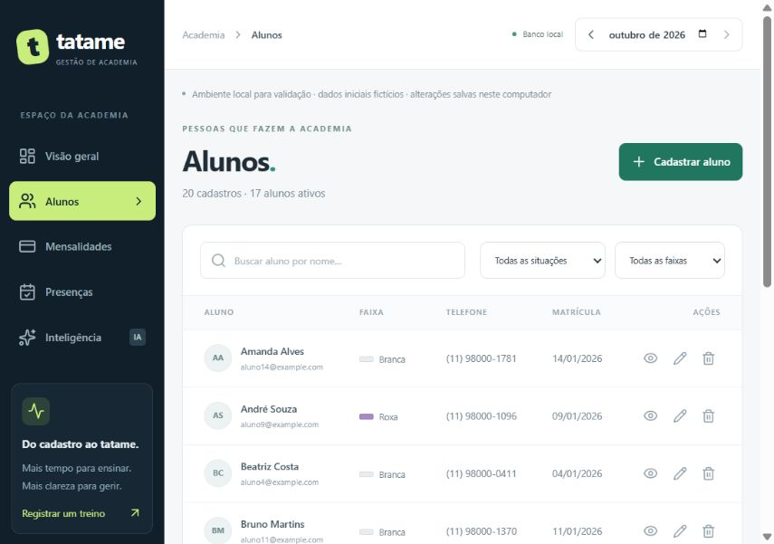
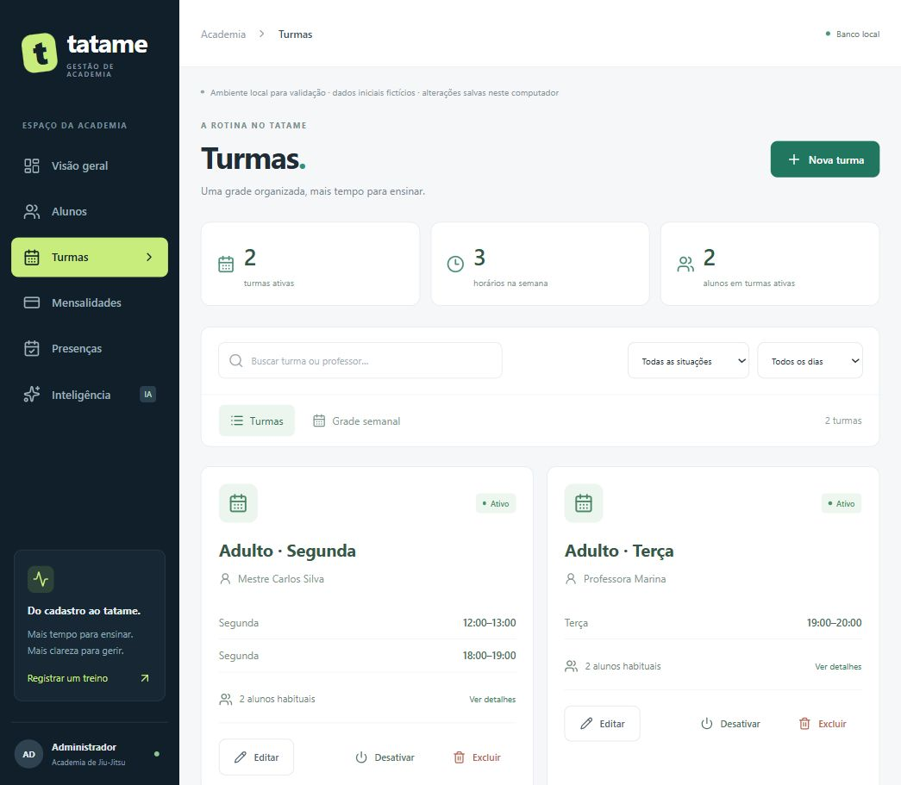
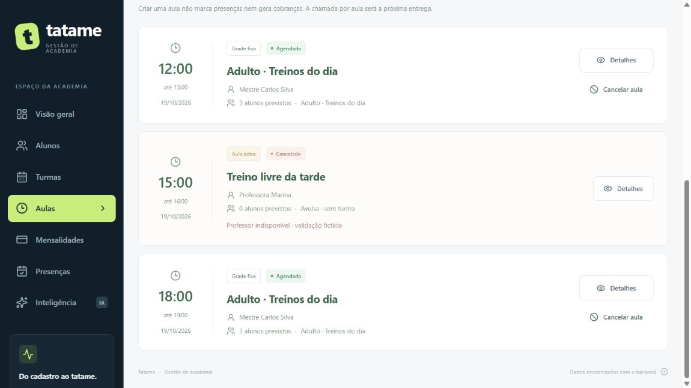

# Tatame — Academia de Jiu-Jitsu

**Cidade opcional publicada — 24/11/2026.** [Abrir Tatame](https://tatame-test-diario.vercel.app/), direto no login próprio. Fonte `fd05301` enviada à branch `codex/evolucao-tatame`, migração aditiva aplicada no Brasil e publicação READY/Production/gru1. O campo Cidade (opcional) já está nos horários fixos e extras; pode ficar vazio. Os dois acessos e bloqueios passaram novamente, e os formulários foram conferidos no navegador sem salvar mudanças. Dados anteriores preservados por comparação de hashes; nenhuma cidade atribuída à grade real. [Entrega e limites da verificação](docs/ACESSO_DEMONSTRACAO.md#cidade-publicada-e-conferida).

**Acesso direto para demonstração — 24/11/2026.** [Abrir Tatame](https://tatame-test-diario.vercel.app/): abre no login do Tatame, sem conta da Vercel. Professor usa o acesso administrativo existente e o outro celular usa o aluno fictício. Os dois perfis, bloqueios da API, logout e telas estreitas foram conferidos; prévias continuam protegidas. O usuário aprovou também incluir a cidade opcional, cuja publicação está em andamento. Os registros históricos abaixo sobre proteção global ou pendência dessa aprovação foram superados. [Roteiro e verificações](docs/ACESSO_DEMONSTRACAO.md).

**Cidade opcional — implementação local em 24/11/2026.** Em **Turmas → Nova turma/Editar → Grade fixa**, cada intervalo aceita **Cidade (opcional)**. Pode escrever qualquer cidade ou deixar em branco; só aparece uma pequena etiqueta quando preenchida. O mesmo campo está em **Adicionar horário extra**. A cidade é copiada ao publicar a aula, preservando os encontros anteriores se a grade mudar. Build/typecheck, 311 testes TypeScript e validação Prisma passaram; conferência visual com dados fictícios em desktop e tela estreita concluída. Migrações preparadas, sem aplicação no Supabase ou publicação desta alteração. [Como usar](docs/TURMAS.md#cidade-opcional--24112026).

**Atualização para os testes da academia — 24/11/2026.** [Abrir Tatame atualizado](https://tatame-test-diario.vercel.app/). Publicação READY em Preview/São Paulo, com as melhorias do commit `9ba3873`, 177 fontes conferidas e os dois acessos testados no navegador. Inclui bolsistas, horários extras, check-in antecipado/cancelamento, seleção semanal, histórico por faixa, convites somente de primeiro acesso e instalação web. Build/typecheck, 306 testes TypeScript, 15 testes Python e cinco testes de configuração passaram nesta data. O player privado do Drive está implementado, mas a conta/pasta real ainda precisa ser configurada. Pix e WhatsApp continuam planejados. [Resultado e limites dos testes](docs/TESTES_EXTERNOS.md#versão-atualizada-para-a-academia--24112026).

**Acesso diário protegido — 23/11/2026.** [Abrir Tatame](https://tatame-test-diario.vercel.app/). O endereço fixo aponta para a publicação do commit `18ce58e`, com proteção da Vercel e login do Tatame. Não depende de executar o VS Code. Publicação READY e 167 fontes conferidas por hash; banco brasileiro retomado. Os dois logins passaram no navegador, com sessão preservada ao atualizar, bloqueio administrativo para aluno e exigência de login após sair. [Estado e instruções](docs/VERCEL_HOMOLOGACAO.md#acesso-diário-protegido--23112026).

**Bolsistas.** Em **Alunos**, marque **Aluno bolsista** no cadastro para isentar a mensalidade. **Mensalidades → Não pagantes** lista os bolsistas. A **Visão geral** mostra a quantidade de bolsistas entre os alunos ativos. [Regras das cobranças](docs/BLOQUEIO_FINANCEIRO.md#aluno-bolsista).

**Chamada em lote.** Em **Presenças**, abra a aula, clique em **Selecionar todos**, desmarque quem não veio e confirme as presenças. A seleção abrange os check-ins pendentes da aula.

**Seleção de dia.** Na agenda do aluno e em **Presenças**, os dias aparecem de segunda a domingo. Escolher uma data mantém a faixa da semana no lugar. As setas selecionam o mesmo dia da semana anterior ou seguinte.

**Horário extra.** Em **Aulas → Adicionar horário extra**, publique um encontro fora da grade para uma data e horário escolhidos. O aluno pode fazer check-in na agenda. [Como adicionar e excluir](docs/AULAS.md#treino-em-data-específica).

**Vídeos do Drive.** A biblioteca aceita vídeos MP4 de uma pasta restrita e usa o player do Tatame para contas com liberação da academia. A conexão real depende da configuração da conta de serviço e da pasta. [Configuração e uso](docs/TECNICAS.md#player-do-tatame-com-google-drive-privado).

**Histórico por faixa.** A ficha e **Minha trajetória** mostram as aulas registradas antes de ajustes ou promoções. O primeiro acesso continua por convite. Para uma conta já ativa, a recuperação é feita pela tela de login quando o e-mail está configurado. [Graduação](docs/EVOLUCAO_GRADUACAO.md) · [Acesso](docs/ACESSO_ALUNO.md).

**Instalação no celular.** Com o Tatame aberto em um endereço HTTPS acessível, no Android use **Instalar app** ou **Adicionar à tela inicial** no menu do Chrome. No iPhone, abra no Safari e use **Compartilhar → Adicionar à Tela de Início → Abrir como App Web**. Agenda e check-in usam conexão com a internet.

**Check-in antecipado.** O aluno pode avisar que vai a uma aula futura assim que ela for publicada e cancelar o próprio check-in pendente até o dia da aula. Na gestão, o professor vê a lista em **Presenças** ao selecionar a data e a aula. [Como testar o fluxo](docs/ACESSO_ALUNO.md#check-in-antecipado).

O login e a ativação têm um botão para mostrar ou ocultar a senha. Ao criar uma senha, use pelo menos oito caracteres e evite combinações comuns. [Guia de acesso](docs/ACESSO_ALUNO.md).

**Ambiente de testes atual.** O Tatame Test de São Paulo pede autenticação da Vercel antes do login do Tatame. [Abrir a prévia](https://tatame-test-en6hefwej-cleiton-pirola.vercel.app/) · [Estado da migração](docs/REGIOES.md).

**Link para avaliadores.** Após uma publicação bem-sucedida do Tatame Test, abra **Gerar link de teste.cmd** na raiz do projeto no Windows. O atalho copia um link de até uma hora para o login do Tatame. [Configuração inicial e uso](docs/VERCEL_HOMOLOGACAO.md#atalho-para-gerar-link-de-teste).

**Recuperação de senha.** Na prévia de São Paulo, o usuário confirmou a entrega de e-mail pelo Resend e a recusa da troca após 15 minutos. A versão mais recente verifica o link antes de mostrar o formulário e permite solicitar outro se ele venceu ou já foi usado. [Configuração e fluxo](docs/ACESSO_ALUNO.md#recuperação-de-senha-e-senhas-comuns--05112026).

Os registros datados abaixo descrevem o estado de cada entrega no momento em que foi testada.

**Comunicados — destaque local em 20/11/2026.** Alunos e responsáveis veem um aviso destacado acima da agenda e das demais abas enquanto houver comunicados aguardando confirmação. O menu mostra a quantidade pendente, e **Ler comunicados** abre as mensagens, com as pendentes primeiro. O destaque só desaparece depois de **Estou ciente** ser salvo. Os formulários individuais e para a equipe pedem título e mensagem, e a gestão pode excluir os envios. [Guia e conferência](docs/COMUNICADOS.md).

**Histórico de recados — 22/11/2026, local.** Recados confirmados permanecem na aba **Comunicados** de cada aluno. O histórico mostra data e horário de envio e de **Estou ciente**, quando registrado. Abrir o recado ou sair da conta mantém a pendência até a confirmação explícita.

**Consulta pelos professores — 22/11/2026, local.** Em **Alunos → Ver ficha → Histórico de comunicados**, administradores conferem os recados, a conta destinatária e os estados **Sem confirmação de leitura** ou **Leitura confirmada**, com data e horário de **Estou ciente**. A ficha oferece consulta; envios e exclusões permanecem no menu **Comunicados**.

Na ficha, o histórico começa recolhido, mostrando somente o resumo de enviados, confirmados e pendentes. Ao expandir, cada recado mostra título e situação; texto, destinatário e datas aparecem ao abrir aquele recado.

**Ficha e graduação — 05/11/2026.** Em **Alunos → Ver ficha → Evolução da graduação**, o professor pode registrar de 1º a 4º grau nas faixas até marrom e de 1º a 6º na preta. As opções já aparecem antes de configurar metas de aulas. Clique no fundo escuro ao redor da ficha para fechar. Na próxima abertura, a ficha volta ao topo. [Guia](docs/EVOLUCAO_GRADUACAO.md) · [Prévia brasileira protegida](https://tatame-homologacao-pteo91412-cleiton-pirola.vercel.app).

**Acesso de menores — 05/11/2026:** Menores: checkbox Possui celular visível. Desmarcado mostra e exige responsável para aulas/check-ins; marcado oculta os controles familiares e permite acesso próprio, sem exigir responsável. Adultos não exibem o bloco. Vínculos anteriores viram contato sem acesso ao aluno, preservando histórico e outros dependentes. Sem migração. 287 testes, build/typecheck e QA visual com dados fictícios em memória aprovados. Sem commit/push; prévia protegida READY, sem troca definitiva do banco. [Regras e evidências](docs/RESPONSAVEIS.md).

**Validar este ajuste:** [Prévia brasileira protegida](https://tatame-homologacao-bomdkv0wn-cleiton-pirola.vercel.app) — abra no Chrome autenticado na Vercel.

**Teste do banco brasileiro — 04/11/2026:** Conexão privada brasileira validada com TLS verify-full. Leitura Prisma das 33 tabelas de domínio e 24 verificações HTTP em cada pooler (5432 e 6543), total 48 aprovações, com login professor/aluno e permissões. Dados fictícios e sessões de teste desfeitos por rollback; 34 tabelas/82 registros reconferidos sem divergências. Aplicação publicada e banco original preservados. Navegador, Python e prévia Vercel brasileira não testados nesta rodada. Sem deploy, commit ou push. [Evidências](docs/REGIOES.md).

**Regiões — 04/11/2026:** Cópia autorizada e concluída no Supabase tatame-homologacao-br (sa-east-1). Comparadas 34 tabelas e 82 registros por quantidade e hash de conteúdo tipado, incluindo os 19 registros do histórico Prisma; destino e releitura da origem sem divergências. Corrigida a precisão de microssegundos nas datas técnicas do histórico durante a conferência. RLS mantida nas 34 tabelas, zero políticas públicas e zero restrições não validadas. A aplicação continua em iad1 usando o banco original us-east-1, preservado. Conexão brasileira e API local posteriormente verificadas; troca publicada ainda pendente. Sem deploy, commit ou push. [Estado e próximos passos](docs/REGIOES.md).

**Prévia atualizada —01/11/2026:** [Testar Tatame](https://tatame-homologacao-f1fi4dmth-cleiton-pirola.vercel.app). Correções de segurança publicadas; botão de nova tentativa no refresh aparece só após erro, com ajuste visual disponível para validação. Mesmos acessos fictícios. Upload de vídeos adiado. [Verificações e limites](docs/TESTES_EXTERNOS.md).

**Segurança das dependências —31/10/2026:** corrigidos os quatro alertas conhecidos de `body-parser`, `fast-uri`, `qs` e `zod`; auditoria npm zerada. Conjunto isolado:228 testes aprovados; workspace completo:285. Build/typecheck aprovados. Correção preparada para Git com autorização explícita, sem deploy nem inclusão das funcionalidades locais pendentes. [Relatório e limites](docs/SEGURANCA_DEPENDENCIAS.md).

**Decisão posterior —31/10/2026:** upload/hospedagem privada de vídeos fica para uma etapa futura, após definir tamanho, qualidade e duração. Código local preservado, sem ativação de buckets/chaves e sem alterar a publicação atual. Essa pendência não bloqueia os testes das funções já publicadas. [Retomada dos vídeos](docs/ARMAZENAMENTO.md).

**Buckets — implementação local,31/10/2026:** fotos e vídeos com Supabase Storage privado, preservando fotos antigas e links externos. Seis testes novos; **284 testes totais e build/typecheck aprovados**. Ainda faltam chave secreta/URL na API, criação dos buckets, publicação e ensaio real. Nenhum bucket/banco/publicação externa alterado nesta etapa; sem commit/push. [Ativação, decisões e limites](docs/ARMAZENAMENTO.md).

**Testes externos liberados — 31/10/2026:** aplicação publicada e conferida em **Vercel Preview**, com Supabase/Python online, logins/permissões de professor e aluno, cadastro/turma/aula, check-in/chamada e graduação/indicadores verificados com dados fictícios. **278 testes locais aprovados**. Banco externo:19 migrações/33 tabelas de domínio, RLS nas34 tabelas com histórico, dados anteriores preservados. [Roteiro e limites dos testes](docs/TESTES_EXTERNOS.md). [Link direto para estes testes](https://tatame-homologacao-aum8h1pc1-cleiton-pirola.vercel.app/), sem conta Vercel; login Tatame obrigatório. Senhas somente nos arquivos privados locais. Exceção limitada a esta publicação, a revogar ao encerrar os testes. Sem commit/push desta rodada, aguardando validação. As notas abaixo são históricas.

**Homologação atualizada — 31/10/2026:** após confirmação, aplicadas oito migrações no Supabase: **18 concluídas, 33 tabelas de domínio**, exportação lógica privada e preservação conferidas. Onze modelos novos lidos pelo Prisma, vínculos/restrições válidos e tabelas novas com RLS. Sem publicação, commit/push ou migração SQLite nesta operação. [Resultado e limites](docs/MIGRACOES_11_18.md). Antes de publicar: [proteger as tabelas antigas — proposta não aplicada](docs/SEGURANCA_HOMOLOGACAO.md). Estados abaixo são históricos.

**Biblioteca de técnicas — 31/10/2026, prévia local:** aba **Técnicas da semana** com vídeos por link, data/tipo de treino, rascunho/publicação, preço mensal opcional editável e liberação administrativa por validade. Aluno/responsável consultam o catálogo e só recebem o link com autorização vigente. Cobrança automática, hospedagem privada e venda entre academias continuam futuras. **276 testes TypeScript, build/typecheck e Prisma aprovados**; fluxo visual conferido com dados fictícios nas portas 3352/3353. Migração18 apenas testada em QA; banco principal v17, Supabase v10 preservados. Sem commit/push. [Guia, decisões e limitações](docs/TECNICAS.md).

**Preparação de homologação — 31/10/2026:** projeto vazio `tatame-homologacao` criado na Vercel, com configuração de telas, API Node e serviço Python interno. **Ainda sem implantação/link funcional.** Supabase consultado somente para metadados: dez migrações concluídas, 11–17 pendentes, sem alteração externa nesta etapa. Novas verificações: **270 testes TypeScript, dois do atalho de conexão e 15 Python aprovados**, typecheck e build web aprovados. Conexão privada na Vercel pendente de preenchimento pelo usuário; mudanças locais continuam sem commit/push. [Configuração e limites da validação](docs/VERCEL_HOMOLOGACAO.md). O estado abaixo registra entregas anteriores.

**Entrega local atual — 27/10/2026:** comunicados para **Todos da equipe** com confirmações individuais; ranking mensal com renovação automática e anual de janeiro a dezembro com fotos e pódio; foto própria em perfis; presenças por dia e aula; nome do treino por horário no portal; modalidades atuais somente Com kimono/Sem kimono. Inclui as simplificações de graduação, categorias e planos descritas abaixo. **267 testes passaram**, build/typecheck e geração/validação Prisma aprovados. Interface local conferida com dados fictícios, incluindo celular. SQLite principal/QA **v17**, backup e preservação das 27 tabelas anteriores. **Supabase mantido parado**, v10, sem conexão/migrações 11–17. **Sem commit/push**, aguardando validação. Guias: [Ranking, fotos e presenças](docs/RANKING_FOTOS_PRESENCAS.md), [Comunicados](docs/COMUNICADOS.md).

**Entrega anterior — 27/10/2026:** categorias Infantil/Juvenil/Adulto até preta com metas independentes, sem bloco Cadastros anteriores; Comunicados no menu próprio; configurações opcionais de planos; portal ilimitado sem cartões de cota e com Aulas realizadas em Meus treinos. Limites e débitos existentes continuam valendo ao ocultar controles. [Configurações e verificação](docs/CONFIGURACOES_ACADEMIA.md), [Faixas](docs/GRADUACOES.md), [Comunicados](docs/COMUNICADOS.md). **256 testes**, build/typecheck e geração/validação Prisma passaram; UI fictícia conferida. SQLite principal/QA v15 com backup/preservação. Supabase v10 permanece aguardando autorização (11–15 pendentes externamente). Conjunto ainda sem commit/push, aguardando validação humana.

**Categorias e Comunicados (27/10/2026, local para validação):** 20 opções Infantil/Juvenil/Adulto somente até preta, com aulas por grau editáveis e independentes. Graduações/metas antigas preservadas; classificação por categoria é explícita na ficha. [Faixas](docs/GRADUACOES.md). Avisos saíram da ficha e estão no menu próprio **Comunicados**; aluno/responsável continuam em Avisos e autorizações. [Uso](docs/COMUNICADOS.md). 252 testes, build/typecheck e UI fictícia aprovados. SQLite principal/QA v14 com backup/preservação; Supabase v10 permanece aguardando autorização externa (11–14 pendentes). Sem commit/push até validação.

**Ficha simplificada (27/10/2026, local para validação):** Ajustar graduação dispensa justificativa; o registro interno é automático. Graus recebidos mostra somente grau e data da concessão. 249 testes TypeScript e build/typecheck aprovados, com conferência visual fictícia. [Guia atualizado](docs/EVOLUCAO_GRADUACAO.md). Avisos coletivos por WhatsApp foram acrescentados ao [planejamento futuro](docs/PLANO_FUNCIONAL.md), sem integração ou envio implementado.

**Catálogo simplificado (27/10/2026, local para validação):** 20 faixas kids e adultas com cores/listras e ordem fixas, sem controles de cor, ordem ou ativação. Em **Regras de graduação → Configurar aulas**, existe somente a quantidade de aulas e Salvar. Adicionar próximo grau fica na ficha administrativa do aluno, até o 4º nas faixas coloridas; total de graus, destino e cadastro de graus foram retirados dessa tela. Critérios de tempo também foram retirados. Registros anteriores preservados. SQLite local v13; Supabase v10 permanece aguardando autorização para migrações externas. [Guia](docs/GRADUACOES.md).

**Evolução configurável da graduação — entrega local para validação (27/10/2026):** faixa e grau saíram do cadastro comum; a ficha possui ponto de partida, metas por aulas confirmadas, confirmação pelo mestre e histórico. O aluno acompanha em Meu perfil → Minha trajetória e pode sinalizar o professor ao atingir os critérios. Não há promoção automática. Guia: [EVOLUCAO_GRADUACAO.md](docs/EVOLUCAO_GRADUACAO.md). A verificação e o estado do banco mais recentes constam no catálogo simplificado acima; ambas as alterações aguardam validação antes de commit/push.

**Vários professores por aula — entrega aprovada para sincronização (26/10/2026):** em **Aulas → Detalhes → Editar professores**, adicione ou remova nomes e salve. Cada aula aceita de 1 a 8 professores; turma e outros encontros permanecem iguais. Migração 11 aplicada no SQLite com backup e preservação das 22 tabelas anteriores; migração PostgreSQL preparada, ainda não aplicada externamente. 227 testes TypeScript, build/typecheck, geração/validação Prisma e UI fictícia aprovados. Guia: [PROFESSORES_AULA.md](docs/PROFESSORES_AULA.md). Usuário aprovou este incremento e seu commit/envio em 26/10/2026. O resultado da sincronização deve ser confirmado no histórico do Git.

**Git confirmado:** os ajustes anteriores de nome, confirmados, remoção de check-in e máscara foram enviados em [e58d87d](https://github.com/Cleitonpirola/academia-jiu-jitsu/commit/e58d87dc832a81ad046de7df2971cd838ba5ce1a), branch codex/evolucao-tatame.

**Ajustes de aulas e telefone — 26/10/2026:** lápis junto ao nome no cartão, sem botão duplicado nos detalhes; confirmados por check-in/presença, sem previsão automática na chamada; remoção administrativa de check-in registra ausência, recalcula crédito e preserva débitos. Telefone com máscara compartilhada no cadastro, perfil e acesso familiar. Suíte nova: 222 testes TypeScript e build/typecheck aprovados; conferência visual com dados fictícios. Usuário autorizou commit/envio após sucesso. Guias: [AULAS.md](docs/AULAS.md) e [TELEFONES.md](docs/TELEFONES.md). Pedido posterior de vários professores será desenvolvido separadamente para validação.

**Conjunto aprovado para commit/envio — 26/10/2026:** após os testes, o usuário autorizou “pode commitar” para a atualização em andamento e suas melhorias pendentes integradas. O conjunto reúne catálogo de faixas/graus, agenda por turmas sem criação/exclusão de avulsas, ícone $ em Mensalidades, além das evoluções locais de turmas, plano mensal/débitos, responsáveis e perfil básico documentadas abaixo. Verificação final desta rodada: 206 testes TypeScript, 15 Python e 3 de configuração; build/typecheck e Prisma aprovados. Migração 10 aplicada localmente com backup e no Supabase de homologação, preservando os campos das 20 tabelas anteriores. Prova sintética restrita limpa com hashes das 22 tabelas iguais ao início. Guias: [GRADUACOES.md](docs/GRADUACOES.md), [AULAS.md](docs/AULAS.md), [RETOMADA.md](docs/RETOMADA.md). Essa aprovação supera as pendências históricas de commit descritas nas entradas anteriores; não publica nova versão/tag, merge ou ambiente público.

**Sincronização concluída:** conjunto acima enviado para `codex/evolucao-tatame` no commit [db08478](https://github.com/Cleitonpirola/academia-jiu-jitsu/commit/db08478d70f623f702ebb6dfda7d3819d75d6cf9). Tag v1.0.0 preservada.

**Novo incremento local — nome da aula:** em **Aulas → Detalhes → Editar nome da aula**, o administrador altera somente aquele encontro. Turma, grade, outras aulas, chamada, check-ins e débitos já contratados são preservados. 210 testes TypeScript e build/typecheck aprovados; navegador fictício confirmou salvar e cancelar. Aguarda validação antes de outro commit/envio, conforme AGENTS.md. Guia: [AULAS.md](docs/AULAS.md).

**Aluno edita dados básicos — 26/10/2026:** em **Meu perfil → Editar meus dados**, nome, telefone e e-mail podem ser atualizados pelo próprio aluno. Troca de e-mail confirma a senha atual e sincroniza o login/ficha em transação, mantendo a sessão atual e revogando outras sessões/convites. Campos administrativos permanecem restritos. Perfil disponível durante bloqueio financeiro, sem liberar check-in. Build/typecheck e 195 testes TypeScript aprovados; prova sintética no Supabase e verificação visual concluídas. Detalhes e limites em [ACESSO_ALUNO.md](docs/ACESSO_ALUNO.md). Aguardando validação antes de commit/envio.

**Horários adicionais opcionais — 26/10/2026:** Nova turma começa com **Incluir mais horários** desmarcado, um intervalo por dia selecionado e botões de adicionar ocultos. Marcar libera horários/combinações extras; desmarcar considera apenas o primeiro intervalo e guarda os extras no rascunho até fechar. Edição de turma com grade múltipla começa marcada para preservar os dados. Build/typecheck, oito testes de horários e conferência visual de salvamento/preservação aprovados; sem migração ou alteração de turmas reais. Veja [TURMAS.md](docs/TURMAS.md). Aguardando validação antes de commit/envio.

**Integração futura — e-mail (25/10/2026):** envio automático registrado nas [integrações complexas futuras](docs/PLANO_FUNCIONAL.md), conforme alternativa autorizada pelo usuário. Previsto convite para definir/recuperar senha, com evolução para avisos e lembretes. Depende de provedor/remetente e endereço público da plataforma. Destinatários devem respeitar o acesso do aluno ou responsável. Hoje os convites são entregues manualmente e os comunicados aparecem no Tatame; nenhum e-mail real foi enviado ou serviço conectado nesta etapa.

**Acesso familiar — 25/10/2026:** menores com ou sem celular, conta própria de responsável para vários dependentes, check-in pelo responsável quando o menor não tem celular, débitos/comunicados e respostas a autorizações. Na ficha, ativação própria e transferência por maioridade preservam cadastro e histórico. Guia: [RESPONSAVEIS.md](docs/RESPONSAVEIS.md). Migração 9 local/Supabase, preservação dos dados, 183 testes TypeScript, 13 Python, 3 de configuração, build/typecheck e conferência visual aprovados. Aguardando sua validação antes de commit/envio. Convites entregues manualmente; sem envio de e-mail/WhatsApp ou publicação pública.

**Integração futura — WhatsApp (25/10/2026):** envio automático de parabéns aos aniversariantes registrado no [planejamento funcional](docs/PLANO_FUNCIONAL.md), conforme alternativa autorizada pelo usuário. Homenagem interna já existente; envio por WhatsApp ainda não implementado nem conectado. A etapa futura incluirá configuração da academia, preferência de recebimento, agendamento e prevenção de mensagens duplicadas.

**Aulas adicionais e Débitos — 25/10/2026:** novo menu **Débitos** na gestão e no portal. A academia habilita preço/prazo (padrão 3 dias); aluno com cota mensal esgotada escolhe uma aula publicada, confere condições e confirma reserva+geração automática do débito. Baixa manual, acompanhamento por status e bloqueio de novos check-ins por atraso, conforme confirmado pelo usuário. A reserva não registra presença e não duplica cobrança ao repetir. Venda começa desativada até configurar o preço real. Migrações 8 SQLite/Supabase, preservação dos dados, 166 testes TypeScript, 13 Python, build/typecheck e fluxo visual aprovados. Regras e limites em [DEBITOS.md](docs/DEBITOS.md). Aguardando validação antes de commit/envio; sem reconhecimento bancário automático ou publicação online.

**Saldo mensal de aulas — 25/10/2026:** em **Alunos → Ver ficha → Limite mensal de aulas**, configure o total mensal ou mantenha ilimitado. Nova coluna mostra aulas restantes; cada check-in único desconta uma aula, saldo zero bloqueia e avisa, cancelamento devolve crédito. Renovação no dia 1 em São Paulo, conforme confirmado pelo usuário. Limite semanal e bloqueio financeiro continuam aplicados. Migrações 7 SQLite/PostgreSQL executadas, com dados anteriores preservados; 152 testes TypeScript, 13 Python, build/typecheck e verificação de concorrência no Supabase aprovados. Guia de regras, limites e defesa oral em [SALDO_MENSAL.md](docs/SALDO_MENSAL.md). Aguardando validação antes de commit/envio.

**Formulário de turmas simplificado — 25/10/2026:** removida a seção Alunos habituais de Nova turma/Editar turma. Novas turmas são criadas sem vínculos; editar preserva os já existentes. Build/typecheck aprovados e conferência no navegador com dados fictícios confirmou ausência da seção e preservação de um vínculo após salvar. Aguardando validação antes de commit/envio.

**Entrada administrativa local temporária — 25/10/2026:** a pedido do usuário, `.env` privado deste computador está com `TATAME_ADMIN_LOCAL=true`. Abrir o Tatame local identifica o administrador já cadastrado sem digitar senha; nenhuma senha foi apagada e essa entrada não cria sessão duradoura. O exemplo mantém false; a opção não funciona com origem publicada, NODE_ENV=production, bind aberto ou requisição encaminhada por proxy. Para voltar ao login, definir false e reiniciar a API. Detalhes em [ACESSO_ALUNO.md](docs/ACESSO_ALUNO.md). Build e 141 testes aprovados; aguardando validação antes de commit/envio.

**Nome automático de turmas — 25/10/2026:** em **Turmas → Nova turma**, a opção **Nome automático** começa marcada e preenche o nome pelo início mais cedo da grade (`13:00` → `Turma das: 13h`; `13:30` → `Turma das: 13h30`). Desmarcar permite nome manual; nomes personalizados existentes continuam manuais ao editar. Build/typecheck, oito testes existentes de horários e conferência de criação/edição no navegador com banco fictício em memória aprovados. Incremento aguardando validação antes de commit/envio. Guia em [TURMAS.md](docs/TURMAS.md).

**Conta comum de homologação — 23/10/2026:** criado Aluno de Teste com perfil `aluno`, sem administração. Verificações reais na API/Supabase: login e portal próprios 200, 13 operações administrativas bloqueadas com 403 e logout 204. Convite privado de ativação entregue para escolha da senha; e-mail fictício `aluno.teste@tatame.example.com`, sem envio de e-mail. Administrador já existente; ativação do aluno pelo usuário e hospedagem pública pendentes. Detalhes em [HOMOLOGACAO.md](docs/HOMOLOGACAO.md); nenhum token/senha versionado ou novo commit/push realizado.

**Homologação em preparação — 23/10/2026:** guia em [HOMOLOGACAO.md](docs/HOMOLOGACAO.md). Após copiar a URI do Session pooler para `.env.homologacao` (arquivo privado ignorado pelo Git), `npm run configurar:homologacao` recebe a senha no terminal sem exibir, codifica símbolos e habilita a verificação TLS. Não conecta, migra ou publica automaticamente. CA oficial instalada; após nova entrada privada da senha, autenticação real e certificado TLS confirmados. As seis migrações foram aplicadas ao banco de testes vazio e conferidas (15 tabelas de domínio mais histórico Prisma). A tela local em `http://127.0.0.1:3333` está pronta para o usuário criar o administrador nesse banco. Conta inicial, testes funcionais externos e Render continuam pendentes; `.env` e SQLite atuais preservados. Esse novo conjunto aguarda validação antes de commit/envio.

**Planos de treino — entrega aprovada em 22/10/2026:** ficha do aluno com plano individual ilimitado ou de 1 a 100 aulas por semana; resumo do uso na gestão e portal; cota aplicada no servidor ao fazer check-in; autorização administrativa de uma aula extra, sem cobrança automática. Semana de segunda a domingo em São Paulo. Migração SQLite 6 aditiva; alunos sem configuração continuam ilimitados. Guia de uso e decisões: [PLANOS.md](docs/PLANOS.md). Usuário autorizou “testa e commita”; nova execução de 136 testes TypeScript, 13 Python, build/typecheck e geração/validação Prisma aprovada. Autorização de commit/envio à branch de trabalho, sem merge, nova tag ou implantação. As evidências anteriores de navegador e preservação do banco não foram repetidas nesta etapa de envio.

A tag **v1.0.0** preserva o MVP inicial. O desenvolvimento utiliza a branch `codex/evolucao-tatame`; cada registro abaixo informa seu estado de validação e envio. Veja o [guia de envio ao GitHub](docs/GITHUB.md).

**Aprovação e verificação final — 22/10/2026:** o usuário autorizou “testa e se tudo estiver ok, pode commitar” para o conjunto abaixo. Nova execução: 121 testes TypeScript e 13 Python aprovados, build/typecheck aprovados, Prisma Client gerado e schema válido. As pendências de aprovação descritas nos registros anteriores ficam superadas por esta autorização para commit/envio à branch de trabalho. Sem merge na main, nova tag ou implantação. As conferências anteriores no navegador não foram repetidas nesta verificação final. PostgreSQL/Supabase e IA externa continuam sem validação externa.

**Entrega 1C local — 21/10/2026:** chamada por aula implementada e testada, com participação em vários horários no dia, inclusão pontual de outros alunos e correção/limpeza de marcações. Migração SQLite 4 aditiva, preservando os registros anteriores. **Este novo conjunto aguarda validação do usuário antes de commit/push.** Uso, decisões e defesa oral: [CHAMADA.md](docs/CHAMADA.md).

**Atualização local — 22/10/2026:** combinações de vários dias com vários horários (ex.: Seg/Qua/Sex às 12h e às 18h), aniversariantes do dia e login integrado à área do aluno. O aluno consulta sua agenda, faz check-in, acompanha a confirmação do responsável, seu histórico, perfil e mensalidades. Migração SQLite 5 aditiva, com backup e preservação das dez tabelas anteriores. Implementado/testado localmente, aguardando validação antes de commit/push. Guias: [TURMAS.md](docs/TURMAS.md) e [ACESSO_ALUNO.md](docs/ACESSO_ALUNO.md).

**Bloqueio financeiro local — 22/10/2026:** a partir do dia seguinte ao vencimento de uma mensalidade não paga, o aluno vê o aviso de débito e os próprios vencidos; as demais áreas e o check-in ficam restritos. Registrar o pagamento de todos os vencidos libera automaticamente na próxima consulta, sem novo login. A gestão permanece acessível ao administrador. Sem migração nova ou integração bancária. Guia: [BLOQUEIO_FINANCEIRO.md](docs/BLOQUEIO_FINANCEIRO.md). Incremento testado, aguardando validação antes de commit/push.

**Branch renomeada — 21/10/2026:** `codex/reestruturacao` passou a se chamar [`codex/evolucao-tatame`](https://github.com/Cleitonpirola/academia-jiu-jitsu/tree/codex/evolucao-tatame), no GitHub e no computador. Código e histórico foram preservados no commit `dd3212e`. Os registros datados abaixo mantêm o nome usado na época. Para estudar as próximas atualizações, consulte o novo nome; os materiais já exportados continuam sendo retratos dos commits indicados neles.

**Entrega 1A aprovada — 19/10/2026:** cadastro de turmas, grade semanal, vínculos habituais de alunos e exclusão definitiva com confirmação. Após a apresentação das telas e verificações, o usuário autorizou o commit e envio desta entrega na branch `codex/reestruturacao`. Guia: [TURMAS.md](docs/TURMAS.md).

**Entrega 1B aprovada — 20/10/2026:** agenda por dia, aulas da grade fixa, extras avulsas ou vinculadas, cancelamento com motivo e exclusão definitiva de extras com confirmação. Após a apresentação das telas, testes e esclarecimentos sobre a exclusão, o usuário autorizou commit e envio na branch `codex/reestruturacao`. Uso e decisões: [AULAS.md](docs/AULAS.md).

Recomendação de acompanhamento: enviar cada entrega testada após aprovação do usuário, fornecendo o link para revisão do Matheus. Tags e releases marcam escopos combinados, sem contagem fixa de commits. Veja [VERSIONAMENTO.md](docs/VERSIONAMENTO.md).

MVP full stack para cadastro de alunos, turmas, grade fixa e agenda de aulas, controle de mensalidades, dashboard financeiro, chamada de treinos e analytics de frequência/evasão. Interface em português, responsiva e com dados fictícios para validação imediata.

## Executar

Requisitos: Node.js 24 ou superior e Python 3.11 ou superior instalado com pip/venv.

```powershell
npm install
npm run db:generate
npm run setup:analytics
npm run dev
```

Abra http://127.0.0.1:5173. API em http://127.0.0.1:3333/api; documentação do Python em http://127.0.0.1:8000/docs.

Sem credenciais, o projeto usa SQLite real, persistido em `data/academia.sqlite`. Na primeira execução são criados 20 alunos fictícios, faixas diferentes, alunos ativos/inativos, cobranças pagas/pendentes/atrasadas e presenças distribuídas em três meses. Reiniciar não sobrescreve seus dados. Dados locais e credenciais estão no .gitignore.

No primeiro acesso, crie sua conta de administrador na tela de configuração inicial com nome, e-mail e senha de pelo menos 8 caracteres. Depois, entre em **Alunos → Ver ficha → Gerar link de acesso** para o aluno escolher a própria senha. O link é privado, de uso único e vence em 24 horas. O endereço 127.0.0.1 funciona neste computador. Para acessar de fora, use uma publicação HTTPS. [Roteiro de acesso](docs/ACESSO_ALUNO.md).

## Correções de arquitetura — 19/10/2026

- SQLite possui migrações versionadas, histórico e verificação dos arquivos aplicados. Antes de atualizar um arquivo com tabelas, cria uma cópia consistente em `data/backups/` (ou `backups/` ao lado de um SQLITE_PATH personalizado). Uma falha reverte a transação; estruturas desconhecidas interrompem a abertura com uma mensagem, sem inventar dados. Veja [MIGRACOES_SQLITE.md](docs/MIGRACOES_SQLITE.md).
- Cada consulta da interface possui carregamento e erro próprios. Uma falha no histórico não bloqueia alunos, cobranças ou dashboard. A recarga após uma gravação mantém a tela montada e seus filtros.
- O módulo de analytics da API valida a resposta do Python antes de entregá-la ao React ou à IA. Respostas incompatíveis retornam HTTP 503 e uma mensagem controlada. O Python valida as entidades recebidas com modelos Pydantic.

As regras de cobrança e a fórmula de risco foram mantidas. Esta etapa conserva SQLite; não transfere registros para Supabase. PostgreSQL/Supabase são recomendados pelo desafio, que exige banco SQL; sua validação continua no plano da stack escolhida.

## Validar as telas

1. **Visão geral:** confira totais, mês de referência, receita e cobranças em atraso.
2. **Alunos:** busque, filtre, cadastre, veja detalhes, edite e inative. Exclusão é permitida quando o aluno não tem cobranças, vínculos com turmas, acesso individual, check-ins ou marcações por aula.
3. **Mensalidades:** cadastre e edite cobranças; registre pagamento e confira a atualização no dashboard. Uma cobrança por aluno/competência.
4. **Presenças:** em **Chamada por aula**, escolha data e aula; marque presente/ausente, inclua outro aluno ou limpe uma marcação incorreta após confirmação. O aluno pode participar de várias aulas no dia; não há falta automática. A aba **Registro por modalidade** conserva o formato anterior sem horário vinculado. Registre cada treino uma única vez, por uma das formas, para não contar o mesmo evento duas vezes nos indicadores.
5. **Inteligência:** consulte risco, frequência e inadimplência calculados por FastAPI/Pandas. O assistente gera respostas reais somente após configuração da API de IA.
6. **Turmas:** crie uma turma com professor responsável, selecione os dias de uma combinação (por exemplo Seg/Qua/Sex) e informe um ou vários intervalos que valem para todos eles. **Adicionar horário** acrescenta um intervalo à combinação; **Adicionar outra combinação** atende dias com horários diferentes. Ao editar, só agrupa dias que têm o mesmo conjunto completo de intervalos. Selecione alunos habituais, edite, desative/reative ou exclua definitivamente após confirmação. Consulte também a Grade semanal. Horários da mesma turma não podem se repetir ou se sobrepor; o término deve ocorrer no mesmo dia, depois do início.
7. **Aulas:** escolha o dia e use **Adicionar aula da turma** para publicar um horário de turma ativa na data compatível. Turmas coringa podem reunir vários horários. Criação e exclusão de avulsas foram retiradas; registros anteriores continuam consultáveis, com chamada/cancelamento e histórico preservados. Cancelamento exige motivo e não ocorre com chamada registrada. Repetir a publicação do mesmo horário/data retorna a aula existente, sem duplicar ou reativar uma cancelada. Novas reservas adicionais pagas usam aulas publicadas por turmas.

As turmas começam vazias, para o usuário montar sua grade. O mesmo aluno pode estar em várias turmas. Novos vínculos exigem aluno ativo; vínculos existentes de alunos posteriormente inativados permanecem até a remoção explícita. Desativar a turma preserva horários e vínculos. O professor é um nome cadastral, sem login nesta entrega.

**Excluir** remove a turma, a grade e seus vínculos, preservando os alunos, mensalidades, presenças e aulas existentes. A aula guarda os nomes e horários da época e perde apenas a referência à turma excluída. Funciona para turmas ativas e inativas, com confirmação explícita na tela. Cadastrar novamente cria uma turma nova; não restaura o registro excluído.

A grade fixa não gera calendário automaticamente: cada aula é criada explicitamente na agenda. Criar ou cancelar uma aula sem chamada não registra presenças/faltas nem gera cobranças. A lista de previstos é uma cópia dos habituais ativos no momento da criação; a chamada começa sem marcações. Aulas futuras ou canceladas não recebem chamada. A frequência Python considera as presenças explícitas antigas e as novas por aula; não deduplica por dia. Login e área do aluno estão implementados localmente, com check-in separado da presença confirmada. Planos individuais ilimitados/semanais e liberação nominal de extra estão implementados localmente em [PLANOS.md](docs/PLANOS.md). Reservas futuras, cobrança de excedentes e perfil separado de professor permanecem no [planejamento](docs/PLANO_FUNCIONAL.md).

## Supabase / PostgreSQL e Prisma

Copie `.env.example` para `.env` e configure `DATABASE_URL` com a conexão PostgreSQL do seu projeto Supabase. `DIRECT_URL` é usada pelas migrations; uma conexão Session Pooler na porta 5432 é uma opção em redes sem IPv6. As strings devem conter a senha codificada corretamente. Não cole credenciais no chat ou no Git.

```powershell
npm run db:generate
npm run db:migrate
npm run db:seed
npm run dev
```

As migrations criam Aluno, Mensalidade, Presenca e Analise e acrescentam Turma, HorarioTurma, AlunoTurma, Aula, AulaAlunoPrevisto, PresencaAula, Usuario, Sessao e CheckinAula, com FKs e índices. Antes de publicar a aplicação, configure o administrador localmente e defina APP_ORIGIN como a origem HTTPS exata, sem barra final; não há configuração inicial pública para hospedagem. O seed externo é explícito e só insere dados quando a tabela Aluno está vazia; não cria turmas ou aulas automaticamente. Os dados locais não são transferidos automaticamente para o Supabase. Usando apenas Prisma no servidor, considere desativar a Data API no painel do Supabase; acesso direto da aplicação cliente não é necessário.

## Assistente de IA

Configure `OPENAI_API_KEY` e, se necessário, `OPENAI_MODEL` no `.env`. Reinicie o projeto. A implementação usa a Responses API e `store: false`; salva pergunta, resposta, modelo, data, usuário local e métricas na tabela Analise. Telefone, e-mail e nascimento não são enviados ao modelo. O usuário inicia cada chamada pelo botão Enviar pergunta. A integração externa não foi validada sem uma chave do usuário; respostas fixas não são apresentadas como IA.

## Testes e build

```powershell
npm test
npm run test:analytics
npm run build
npm start
```

`npm start` usa o frontend compilado, servido pela API em http://127.0.0.1:3333, junto ao serviço Python. `npm run dev` usa Vite e proxy para a API.

`npm test`: **121 testes aprovados, zero falhas**, no incremento de bloqueio financeiro de 22/10/2026. Inclui API, turmas, aulas, chamada, contratos, migrações, horários combinados, aniversários, autenticação, permissões, check-in e bloqueio financeiro. `npm run test:analytics`: **13 testes Python aprovados** na retomada anterior ao bloqueio financeiro; não reexecutados neste incremento, que não altera o serviço ou os cálculos. `npm run build`: typecheck e Vite aprovados; Prisma Client gerado. Navegador conferido com dados fictícios e tela estreita; não é uma suíte automática de navegador nem teste em aparelho físico. Sem execução externa de PostgreSQL/Supabase ou IA. Evidências e limites em [ACESSO_ALUNO.md](docs/ACESSO_ALUNO.md), [TURMAS.md](docs/TURMAS.md) e [REVISAO_IA.md](docs/REVISAO_IA.md).

## Estrutura

Captura do MVP em execução:



Turmas na validação visual com dados fictícios em ambiente separado. Essas turmas de teste não foram inseridas no banco local do usuário:



Agenda na validação isolada com três encontros fictícios (12h, 15h e 18h), sendo a extra cancelada com motivo. Esses encontros não foram inseridos na base do usuário:



```text
apps/api/src/          API, domínio, repositórios SQLite/Prisma e testes
  database/sqlite/     Runner, histórico e arquivos de migração SQLite
  modules/analytics/  Serviço e validação de resposta do Python
  modules/turmas/     Rotas, validação e regras de turmas e grade semanal
  modules/aulas/      Aulas datadas, fotografia dos previstos e cancelamento
apps/web/src/          React, telas e estilos Tailwind
packages/shared/src/  Contratos TypeScript
services/analytics/   FastAPI, Pandas e testes dos indicadores
prisma/               Schema e migration PostgreSQL
scripts/              Inicialização e preparação do Python
docs/                 Arquitetura, prompts, processo e revisão
```

## Regras e limitações

- Dinheiro: centavos inteiros. Datas de calendário: YYYY-MM-DD. Dia atual: America/Sao_Paulo.
- Status de cobrança é derivado, não armazenado. Vencimento hoje é pendente, não atrasado.
- Dashboard: receita pelo pagamento; valor a receber por vencimento; contagem de cobranças por competência.
- Risco: atraso +30, 14 dias sem treino +30, queda acima de 50% +40; baixo até 30, médio até 60, alto acima de 60. Sem treinos anteriores, não há divisão por zero nem queda presumida. Aluno sem treinos usa a matrícula como referência para tempo sem treino.
- Frequência compara janelas equivalentes. Situação ativo/inativo é o cadastro atual; não há histórico de mudanças cadastrais para reconstruir status passado.
- MVP local com administrador único. Autenticação, perfis, publicação e dois repositórios públicos para a entrega do desafio permanecem como etapas posteriores.
- O desafio exige SQL e recomenda PostgreSQL/Supabase. Essa integração pertence à stack escolhida e ainda precisa de validação externa; SQLite continua suportado localmente.
- Se as portas 3333/5173/8000 estiverem ocupadas, finalize a execução anterior antes de iniciar outra.
- Se analytics estiver indisponível, execute `npm run setup:analytics` e reinicie `npm run dev`.
- Ambiente validado em 19/10/2026: Node 24.19, Python 3.14.7, 65 testes TypeScript e 12 testes Python (executados antes do incremento de exclusão, sem mudanças no Python). requirements.lock.txt registra as dependências Python desse ambiente.

Referências usadas na implementação: [Prisma/Supabase](https://supabase.com/docs/guides/database/prisma), [Tailwind/Vite](https://tailwindcss.com/docs/installation/using-vite), [FastAPI](https://fastapi.tiangolo.com/tutorial/first-steps/), [OpenAI Responses](https://developers.openai.com/api/docs/quickstart).
