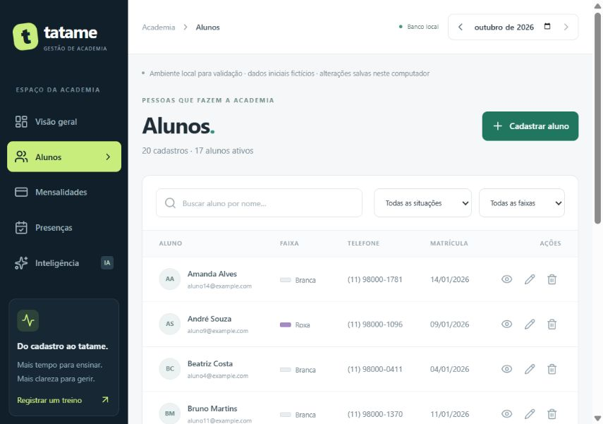

# Tatame — Academia de Jiu-Jitsu

Versão **1.0.0**: registro do MVP atual, preservando sua lógica. Veja o [guia de envio ao GitHub](docs/GITHUB.md).

MVP full stack para cadastro de alunos, controle de mensalidades, dashboard financeiro, chamada de treinos e analytics de frequência/evasão. Interface em português, responsiva e com dados fictícios para validação imediata.

## Executar

Requisitos: Node.js 24 ou superior e Python 3.11 ou superior instalado com pip/venv.

```powershell
npm install
npm run db:generate
npm run setup:analytics
npm run dev
```

Abra http://127.0.0.1:5173. API em http://127.0.0.1:3333/api; documentação do Python em http://127.0.0.1:8000/docs.

Sem credenciais, o projeto usa SQLite real, persistido em `data/academia.sqlite`. Na primeira execução são criados 20 alunos fictícios, faixas diferentes, alunos ativos/inativos, cobranças pagas/pendentes/atrasadas e presenças distribuídas em três meses. Reiniciar não sobrescreve seus dados. Dados locais e credenciais estão no .gitignore.

## Validar as telas

1. **Visão geral:** confira totais, mês de referência, receita e cobranças em atraso.
2. **Alunos:** busque, filtre, cadastre, veja detalhes, edite e inative. Exclusão é permitida quando o aluno não tem cobranças.
3. **Mensalidades:** cadastre e edite cobranças; registre pagamento e confira a atualização no dashboard. Uma cobrança por aluno/competência.
4. **Presenças:** selecione data/tipo e marque presente/ausente. Cada marcação é salva na API.
5. **Inteligência:** consulte risco, frequência e inadimplência calculados por FastAPI/Pandas. O assistente gera respostas reais somente após configuração da API de IA.

## Supabase / PostgreSQL e Prisma

Copie `.env.example` para `.env` e configure `DATABASE_URL` com a conexão PostgreSQL do seu projeto Supabase. `DIRECT_URL` é usada pelas migrations; uma conexão Session Pooler na porta 5432 é uma opção em redes sem IPv6. As strings devem conter a senha codificada corretamente. Não cole credenciais no chat ou no Git.

```powershell
npm run db:generate
npm run db:migrate
npm run db:seed
npm run dev
```

As migrations criam Aluno, Mensalidade, Presenca e Analise, com FKs e índices. O seed externo é explícito e só insere dados quando a tabela Aluno está vazia. Os dados locais não são transferidos automaticamente para o Supabase. Usando apenas Prisma no servidor, considere desativar a Data API no painel do Supabase; acesso direto da aplicação cliente não é necessário.

## Assistente de IA

Configure `OPENAI_API_KEY` e, se necessário, `OPENAI_MODEL` no `.env`. Reinicie o projeto. A implementação usa a Responses API e `store: false`; salva pergunta, resposta, modelo, data, usuário local e métricas na tabela Analise. Telefone, e-mail e nascimento não são enviados ao modelo. O usuário inicia cada chamada pelo botão Enviar pergunta. A integração externa não foi validada sem uma chave do usuário; respostas fixas não são apresentadas como IA.

## Testes e build

```powershell
npm test
npm run test:analytics
npm run build
npm start
```

`npm start` usa o frontend compilado, servido pela API em http://127.0.0.1:3333, junto ao serviço Python. `npm run dev` usa Vite e proxy para a API.

## Estrutura

Captura do MVP em execução:



```text
apps/api/src/          API, domínio, repositórios SQLite/Prisma e testes
apps/web/src/          React, telas e estilos Tailwind
packages/shared/src/  Contratos TypeScript
services/analytics/   FastAPI, Pandas e testes dos indicadores
prisma/               Schema e migration PostgreSQL
scripts/              Inicialização e preparação do Python
docs/                 Arquitetura, prompts, processo e revisão
```

## Regras e limitações

- Dinheiro: centavos inteiros. Datas de calendário: YYYY-MM-DD. Dia atual: America/Sao_Paulo.
- Status de cobrança é derivado, não armazenado. Vencimento hoje é pendente, não atrasado.
- Dashboard: receita pelo pagamento; valor a receber por vencimento; contagem de cobranças por competência.
- Risco: atraso +30, 14 dias sem treino +30, queda acima de 50% +40; baixo até 30, médio até 60, alto acima de 60. Sem treinos anteriores, não há divisão por zero nem queda presumida. Aluno sem treinos usa a matrícula como referência para tempo sem treino.
- Frequência compara janelas equivalentes. Situação ativo/inativo é o cadastro atual; não há histórico de mudanças cadastrais para reconstruir status passado.
- MVP local com administrador único. Autenticação, perfis, publicação e dois repositórios públicos para a entrega do desafio permanecem como etapas posteriores.
- SQLite permite validar agora, mas a entrega final deve ser validada com Supabase/PostgreSQL.
- Se as portas 3333/5173/8000 estiverem ocupadas, finalize a execução anterior antes de iniciar outra.
- Se analytics estiver indisponível, execute `npm run setup:analytics` e reinicie `npm run dev`.
- Ambiente validado: Node 24.19, Python 3.14.7, 12 testes da API e 8 testes de analytics. requirements.lock.txt registra as dependências Python desse ambiente.

Referências usadas na implementação: [Prisma/Supabase](https://supabase.com/docs/guides/database/prisma), [Tailwind/Vite](https://tailwindcss.com/docs/installation/using-vite), [FastAPI](https://fastapi.tiangolo.com/tutorial/first-steps/), [OpenAI Responses](https://developers.openai.com/api/docs/quickstart).
