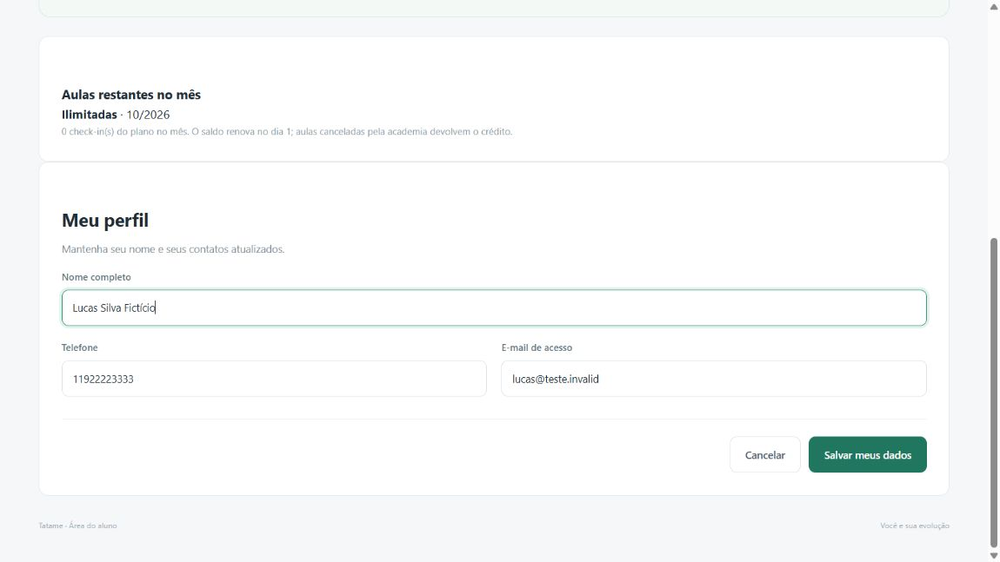
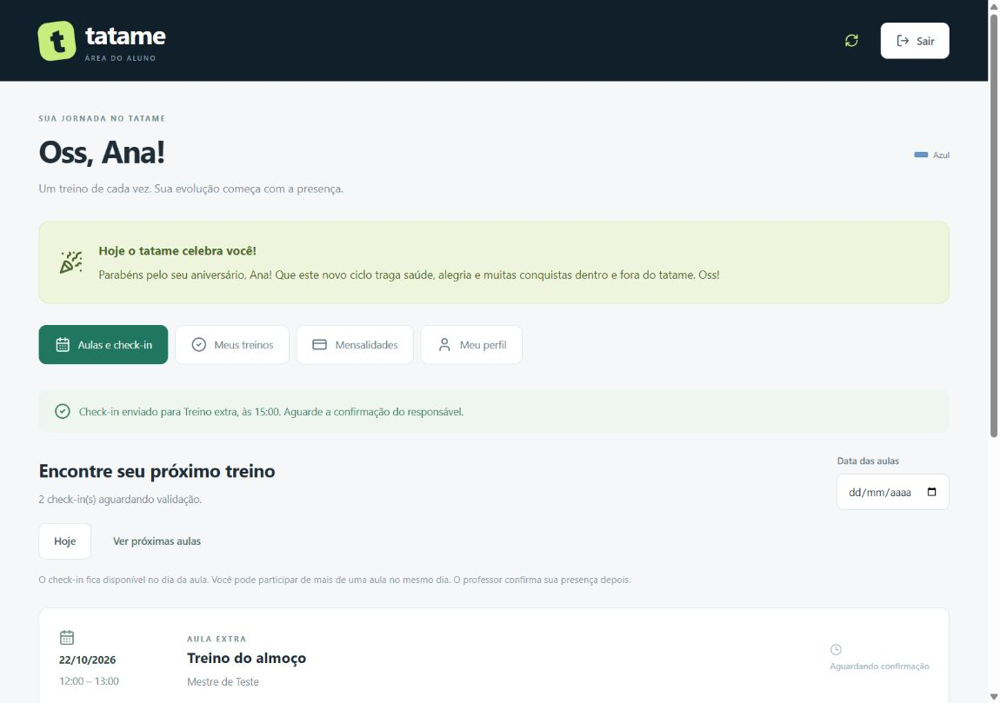
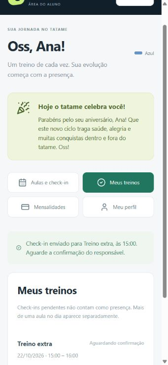
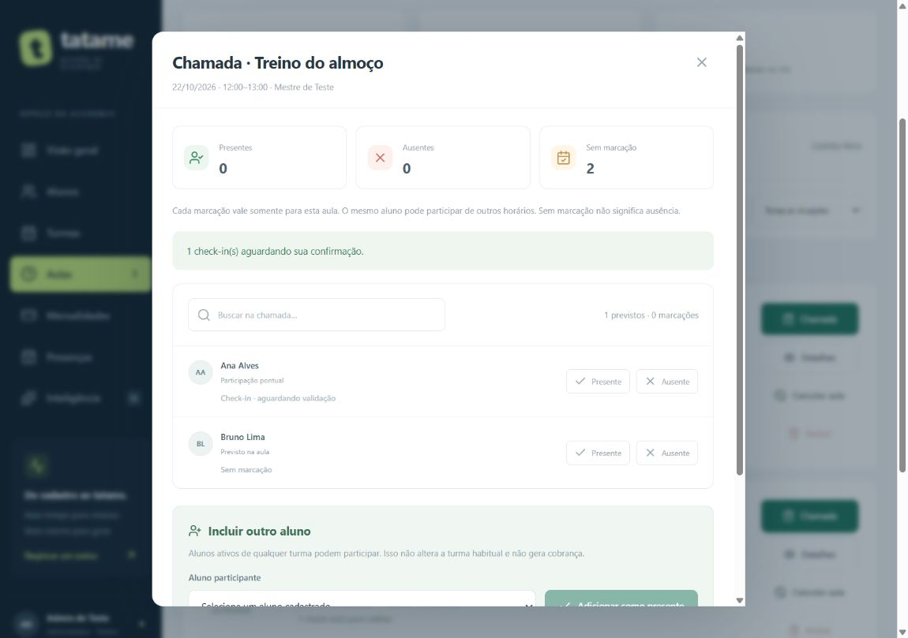

# Acesso e área do aluno

## Edição dos dados básicos pelo aluno — 26/10/2026

**Implementado e testado, aguardando validação do usuário antes de commit/envio.** Em **Meu perfil → Editar meus dados**, o aluno altera nome, telefone e e-mail. Nome/telefone não pedem senha. Troca de e-mail exige a senha atual, porque também muda o endereço do próximo login; a senha permanece a mesma e a sessão atual continua válida. Outras sessões e convites anteriores são invalidados quando o e-mail muda. Não há envio ou confirmação de propriedade da caixa de e-mail nesta entrega: a integração externa continua futura.

O formulário permite cancelar sem salvar e apresenta confirmação/erro. Somente esses três campos são enviados: faixa, nascimento, matrícula, situação, plano, saldo, pagamentos e vínculos continuam administrativos. Contatos próprios podem ser corrigidos mesmo havendo bloqueio financeiro; isso não libera aulas nem quita cobranças. O responsável continua consultando a ficha do dependente, sem receber permissão para alterar o login do aluno por este formulário. Menores com acesso próprio usam o mesmo recurso; quem tem acesso principal pelo responsável não pode utilizá-lo como aluno.

### Como funciona por dentro

- `GET /api/portal/perfil` consulta a ficha do aluno autenticado e exibe o e-mail efetivamente usado em sua conta de acesso, inclusive se um cadastro antigo tiver endereço divergente. Não devolve hashes, convites ou sessões.
- `PUT /api/portal/perfil` recebe `{nome,telefone,email}` e `senhaAtual` somente quando necessário. O servidor obtém aluno, usuário e sessão da autenticação, sem aceitar ID de outra pessoa ou perfil no corpo.
- `apps/api/src/modules/auth/perfil.ts` valida nome de 2–120 caracteres, telefone com 8–15 dígitos (formatação permitida), e-mail válido de até 180 caracteres e exclusividade entre alunos/usuários. Endereços são normalizados com trim/minúsculas; o domínio interno cadastro.invalid não pode ser escolhido para acesso próprio.
- `Repository.savePerfilAluno` grava `Aluno.nome/telefone/email` e `Usuario.nome/email` juntos, em transação SQLite/PostgreSQL, e revalida sessão, acesso principal e a prova de senha. Se uma conta mudar durante a confirmação, a operação é recusada. Colisão ou falha na auditoria desfaz a mudança inteira, inclusive revogação de sessões.
- `EventoAcessoAluno` registra o próprio aluno como autor, tipo perfil_basico_atualizado, campos alterados e data; não guarda senha, token ou valores anteriores dos contatos. Salvar sem mudanças não cria evento extra. Nomes registrados em chamadas/check-ins antigos permanecem como histórico; o cadastro e os próximos registros usam o nome atualizado.
- Confirmação de senha para e-mail tem limite de dez tentativas por conta em 15 minutos, em memória por processo. O bloqueio dessas tentativas não impede editar nome/telefone. Esse limite não é distribuído entre múltiplas instâncias.
- `apps/web/src/components/PerfilAluno.tsx` consulta, edita, cancela e salva. O formulário não é reinicializado pela atualização periódica do restante do portal enquanto o aluno está digitando. `StudentPortal.tsx` mantém Meu perfil disponível durante bloqueio financeiro. Não foi necessária migração: são usados campos e auditoria existentes.

### Verificação executada nesta entrega

**195 testes TypeScript aprovados**, incluindo 12 novos de perfil: identidade, campos permitidos, dados inválidos, senha, colisão de e-mail, login novo/recusa do antigo, sessões/convites, limite de tentativas, preservação de histórico, bloqueio financeiro e rollback. Build/typecheck aprovados. Python não foi repetido, pois não houve mudança no serviço de analytics.

Supabase de homologação: contas sintéticas confirmaram gravação nas duas entidades, senha necessária, colisão concorrente (uma operação 200 e outra 409), login após troca e revogação. Na primeira prova, o login executou sua limpeza já existente de sessões expiradas: 19 tabelas permaneceram iguais, e a tabela Sessao teve remoção de registro expirado; por isso, a comparação integral inicial falhou. A revisão automática bloqueou repetir esse fluxo global. A alternativa executada restringiu operações aos IDs sintéticos, sem chamar login/ativação: passou e, após limpeza, hashes das 20 tabelas ficaram idênticos ao início desse novo teste. Não houve alteração de cadastro ou histórico real, envio de e-mail ou nova migração.

Navegador isolado em memória: edição de nome/telefone, confirmação, cancelamento sem gravar e edição de telefone com mensalidade atrasada aprovados. A troca de e-mail foi exercitada pelos testes da API; a confirmação da senha no formulário fica para validação humana. Sem teste físico de celular. Captura abaixo contém somente dados fictícios.

**Para a defesa:** por que atualizar duas tabelas? Aluno guarda a ficha de quem treina; Usuario guarda a identidade usada para entrar. Alterar só uma delas pode deixar a tela mostrando um e-mail e o login esperando outro. A transação garante que ambas mudem juntas. Por que pedir senha ao trocar e-mail? Essa alteração muda a identificação da conta; confirmar a senha exige mais que uma sessão aberta. Por que o corpo não aceita alunoId? A identidade vem da sessão, evitando que o usuário escolha outra ficha para alterar.

## Entrega de e-mail planejada — 25/10/2026

O usuário autorizou deixar o envio automático nas integrações complexas futuras. [PLANO_FUNCIONAL.md](PLANO_FUNCIONAL.md) detalha convites de ativação/recuperação, destinatário aluno/responsável, configuração do provedor e testes. Até essa implementação, o convite continua sendo copiado e entregue manualmente. A conta escolhe sua senha pelo link de uso único; nenhum e-mail é enviado pelo Tatame nesta etapa.

## Responsável e transição de acesso — 25/10/2026

Novo perfil responsavel acompanha somente seus menores ativos. Sem celular, ele pode fazer check-in pelo dependente, conforme confirmação explícita do usuário. Com celular, o aluno faz o próprio check-in e mantém acompanhamento do responsável. Aos 18, acesso parental é recusado; administrador finaliza transferência e pode manter contato sem conceder acesso. Convites e sessões continuam sujeitos a validade e vínculo atuais. Caminhos, exemplos, limitações e evidências em [RESPONSAVEIS.md](RESPONSAVEIS.md). Avisos/autorizações internos e débitos estão disponíveis por dependente. Nenhuma mensagem externa é enviada automaticamente.

## Menu Débitos e reserva adicional — 25/10/2026

Ao atingir a cota mensal, o portal informa preço configurado e oferece reservar aula adicional de hoje ou futura no período elegível. O aluno confirma dia/horário, valor e prazo antes de gerar débito. A lista Débitos abre imediatamente; o check-in continua no dia. Débito vencido bloqueia novos check-ins, conforme resposta explícita do usuário, mas login e Débitos permanecem acessíveis, inclusive com mensalidade vencida. Pagamento é registrado pela academia e o estado é atualizado no portal. Autorização, isolamento e limitações em [DEBITOS.md](DEBITOS.md).

## Saldo mensal no portal — 25/10/2026

O aluno agora vê Aulas restantes no mês. Cada novo check-in único debita uma aula quando há limite mensal; saldo esgotado mostra aviso e bloqueia novos check-ins. Renovação no dia 1, conforme confirmado pelo usuário; cancelamento de aula devolve crédito. Limite semanal e financeiro também continuam valendo; somente a administração configura o limite mensal. Regras e verificações novas em [SALDO_MENSAL.md](SALDO_MENSAL.md).

## Entrada temporária sem senha no computador — 25/10/2026

Solicitação explícita do usuário: entrar como administrador sem repetir a senha durante os testes, com possibilidade de voltar ao login depois. Implementada opção `TATAME_ADMIN_LOCAL=true` no `.env` privado deste computador. O arquivo não existia nessa conferência; foi criado com HOST=127.0.0.1 e a opção local, sem copiar credenciais de outros ambientes. A execução atual continua usando SQLite. `.env.homologacao` recebeu explicitamente `TATAME_ADMIN_LOCAL=false`, preservando suas conexões e credenciais: isso evita que dotenv complete a flag ausente com o valor true do .env local ao iniciar o ambiente de homologação.

Ao abrir http://127.0.0.1:5173 ou http://127.0.0.1:3333, uma requisição local sem sessão válida identifica o administrador inicial já existente. Não apaga a senha, não cria administrador padrão, não grava nova sessão/cookie e não altera o cadastro. Uma sessão válida de aluno tem prioridade e continua com perfil aluno. Enquanto a opção estiver ativa, qualquer pessoa usando esse acesso local sem sessão válida entra como administrador; para testar as restrições de um visitante sem sessão, desligue a opção.

A opção exige HOST de loopback, hostname e endereço remoto de loopback, ausência de APP_ORIGIN e NODE_ENV diferente de production. Rejeita origem externa, Sec-Fetch-Site cross-site e cabeçalhos de encaminhamento Forwarded/X-Forwarded-For/Host/Proto. Não foi criada uma rota pública para ligar o modo. Os filtros de escrita e as demais regras de autorização permanecem aplicados. Em hospedagem, configurar APP_ORIGIN, HOST e NODE_ENV corretamente continua necessário.

Para restaurar o login: definir `TATAME_ADMIN_LOCAL=false` no arquivo privado e reiniciar a API. Como a entrada automática não emite cookie/sessão, ela não deixa um acesso administrativo novo sobrevivendo à desativação. Sessões normais já existentes continuam com seu prazo original. O botão Sair encerra sessões normais e mostra o login; ao atualizar a página sem sessão, a opção local volta a identificar o administrador enquanto estiver ligada. Isso também permite entrar normalmente com uma conta de aluno pela tela de login.

Verificação nova: 141 testes TypeScript aprovados, incluindo cinco casos de entrada local/limites de rede e ambiente, preservação de aluno e retorno ao login. Build/typecheck aprovados. Na execução real, sem cookie, estado/perfil admin e listagem de turmas retornaram 200 nas portas 3333 e 5173; requisição com X-Forwarded-For foi recusada com 401. Serviço Python /health retornou 200, sem repetição da suíte Python. Nenhuma migração ou escrita de teste no banco de homologação. Incremento aguarda validação antes de commit/envio.

**Incremento local de planos — 22/10/2026:** o portal mostra plano/uso semanal e restringe novos check-ins quando a cota acaba, com exceção de aula nominal autorizada pela administração. Sem plano mantém ilimitado. Check-in pendente ocupa vaga, ausência/cancelamento libera; frequência continua dependendo de presença confirmada. Bloqueio por mensalidade vencida permanece prioritário. Guia e limites: [PLANOS.md](PLANOS.md). Entrega aprovada para commit/envio após nova execução bem-sucedida de 136 testes TypeScript, 13 Python, build/typecheck e Prisma; a aprovação abaixo pertence à entrega anterior.

**Estado em 22/10/2026:** conjunto aprovado para commit/envio após nova execução bem-sucedida de 121 testes TypeScript, 13 Python, build/typecheck e validação Prisma. Essa autorização supera as pendências históricas abaixo. Registro em [PROCESSO.md](PROCESSO.md).

## Decisão de arquitetura — 21/10/2026

Implementado localmente em 21–22/10/2026, com testes automatizados e conferência visual. Aguarda validação do usuário antes de commit/push. O login identifica a pessoa antes de abrir a área correspondente. Administrador acessa a gestão; aluno acessa somente o próprio cadastro, mensalidades, aulas publicadas e histórico. A API protege os dados mesmo quando alguém tenta chamar uma rota sem usar as telas.

O primeiro administrador é criado uma única vez pela tela de configuração inicial. Não existe senha padrão. Depois, o administrador gera um link temporário para um aluno cadastrado escolher a própria senha. O link também permite redefinição assistida; não há envio automático de e-mail ou WhatsApp.

Senhas são armazenadas como hash scrypt com sal aleatório (N=32768, r=8, p=3), nunca como texto. Sessões usam um token aleatório de 32 bytes em cookie HttpOnly/SameSite=Strict; somente seu SHA-256 é salvo no banco, com expiração absoluta de oito horas. Escritas exigem cabeçalho próprio do aplicativo e verificação de origem, sem liberar CORS; formulários enviam JSON. HTTPS e origem explícita são necessários para uso externo.

Referências consultadas: [armazenamento de senhas OWASP](https://cheatsheetseries.owasp.org/cheatsheets/Password_Storage_Cheat_Sheet.html), [sessões OWASP](https://cheatsheetseries.owasp.org/cheatsheets/Session_Management_Cheat_Sheet.html) e [proteção CSRF para APIs OWASP](https://cheatsheetseries.owasp.org/cheatsheets/Cross-Site_Request_Forgery_Prevention_Cheat_Sheet.html). As decisões acima descrevem a implementação escolhida para este projeto.

## Check-in e presença

**Incremento de 22/10:** mensalidade vencida e não paga restringe o portal à tela de débito em aberto e bloqueia check-in. Vencimento hoje ainda permite acesso. Login continua disponível para mostrar a orientação privada; após pagamento de todos os vencidos registrado pela academia, a mesma sessão volta a acessar. Guia: [BLOQUEIO_FINANCEIRO.md](BLOQUEIO_FINANCEIRO.md). A descrição abaixo do portal completo corresponde ao aluno sem vencidos.

O aluno consulta aulas já publicadas pelo administrador, da grade e extras. O check-in é liberado no dia da aula, pelo calendário de São Paulo, para alunos ativos e aulas não canceladas. Pode fazer check-in em várias aulas no mesmo dia, uma vez por aula. Ainda não há limite de plano nem cobrança extra automática. Nesta primeira entrega não há janela por minutos ou geolocalização: o clique é um aviso para validação do responsável.

Check-in significa “o aluno avisou que chegou”. Presença significa “o responsável confirmou”. São registros separados. Um check-in entra na chamada como pendente de validação; só a marcação do administrador alimenta os indicadores de frequência. Cadastrar uma turma não publica automaticamente todas as suas aulas.

## Modelo implementado

- Usuario: identidade de acesso, perfil, vínculo opcional com Aluno, hash da senha e convite temporário.
- Sessao: vínculo com Usuario, verificador do token, impressão da credencial e prazo de validade. A impressão impede que um login em andamento com senha antiga produza uma sessão válida depois de uma redefinição.
- CheckinAula: vínculo único entre aluno e aula, nome histórico e momento do aviso.

Migração SQLite 005 acrescenta as três tabelas, com backup automático, sem converter ou alterar os cadastros/chamadas existentes. O teste v4→v5 preenche as dez tabelas anteriores e confere preservação, backup e persistência após reabrir. O banco local foi comparado ao backup v4 em 22/10: dez conjuntos de linhas iguais por SHA-256 e nenhum vínculo inválido. O equivalente Prisma/PostgreSQL foi gerado e verificado em TypeScript; não houve execução externa no Supabase.

## Como usar no seu computador

1. Abra o endereço local informado no README. No primeiro acesso, preencha seu nome, e-mail e uma frase de senha com pelo menos 15 caracteres. Confirme a senha e crie sua conta. Essa etapa deve ser feita pelo próprio usuário; não compartilhe a senha no chat.
2. Entre em **Alunos → Ver ficha → Área do aluno → Gerar link de acesso**. O aluno precisa estar ativo. O acesso fica vinculado ao cadastro escolhido; não há cadastro público que permita escolher outro aluno ou perfil de administrador.
3. Copie o link privado e entregue somente ao aluno correspondente. Vence em 24 horas e funciona uma vez. Gerar outro invalida o anterior. A senha atual só muda quando o novo link é utilizado.
4. O aluno abre o link, escolhe e confirma a própria senha. Depois, entra pelo e-mail de acesso. Pode trocar esse endereço em **Meu perfil → Editar meus dados**, confirmando a senha atual; ficha e conta são atualizadas juntas. Na gestão, a troca de e-mail de conta existente passa pela ativação/transferência na seção Responsável e acesso.
5. Em **Aulas e check-in**, selecione a data ou **Ver próximas aulas**. No dia da aula, clique em **Fazer check-in**. Um segundo clique/reenvio não duplica o aviso.
6. Na gestão, abra **Aulas → Chamada**. O aluno que avisou aparece mesmo sem ser habitual daquela turma. Marque presente ou ausente. O aluno vê o resultado em **Meus treinos** e na aula.
7. **Mensalidades** mostra somente as próprias cobranças, valores, vencimentos e pagamentos registrados. É consulta; ainda não existe pagamento online. **Meu perfil** permite consultar a ficha e editar nome, telefone e e-mail de acesso pelas regras acima.
8. **Sair** revoga a sessão no servidor. Sessão expirada exige novo login. Inativar o aluno impede novo login e uso das sessões existentes; não apaga o histórico.

As duas áreas atualizam os dados a cada 30 segundos enquanto a página está visível e ao retornar à janela. Uma falha de consulta é apresentada; na área do aluno, o check-in fica indisponível até recarregar com sucesso. Cadastro de turma não publica aulas automaticamente: use a agenda administrativa para criar cada encontro.

Um endereço 127.0.0.1 pertence ao próprio aparelho. Um link com esse endereço só funciona no computador do servidor. Acesso real pelo celular fora de casa exige hospedagem/HTTPS e uma URL pública; a aplicação ainda não foi implantada na internet.

## Rotas e permissões

| Rota | Acesso | Resultado |
| --- | --- | --- |
| GET /api/auth/estado | Público | Informa se falta configuração e a identidade da sessão atual, sem hashes |
| POST /api/auth/configurar | Primeiro acesso local | Cria o único administrador inicial; fecha após criação |
| POST /api/auth/entrar | Público, com limite de tentativas | Valida credenciais e cria nova sessão |
| POST /api/auth/ativar | Link temporário | Define senha do aluno, consome o convite e revoga sessões anteriores |
| POST /api/auth/sair | Sessão atual ou já encerrada | Revoga se existir e remove o cookie |
| POST /api/auth/alunos/:id/convite | Administrador | Gera/reemite link de ativação ou redefinição assistida |
| GET /api/portal | Aluno ativo | Retorna o portal próprio quando regular ou somente mensagem/pendências financeiras quando bloqueado |
| PUT /api/portal/aulas/:id/checkin | Aluno ativo | Faz aviso em nome do aluno obtido da sessão, nunca de um alunoId escolhido na tela |
| Demais rotas /api | Administrador | Gestão, finanças, chamada, analytics e assistente |

API sem sessão responde 401; sessão de aluno em rota administrativa responde 403. Rotas do portal não devolvem lista de colegas, chamadas completas ou cobranças de outras pessoas. O nome cadastral do professor na turma não cria uma conta de professor.

## Segurança e limites desta entrega

- Conta inicial somente em conexão local/host local e sem APP_ORIGIN configurado. Configure-a antes de expor o servidor. Para hospedagem, APP_ORIGIN deve ser a origem HTTPS exata, sem caminho ou barra final; HTTP só é aceito para loopback.
- Cookie Secure quando a origem configurada usa HTTPS. Sem tokens em localStorage, parâmetros de consulta ou JSON do login. O convite usa fragmento de URL, removido da barra após leitura; a página não precisa mandá-lo em logs de navegação.
- Comparação de senha com tempo constante após derivação, erro genérico para credenciais inválidas, limite de 20 tentativas por IP em 15 minutos e no máximo duas derivações scrypt simultâneas por processo.
- Link consumido por atualização condicional em transação; repetição/expiração/inativação não ativa acesso. Redefinição invalida sessões antigas inclusive em concorrência com login. Sessões não têm renovação automática.
- Check-in usa transação, chave única aula/aluno e validações junto à gravação. PostgreSQL coordena aula/aluno por bloqueio de linha; ainda precisa de teste externo. Check-in bloqueia excluir aula extra; cancelar preserva os avisos. Chamada confirmada mantém as proteções anteriores.
- Não há MFA, entrega de e-mail, recuperação automática do administrador, perfil separado de professor, multiacademia, limites de planos, capacidade, lista de espera ou trilha completa de autor/edições. O limitador é em memória por processo, não distribuído. Consultas do repositório ainda carregam conjuntos inteiros; paginação e consultas filtradas serão necessárias com crescimento.

## Arquivos para estudar

| Arquivo | Responsabilidade e motivo |
| --- | --- |
| apps/web/src/AuthGate.tsx | Identifica a sessão antes de montar gestão ou portal, evitando consultar dados administrativos ao entrar como aluno |
| apps/web/src/pages/StudentPortal.tsx | Agenda, check-in, histórico, próprias mensalidades, perfil e homenagem de aniversário |
| apps/web/src/components/AcessoAluno.tsx | Permite ao administrador gerar e copiar o link privado, sem escolher a senha do aluno |
| apps/web/src/components/ChamadaAula.tsx | Reúne previstos, check-ins e marcações; aviso não é presença |
| apps/api/src/modules/auth/routes.ts | Login, sessão, configuração inicial, convite e permissões de acesso |
| apps/api/src/modules/auth/password.ts | Encapsula scrypt, geração aleatória e verificadores SHA-256 |
| apps/api/src/modules/auth/portal.ts | Obtém o aluno pela sessão e filtra os dados devolvidos |
| apps/api/src/modules/auth/checkin-rules.ts | Regras do check-in verificadas dentro da transação do repositório |
| apps/api/src/repository.ts | Persistência SQLite/Prisma, ativação atômica e check-in por aula |
| apps/api/src/auth.test.ts | Testes reais HTTP de identificação, permissões, isolamento, convite, expiração, concorrência e check-in |
| apps/api/src/test-auth-helper.ts | Fixture usada só por testes antigos para fornecer sessão de administrador; não é importada pelo servidor nem desativa a proteção |
| apps/api/src/acesso-migration.test.ts | Confere backup, preservação das dez tabelas e reabertura do banco com o novo modelo |

## Aniversários

Na gestão, **Visão geral → Aniversariantes do dia** mostra somente alunos ativos que fazem aniversário na data atual em São Paulo. O mês financeiro selecionado não muda a data da homenagem. Na área do aluno, o próprio aniversariante recebe a mensagem simbólica. São textos do sistema, sem chamada de IA, e-mail ou WhatsApp. Quem faz aniversário amanhã aparece amanhã; 29/02 não é antecipado em ano não bissexto. A exibição depende do relógio do dispositivo e de abrir/manter a página ativa.

O helper `aniversarios.ts` centraliza seleção/mensagem; `aniversarios.test.ts` cobre mudança de dia, ativos, ordenação, ano bissexto e mensagem. Usa data de nascimento já cadastrada, sem nova coluna no banco.

## Validação e telas

Na validação inicial de login/portal em 22/10/2026: 112 testes TypeScript, 13 Python e build/typecheck aprovados. O incremento posterior de bloqueio financeiro chegou a 121 testes TypeScript e novo build/typecheck aprovados; veja [BLOQUEIO_FINANCEIRO.md](BLOQUEIO_FINANCEIRO.md). Prisma Client gerado; sem validação externa PostgreSQL/IA. Testes de navegador usam SQLite em memória e nomes fictícios. Não foi criada conta ou senha no banco do usuário durante os testes.

## Para defender na avaliação

“Login é a identificação na portaria; permissão define quais salas a pessoa pode acessar. O servidor obtém o aluno pela sessão, sem confiar num identificador enviado pela tela. Check-in é um pedido de confirmação, e não uma presença calculada automaticamente.”

Perguntas de fixação: por que esconder o botão administrativo não basta para proteger os dados? Por que dois check-ins e uma presença confirmada resultam em apenas um treino nos indicadores?
