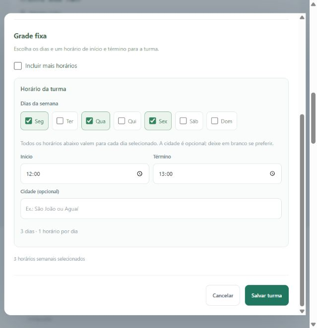
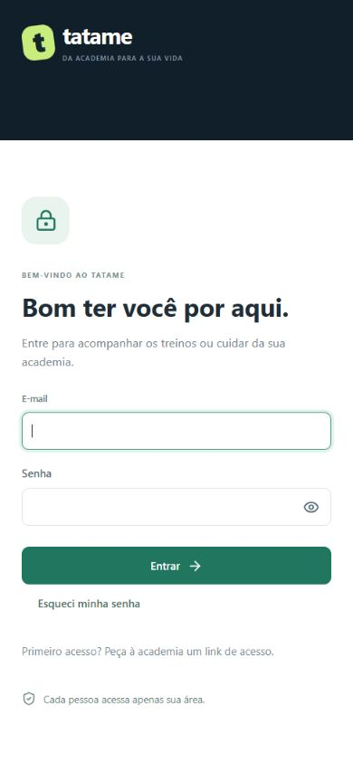
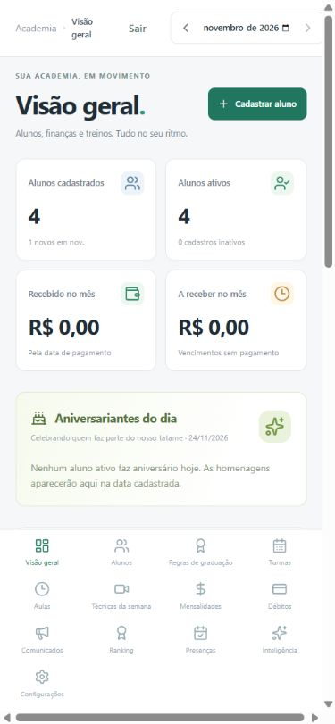
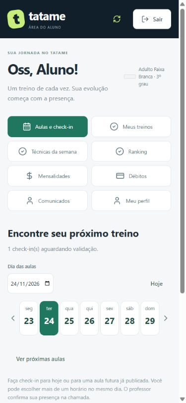

# Acesso direto para demonstração — 24/11/2026

[Abrir o Tatame](https://tatame-test-diario.vercel.app/). O endereço abre diretamente o login do Tatame, sem conta da Vercel, link temporário ou computador local ligado. O usuário autorizou o mestre a usar a conta existente de professor como administrador e a conta fictícia de aluno em outro celular. As credenciais permanecem privadas e não foram alteradas.

## Demonstração em dois celulares

1. Entregue ao mestre o endereço diário e o acesso de professor. Ele entra no painel administrativo.
2. No outro celular, abra o mesmo endereço com o acesso fictício de aluno.
3. O professor publica uma aula em **Aulas**, da grade ou por horário extra. A grade semanal sozinha não publica todas as datas automaticamente.
4. O aluno escolhe a mesma data e toca em **Atualizar minha área**, se necessário, para ver a publicação. Pode fazer check-in quando permitido pelo plano.
5. O professor abre a chamada dessa aula e confirma a participação. Consultem também os comunicados nos dois perfis.

As alterações ficam salvas no banco brasileiro de testes. A conta de professor tem poderes reais de administração nesse ambiente; entregue-a somente ao destinatário pretendido. Antes de usar dados reais, adotar contas individuais e revisar as pendências, incluindo limite de tentativas distribuído. O limitador atual é por processo; esta publicação não o tornou distribuído nem constitui auditoria completa.

## Publicação e proteção

Primeira liberação direta: `dpl_2UTdP7uckSRwiecsvN3iNKZKpwur`, READY/Production/gru1, recriada da prévia validada `dpl_J3B3eYEWneShxyrTyceMSMYXJkpK`, fonte `9ba3873f282e28161f3661c74ab7019c79d25628`. Seus 177 arquivos foram conferidos por SHA-1 contra o manifesto anterior, com os três auxiliares/fixture já retirados da publicação original. Não houve migração, seed ou reset nesta primeira liberação.

O endereço diário agora é domínio de produção. Vercel Authentication continua ativa em **Standard Protection** (`all_except_custom_domains`): domínios de produção abrem a aplicação; prévias e URLs geradas de deployment continuam protegidas. Não foi criado bypass, segredo de automação ou link compartilhável. [Escopo oficial](https://vercel.com/docs/deployment-protection#standard-protection).

DATABASE_URL, RESEND_API_KEY, RESEND_FROM e APP_ORIGIN foram estendidas de Preview para Production sem ler segredos. PASSWORD_RESET_ORIGIN recebeu configuração própria de produção igual à origem diária, mantendo o sentinela preview restrito às prévias. Dados continuam exigindo login, cookie Secure/HttpOnly/SameSite=Strict e verificação de papéis pela API.

## Verificações novas da liberação direta

- Sem sessão: página/estado 200, dados administrativos/portal 401, configuração inicial remota 403 e origem estrangeira 403.
- Professor: login, estado e listagem administrativa 200, papel admin, backend Supabase e analytics disponível.
- Aluno: login/portal 200 e administração/configurações 403. Logout bloqueia o token de ambos; atributos do cookie conferidos.
- Prévia anterior e URL gerada da publicação retornaram 302 para vercel.com sem sessão. O endereço diário retornou 200 direto, sem bypass.
- Navegador: os dois logins, painel administrativo, portal e saída conferidos em tela estreita; viewport restaurado. Não é teste em aparelho físico. Nenhuma aula, presença, cobrança ou mensagem criada pelo Codex.

Evidência HTTP privada em `.test-output/acesso-direto-20261124/verificacao-api.json`. O roteiro inicialmente esperava o nome do backend como postgres; ajustado para o valor real supabase e reexecutado com sucesso. Não se repetiu a suíte local nesta liberação de infraestrutura.

## Cidade publicada e conferida

Após a primeira liberação, o usuário pediu **pode incluir a opção de cidade tbm** e **continue**, aprovando o conjunto apresentado para commit/envio e publicação. Fonte enviada em `fd05301f7ddacf6fdafbb304412d5de40c0c1dee`, branch `codex/evolucao-tatame`. Build/typecheck, 311 testes TypeScript, Prisma e conferência visual local passaram nesta rodada, antes da publicação.

Migração `202611240001_cidade_treino` aplicada no Supabase brasileiro `yptdxyjqgvzmkoizavmj`, com checksum `c4ceb4648ec64810a7b110a96a704df7bc169cc4d7d8e8e672dab223dcdf2933` no histórico Prisma. São duas colunas VARCHAR(80), anuláveis e sem backfill. Hashes de todas as colunas anteriores de HorarioTurma e Aula permaneceram iguais; mantidos 30 horários (incluindo a grade inativa histórica), duas aulas, dois check-ins e duas presenças por aula. RLS permanece habilitada. Nenhuma cidade foi atribuída automaticamente.

Publicação final `dpl_5KPypuvKgvJNwdxuifmLkaGrys9P`, READY/Production/gru1, com 180 fontes conferidas por SHA-1 e duas funções geradas pela plataforma. O domínio diário aponta para essa publicação. Segredos, testes, fixtures e portfólio não fazem parte do pacote. Sem merge, tag ou alteração de versão; v1.0.0 preservada.

O roteiro HTTP dos dois perfis foi executado novamente nesta versão e passou: entrada direta 200, dados 401 sem sessão, aluno 403 na administração, professor 200, cookie seguro, origem estrangeira recusada e logout. Navegador confirmou Cidade (opcional) em Editar turma e Adicionar horário extra, valor vazio, required=false e limite 80; os formulários foram fechados sem salvar. Captura abaixo é da versão online.

A revisão automática rejeitou a execução de um roteiro que criaria e excluiria uma turma e duas aulas fictícias no banco online, pelo risco de limpeza incompleta e ausência de autorização específica para esse teste de escrita. O roteiro não foi executado nem contornado. A verificação externa desta cidade foi concluída por consultas e telas; criação/edição com cidade e snapshot foram validados localmente, sem alegar gravação externa testada. O advisor de segurança retornou somente o aviso informativo de RLS sem políticas nas 35 tabelas privadas, coerente com o acesso exclusivo pelo backend; nenhuma política pública foi adicionada. [Significado do aviso](https://supabase.com/docs/guides/database/database-linter?lint=0008_rls_enabled_no_policy).

