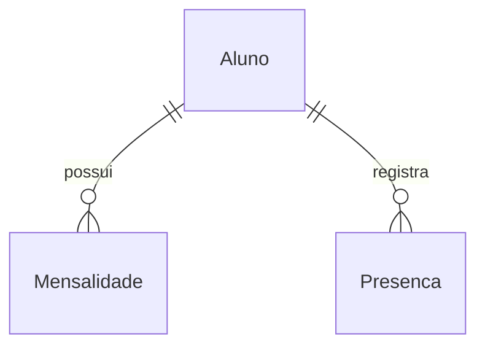
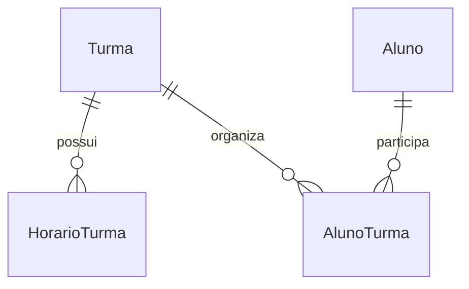
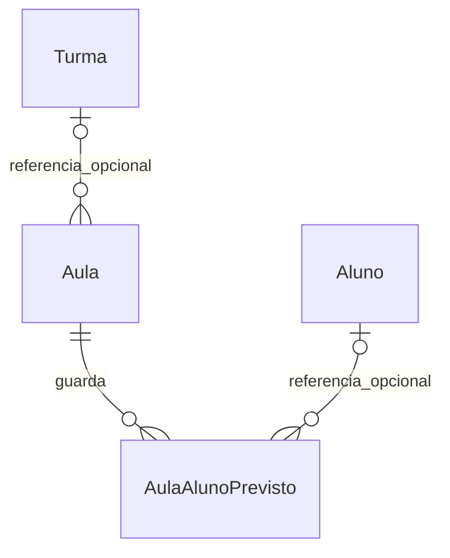
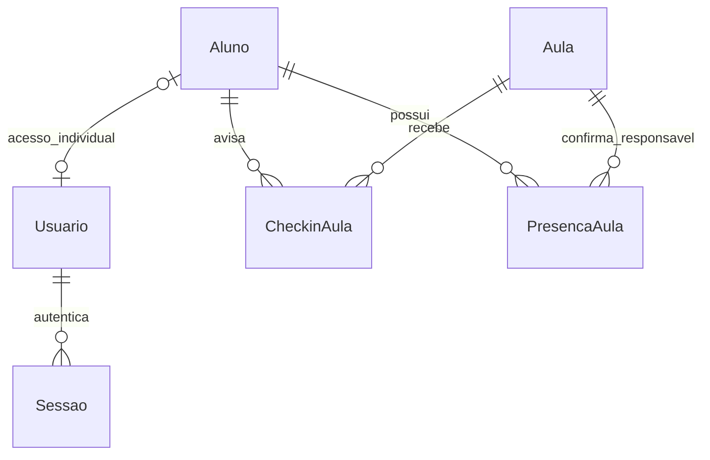

# Arquitetura — Academia de Jiu-Jitsu

## Objetivo
Construir um sistema para cadastrar alunos e controlar mensalidades.

## Dados principais
- Aluno: guarda as informações cadastrais de uma pessoa.
- Mensalidade: guarda uma cobrança, com valor, vencimento e situação.
- Um aluno pode ter zero ou várias mensalidades.
- Cada mensalidade pertence a um único aluno.

## Identificação dos registros
- O id do aluno identifica seu cadastro e é sua chave primária.
- O id da mensalidade identifica a cobrança e é sua chave primária.
- O alunoId da mensalidade aponta para o id do aluno e é uma chave estrangeira.

## Campos de Aluno — rascunho
- id: identificador único do cadastro.
- nome: nome do aluno.
- telefone: contato telefônico do aluno.
- email: endereço de e-mail do aluno.
- dataNascimento: data em que o aluno nasceu.
- faixa: faixa atual do aluno, como branca ou azul.
- dataMatricula: data em que o aluno entrou na academia.
- situacao: indica se o aluno está ativo ou inativo.

## MVP e decisões de implementação — 09/10/2026

O usuário alterou a dinâmica da mentoria: priorizar um MVP executável e validar as telas antes das explicações. O histórico acima registra a modelagem feita pelo aluno.

### Componentes

React + TypeScript + Tailwind (apps/web) → API Express + TypeScript (apps/api) → repositório SQL.
O backend consulta FastAPI + Pandas (services/analytics) para métricas determinísticas. Somente essas métricas e nomes necessários são enviados ao modelo de IA pela API Node. Credenciais ficam no backend.

- Supabase/PostgreSQL + Prisma 7: caminho configurável com DATABASE_URL; migrations versionadas.
- SQLite nativo do Node 24: banco real persistido em data/academia.sqlite para validar o MVP sem credenciais externas. O desafio exige SQL e recomenda PostgreSQL/Supabase; a validação de PostgreSQL continua planejada por fazer parte da stack escolhida. A tela identifica o banco utilizado.
- O repositório possui o mesmo contrato nos dois bancos. Nenhuma conexão com o Supabase é presumida ou simulada.
- UUID identifica registros. Datas de calendário usam YYYY-MM-DD, sem conversão de fuso; a data atual é calculada em America/Sao_Paulo.
- Valores monetários são inteiros em centavos, evitando arredondamentos de ponto flutuante.

### Mensalidade

id, alunoId (FK), competencia (YYYY-MM), valorCentavos, dataVencimento, dataPagamento (opcional), criadoEm. Uma cobrança por aluno/competência no MVP.
O status é calculado: com pagamento = pago; sem pagamento e vencimento anterior a hoje = atrasado; demais = pendente. Vencer hoje ainda não significa atraso. Não persistimos o status, pois ele muda com o calendário.

### Presença e análises

Presenca: id, alunoId, dataTreino, tipoTreino e presente. Há um registro por aluno/data/tipo; editar permite corrigir a chamada.
Analise: pergunta, resposta real da IA, usuário local, modelo, data e snapshot das métricas. O MVP local tem um administrador; autenticação e perfis são uma evolução antes de qualquer publicação com dados reais.

### Regras e erros

A API valida todos os payloads com Zod, rejeita datas inexistentes/futuras quando inadequadas, relacionamentos inválidos, e-mails e cobranças duplicados. Alunos com cobranças não podem ser excluídos: devem ser inativados para preservar o histórico. HTTP 400 = entrada inválida; 404 = inexistente; 409 = conflito; 503 = integração indisponível. Mensagens da interface vêm da API. Consultas SQLite parametrizadas e Prisma evitam SQL concatenado.

### Dashboard e analytics

Receita do mês usa dataPagamento. Valor a receber usa vencimentos no mês sem pagamento; parcelas pendentes e atrasadas permanecem distinguíveis. Risco: atraso +30, pelo menos 14 dias sem presença +30, queda acima de 50% +40. Baixo 0–30, médio 31–60, alto 61–100. A frequência do mês corrente é comparada com os mesmos dias do mês anterior, evitando comparar um mês parcial com um completo.

### Revisão arquitetural antes da implementação

Codex revisou o rascunho e adotou: status derivado, centavos inteiros, restrição de exclusão financeira, períodos comparáveis e identificação explícita das integrações. Rejeitada a necessidade de XAMPP: a stack é Node/PostgreSQL. DBeaver é opcional. Não há resposta simulada apresentada como IA.

## Correções de evolução e integração — 19/10/2026

Primeira extração gradual: `modules/analytics/service.ts` concentra a consulta dos dados e a chamada HTTP ao Python; `schema.ts` valida sua resposta com Zod. `http-error.ts` compartilha o erro HTTP entre a composição da API e esse serviço. As rotas anteriores continuam em `app.ts`; a modularização completa ainda não foi realizada. A nova entrega de turmas usa módulo próprio desde sua criação, conforme a seção abaixo.

O contrato TypeScript descreve os tipos durante o desenvolvimento. A validação Zod verifica os valores recebidos pela rede: datas, mês solicitado, inteiros não negativos, listas e níveis de risco. Campos adicionais são aceitos e descartados; campos obrigatórios ausentes ou incompatíveis geram HTTP 503. Isso evita repassar uma string onde a tela espera uma lista. Essa checagem não prova, sozinha, que toda fórmula financeira está correta: os testes determinísticos e a conferência dos períodos continuam necessários.

No Python, StudentInput, PaymentInput e AttendanceInput substituem os dicionários genéricos de entrada. Datas impossíveis, valores fracionados de centavos e presença em texto são rejeitados antes do cálculo. Telefone, e-mail e nascimento não são enviados pelo Node ao Python. A fórmula e os limites de risco não mudaram.

O React mantém dados e estados separados por recurso em `data.ts`; `load-data.ts` publica cada resultado assim que chega, com Promise.allSettled. Cada página depende apenas dos recursos necessários. Histórico e indicadores possuem mensagens e tentativas próprias; erro não é apresentado como lista vazia ou total zero. Recargas em segundo plano preservam a página montada quando seus dados já estão disponíveis; uma falha invalida os dados do recurso afetado.

O SQLite usa o runner em `database/sqlite/migrate.ts` e os arquivos SQL de `database/sqlite/migrations/`. A versão inicial reproduz as quatro tabelas anteriores; registra a adoção de um banco 1.0 compatível sem recriar seus registros. O runner verifica histórico e checksum, faz backup antes de alterações pendentes em arquivos com tabelas e aplica as migrações em transação. Compara colunas, chaves estrangeiras e unicidade com a estrutura conhecida e confere vínculos. Estrutura desconhecida exige uma migração explícita; não se atribui uma faixa presumida ao aluno.

O histórico `_tatame_migrations` descreve o schema local, independentemente da versão do pacote npm. Migrações Prisma/PostgreSQL são outro caminho, mantido em `prisma/migrations/`; trocar DATABASE_URL não transfere registros. Procedimento e limites: [MIGRACOES_SQLITE.md](MIGRACOES_SQLITE.md).

Ao mudar o mês, o dashboard é invalidado até chegar o novo resumo; indicadores também limpam o contexto anterior durante a consulta. Isso impede atribuir números do período anterior ao mês recém-selecionado, sem invalidar os cadastros que não dependem do mês.

## Desenho da entrega 1A — turmas e grade fixa — 19/10/2026

Registrado antes da implementação, após o usuário autorizar começar pelas pequenas entregas. Escopo: cadastrar, editar, consultar e desativar turmas; grade semanal com vários horários por dia; vínculos habituais dos alunos. Aula extra, encontro datado, nova chamada, planos e login permanecem nas entregas seguintes. O professor responsável é um nome cadastral nesta etapa, não uma conta autenticada.

- Turma: UUID, nome, professor responsável, situação ativo/inativo e datas de criação/atualização.
- HorarioTurma: UUID, turmaId, diaSemana (0 = domingo a 6 = sábado), horaInicio/horaFim em HH:mm. Vários horários no mesmo dia são permitidos; repetição e sobreposição dentro da mesma turma são rejeitadas. Nesta entrega, um intervalo não atravessa a meia-noite.
- AlunoTurma: UUID, turmaId, alunoId e criadoEm; unicidade por turma/aluno. O vínculo é habitual e não define ainda um direito comercial ou uma presença.

As tabelas novas usam chaves estrangeiras e não alteram as quatro tabelas de negócio anteriores. Novos vínculos exigem aluno ativo; um aluno posteriormente inativado pode permanecer vinculado até a remoção explícita. Exclusão de aluno vinculado é impedida, com orientação para retirar o vínculo ou inativar. Desativar a turma preserva horários e vínculos.

O desenho inicial não expunha exclusão de turma. Após conferir a interface, o usuário pediu a remoção definitiva, além da desativação. Foi acrescentado DELETE /api/turmas/:id e `removeTurma` no repositório, removendo horários, vínculos e turma em uma transação SQLite/Prisma. Não exclui alunos, mensalidades ou as presenças existentes. Não foi necessária outra migração. A interface exige confirmação e explica que recriar uma turma gera um cadastro novo. Na futura etapa de aulas, a preservação do histórico de encontros e presenças também deverá ser mantida ao definir a relação com turmas.

Implementado em `modules/turmas/`: schema Zod, serviço e rotas. O método `saveTurma` do repositório salva turma, horários e vínculos na mesma transação: síncrona, sem awaits intercalados no SQLite, e por `$transaction` no Prisma. A grade define programação, sem gerar encontros ou presenças automaticamente. Os horários usam a referência local da academia, America/Sao_Paulo nesta entrega.

Contratos implementados: GET/POST /api/turmas, GET/PUT/DELETE /api/turmas/:id e PATCH /api/turmas/:id/situacao. A edição completa recebe nome, professor, situação, lista de horários e alunoIds; a resposta inclui identificadores e datas. O React possui recurso próprio de turmas, com falha isolada das demais áreas, filtros, cartões, detalhes, formulário e grade semanal. A versão de schema SQLite avança pela nova migração `002_turmas`; `001_initial.sql` permanece intacta. O caminho PostgreSQL recebe migração equivalente, sem presumir validação externa.

Validação executada: migração sobre arquivo temporário da versão anterior sem alterar seus registros, persistência após reabrir, gravação atômica com rollback, horários inválidos/sobrepostos, vínculos inexistentes/repetidos/inativos, aluno em várias turmas, desativação sem perda e navegador com base fictícia isolada. A atualização da base local também preservou os registros anteriores. Resultados e limites em [TURMAS.md](TURMAS.md) e [REVISAO_IA.md](REVISAO_IA.md).

Horários mantidos preservam seus IDs por dia/início; vínculos mantidos preservam ID e data de criação. A substituição da grade e dos vínculos ocorre como uma unidade. Nesta fase, não há histórico completo de remoção de vínculos nem bloqueio otimista de edições simultâneas: a última edição completa prevalece. A geração de aulas futuras deverá guardar seus próprios dados e participantes esperados, sem reconstruir encontros antigos a partir da grade atual. Aulas, planos, login e isolamento entre academias continuam planejados.

## Desenho da entrega 1B — aulas datadas — 19/10/2026

Registrado antes de implementar, após o usuário aprovar começar com “bora”. Aula guarda data, início/fim, título, professor, origem (grade/extra), situação (agendada/cancelada), turma opcional e cópia do nome da turma. Criar da grade recebe horário e data, exige turma ativa e dia da semana compatível; usa cópias dos horários/professor atuais, sem gerar calendário inteiro. Extra recebe campos livres, com turma ativa opcional. Datas futuras são permitidas; horários não atravessam meia-noite. Não há confirmação automática de realização ou presença.

`AulaAlunoPrevisto` guarda a lista de alunos habituais ativos no momento da criação e uma cópia dos nomes. Previsão não é presença/inscrição nem limita participação futura. Essa fotografia prepara a chamada 1C sem aplicar mudanças atuais de vínculo ao passado. As duas tabelas são salvas numa transação. A turma e o aluno são referências opcionais com ON DELETE SET NULL: excluir o cadastro desvincula a referência, preservando a aula e seus nomes históricos. Nenhuma presença anterior é convertida ou inventada.

A origem do horário é uma chave histórica sem FK, porque a edição da grade substitui seus registros. A combinação origemHorarioId/dataAula é única: repetir a criação retorna a aula existente, inclusive cancelada, sem reativar ou sobrescrever dados. Cancelar exige motivo e preserva o registro; repetição mantém o primeiro cancelamento. Não há rota de exclusão nem edição de aula nesta entrega. Correções usam cancelamento e nova aula extra, com histórico explícito. Sobreposição entre aulas/professores não é bloqueada, pois ainda não há cadastro de locais e contas de professores.

Serão acrescentados módulo de aulas, contratos compartilhados, migração SQLite 3 e equivalente PostgreSQL, navegação própria e carregamento isolado. A edição/exclusão de turmas permanece disponível, com suas aulas preservadas. Fluxo administrativo local, sem login, cobrança automática, nova chamada ou mudança nos cálculos Python. Aprovação para implementar não é aprovação para commit/push desta entrega.

**Estado após implementação:** o desenho acima foi implementado em `modules/aulas`, `AulasPage.tsx`, migração 003 e modelos Prisma. Rotas: GET /api/aulas (filtros opcionais), GET /api/aulas/:id, POST /api/aulas/da-grade, POST /api/aulas/extras e PATCH /api/aulas/:id/cancelamento. Criação da grade responde 201 ou 200 para repetição; a chave única também protege concorrência. Cancelamento usa UPDATE condicionado a agendada, preservando o primeiro motivo/timestamp. Agenda e formulários possuem recurso de carregamento próprio; os sete destinos móveis ficam em duas linhas. Lista por dia na interface; consultas ainda carregam todas as aulas, sem paginação.

Foram aprovados 61 testes TypeScript, 12 Python, build/typecheck e schema Prisma; navegador fictício e preservação das sete tabelas locais conferidos. Não houve validação externa PostgreSQL/IA. Sem conversão de presenças antigas, marcação de realização, edição ou reativação de aula; alunos previstos não são presenças. Guia e evidências em [AULAS.md](AULAS.md). A entrega 1B permanece local para validação antes de commit/push.

### Incremento 1B solicitado: excluir aulas extras

Após conferir os testes, o usuário pediu “adicione um botão de exclusão das aulas extras também”. Desenho anterior à implementação do incremento: DELETE /api/aulas/:id permitido somente para origem extra, agendada ou cancelada; aulas da grade retornam 409. Remover a extra e seus alunos previstos numa transação, preservando cadastros, turmas/grade, finanças, presenças atuais e outras aulas. A confirmação diferencia excluir definitivamente de cancelar com histórico; cancelar continua disponível. O repositório também confere a origem antes de remover os previstos, evitando perda parcial se for chamado diretamente com uma aula da grade.

Não é necessária nova migração. Nesta fase as presenças antigas ainda não apontam para aulas. Antes da entrega 1C, a política de exclusão deverá considerar as presenças vinculadas, sem apagá-las por consequência. O incremento permanece no conjunto local da entrega 1B, aguardando validação antes de commit/push.

Implementado em serviço/rota, repositórios e tela de aulas. DELETE retorna 204; ID inválido/inexistente retorna 404, grade fixa 409. Os dois repositórios fazem a remoção transacional somente após conferir origem extra; SQLite sem awaits durante a transação e Prisma por `$transaction`. Botão nos cartões/detalhes, confirmação explícita e opção de voltar. Nova execução: 65 testes TypeScript e build/typecheck aprovados. Navegador verificou a confirmação e seu cancelamento; exclusão efetiva e rollback validados em HTTP/SQL. A comparação das nove tabelas no reinício preservou inclusive a aula já criada pelo usuário. Sem alteração de SQL aplicado ou validação externa do Prisma.

**Aprovação posterior — 20/10/2026:** o usuário autorizou commit/envio do conjunto 1B, incluindo exclusão de extras, com “pode commitar”. As pendências de aprovação descritas nesta seção registram a apresentação anterior. Não houve nova alteração de arquitetura ou testes nesta etapa de registro; não inclui autorização para implementar a chamada 1C ou publicar tag/release.

## Desenho da entrega 1C — chamada por aula — 21/10/2026

Após a discussão de funcionalidades, o usuário autorizou começar as alterações. Primeiro incremento: chamada administrativa ligada a uma aula específica, acessível pela agenda e por Presenças. Alunos previstos começam sem marcação; outros alunos cadastrados ativos podem participar sem mudar o vínculo habitual. Cada aluno pode ter uma marcação por aula e participar de várias aulas no mesmo dia. Presença, ausência e limpar marcação são ações explícitas; não existe falta automática, reserva, limite de plano ou cobrança adicional nesta entrega.

Decisão de migração: adicionar `PresencaAula` (id, aulaId, alunoId, nome histórico, presente, criadoEm, atualizadoEm), com unicidade aula/aluno e FKs RESTRICT. Manter a tabela `Presenca` e todos os seus registros sem conversão: uma data/modalidade antiga não informa em qual horário o aluno treinou. Isso evita inventar a ligação com uma aula. A migração SQLite 4 é aditiva, com backup pelo runner; PostgreSQL recebe SQL/modelo equivalente, sem afirmar validação externa. A tela antiga continua disponível como registro por modalidade, identificada como sem aula vinculada.

O serviço Python recebe uma projeção de ambas as fontes: cada marcação explícita por aula vira um treino na data da aula. Não agrupar por dia, pois duas aulas efetivamente frequentadas são dois treinos. A origem antiga não é reconciliada automaticamente com a nova: não registrar o mesmo treino nas duas formas. Não há mudança na fórmula de risco; testes devem comprovar múltiplos treinos, ausências e registros antigos.

Gravação/limpeza bloqueia aula futura ou cancelada; gravação também rejeita treino anterior à matrícula. Novas marcações exigem aluno ativo; uma marcação existente pode ser corrigida/limpa após inativação. Aula com qualquer marcação não pode ser cancelada ou excluída; aluno com marcação por aula não pode ser excluído (inativar preserva seu histórico). Os repositórios devem garantir verificações/gravação na mesma transação; no Prisma, bloquear a linha da aula para serializar chamada, cancelamento e exclusão concorrentes. Interface com marcação individual, confirmação para limpar, contagem de presentes/ausentes/sem marcação, seleção de outros alunos e indicação de limitações. Nenhum commit/push antes da validação do usuário.

**Estado após implementação:** migração 004, modelo Prisma e módulo de chamada implementados. `AulaView` inclui `chamada`; PUT /api/aulas/:id/chamada/:alunoId responde 201/200 e DELETE limpa com 204. SQLite usa transação síncrona; Prisma usa transação e bloqueio de linha, sem validação externa. O React compartilha `ChamadaAula` entre agenda e Presenças, preservando o formato antigo em aba própria. Falha na consulta de aulas é apresentada separadamente do formato anterior. O Node projeta ambos os formatos para o Python sem mudar sua fórmula. Não há reconciliação automática de um mesmo evento lançado nos dois formatos.

81 testes TypeScript, 13 Python, build/typecheck e schema Prisma aprovados; integração real local com Python e conferência de navegador fictício executadas. Na revisão final, analytics passou a rejeitar com 503 o contexto inconsistente de consultas separadas que observam aula/chamada em instantes diferentes, antes de enviá-lo ao Python. Base local atualizada para v4 com backup, nove tabelas anteriores preservadas por contagem/hash e nova tabela vazia. A chamada, seus bloqueios e limites estão em [CHAMADA.md](CHAMADA.md). Login, planos, inscrições e validação externa permanecem pendentes; conjunto local aguarda validação do usuário antes de commit/push.

## Agrupamento de dias no formulário de turmas — 21/10/2026

Após pedido do usuário, O primeiro incremento agrupou dias para um intervalo; a ampliação de 21–22/10 passou a representar uma combinação como diasSemana[] e intervalos[] (horaInicio/horaFim). O helper `apps/web/src/turma-horarios.ts` só agrupa dias com o mesmo conjunto completo de intervalos e expande dias × intervalos para o payload atual antes de salvar. Isso evita inventar quarta à noite quando apenas segunda tinha esse intervalo. O contrato TurmaInput, as rotas, o serviço de turmas e o modelo HorarioTurma não foram alterados por esse incremento. A API continua validando conflitos e preservando IDs por dia/início; horários antigos e aulas datadas não são reconstruídos pelo formulário.

Checkboxes nomeados por dia/combinação permitem seleção múltipla e teclado. Toda combinação precisa de um dia e um intervalo; o limite de 100 considera o produto expandido. Adicionar horário inclui outro intervalo nos mesmos dias; adicionar outra combinação permite dias com uma programação diferente, respeitando a validação de sobreposição já existente. A implementação/testes desta melhoria são locais e preservam a entrega 1C pendente. Guia e evidências em [TURMAS.md](TURMAS.md).

## Login, portal e aniversário — 21–22/10/2026

**Incremento solicitado em 22/10 — bloqueio financeiro (desenho anterior ao código):** o aluno continua podendo se identificar, mas uma mensalidade cadastrada, não paga e com vencimento anterior ao dia atual de São Paulo restringe o portal a uma tela de débito em aberto. Vencimento hoje não bloqueia. A API devolve apenas os próprios débitos necessários para entender o bloqueio, sem liberar aulas, perfil ou histórico, e o check-in revalida a regra dentro da transação. Registrar o pagamento de todos os vencidos libera automaticamente na próxima consulta, sem alterar senha, situação cadastral ou histórico. A administração continua acessível para receber e registrar o pagamento. Regra derivada das mensalidades existentes, sem flag persistida, nova migração, tarefa agendada, multa ou envio de e-mail. Nenhum cadastro/cobrança real será alterado pelos testes.

O desenho de acesso foi registrado em [ACESSO_ALUNO.md](ACESSO_ALUNO.md) antes do código. O usuário autorizou começar o portal depois das melhorias de horários e aniversário. A ordem adotada foi identidade/permissões, portal e check-in ligado à chamada existente. Não houve troca de provedor de banco, publicação ou aprovação para commit/push.

AuthGate consulta a sessão antes de montar o App administrativo ou StudentPortal. O servidor usa cookie HttpOnly e não confia em perfil/alunoId enviados pela tela. auth.identify verifica sessão, validade, impressão da credencial e situação atual do aluno; requireLogin/requireAdmin protegem as rotas. O módulo do portal filtra os dados pelo aluno da sessão. Tipos públicos compartilhados excluem hashes, convites e tokens de sessão.

Migração 005 aditiva: Usuario possui e-mail único, perfil admin/aluno, alunoId opcional único, senhaHash e conviteHash/expiração; Sessao guarda verificador do token, impressão da credencial e validade; CheckinAula possui chave única aula/aluno. Primeiro administrador recebe um ID fixo, garantindo configuração única mesmo em concorrência, sem senha padrão. Conta inicial é configurada pessoalmente em acesso local antes de APP_ORIGIN para hospedagem. Convite de aluno é gerado pelo administrador, temporário e consumido atomicamente; redefinição revoga sessões anteriores. A impressão da credencial também invalida sessão criada por um login antigo que termine depois da redefinição.

O check-in é um aviso distinto de PresencaAula. Aluno ativo pode avisar em várias aulas no mesmo dia, uma vez por aula, sem mudar turmas habituais ou finanças. Dia atual é conferido no servidor em São Paulo; futuro, passado, cancelamento, data anterior à matrícula e chamada já registrada sem aviso anterior são rejeitados. A transação coordena check-in com cancelamento/exclusão. Uma extra com check-ins não é excluída; cancelamento preserva os avisos, desde que não haja chamada. Previsto, aviso pendente e presença confirmada são registros diferentes, não três formas de contar frequência.

AulaView passa a incluir checkins para o administrador. AulaAlunoView expõe somente o próprio checkin/presenca do aluno, sem listas de colegas. ChamadaAula reúne previstos, check-ins e marcações por identificador. O responsável confirma presença/ausência explicitamente; só a chamada e o legado seguem para o Python. Agenda sinaliza avisos pendentes, e as duas áreas recarregam a cada 30 segundos enquanto visíveis e ao retornar à janela. A consulta ainda usa conjuntos inteiros no repositório; paginação/consultas filtradas ficam para escala maior.

O aniversário usa dataNascimento já existente. O helper frontend seleciona ativos por mês/dia de São Paulo para o dashboard, e o portal mostra uma mensagem para o próprio aniversariante. A referência é o dia atual, independente do mês financeiro. Não há IA gerando o texto, envio externo ou tarefa agendada. Atualização de data ocorre enquanto a interface está aberta; a data exibida depende do relógio do dispositivo.

Validação retomada em 22/10: 112 testes TypeScript, 13 Python, build/typecheck aprovados e Prisma Client gerado. HTTP real Node→Python na base fictícia conferiu dois check-ins e apenas uma presença confirmada nos indicadores. Migração v4→v5 possui teste com as dez tabelas preenchidas; banco local comparado ao backup v4 sem alteração dos dez conjuntos de linhas. Sem validação externa Supabase/IA, MFA, perfil separado de professor, multiacademia, planos ou pagamentos online. Guia de uso e limites em [ACESSO_ALUNO.md](ACESSO_ALUNO.md).

### Bloqueio financeiro — estado após implementação em 22/10/2026

Implementado o desenho registrado antes do código: financial-access.ts reutiliza statusOf/data de São Paulo; o contrato RespostaPortalAluno discrimina resposta normal bloqueado=false e resposta restrita bloqueado=true/mensagem/pendencias mínimas. A consulta com débito não carrega aulas/histórico, e o check-in revalida mensalidades na transação SQLite/Prisma. Nenhuma flag persistida ou nova migração; schema continua 5. A tela substitui o portal pelo aviso, consulta liberação e limpa dados anteriores se houver falha de consulta. Login e gestão administrativa permanecem acessíveis.

121 testes TypeScript e build/typecheck aprovados; navegador em base de memória verificou bloqueio, tela estreita, pagamento fictício registrado pela API e liberação da mesma sessão, seguida de check-in. Os 13 testes Python anteriores não foram reexecutados neste incremento. Banco real preservado no reinício em treze tabelas por contagem/hash. O usuário pediu deixar confirmação automática de pagamento e banner de paga/a vencer para a etapa final, separados da integração de e-mail. Guia: [BLOQUEIO_FINANCEIRO.md](BLOQUEIO_FINANCEIRO.md).
