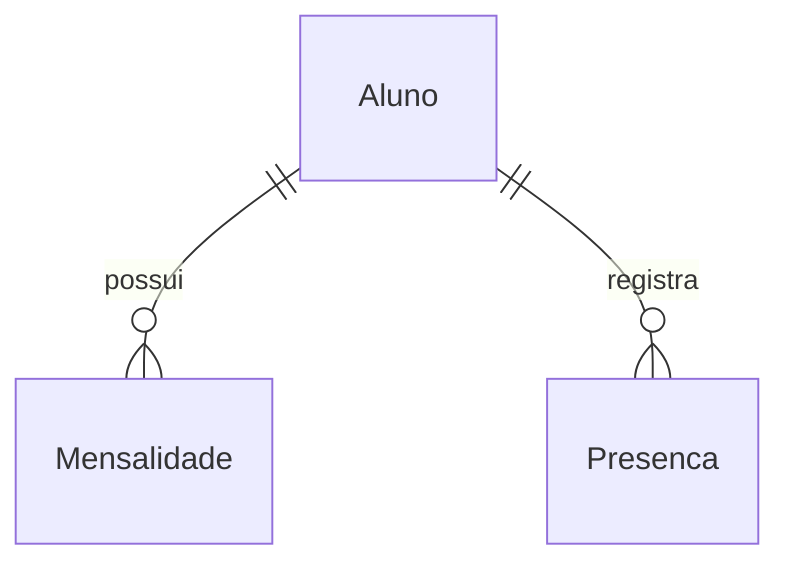

# Arquitetura — Academia de Jiu-Jitsu

## Objetivo
Construir um sistema para cadastrar alunos e controlar mensalidades.

## Dados principais
- Aluno: guarda as informações cadastrais de uma pessoa.
- Mensalidade: guarda uma cobrança, com valor, vencimento e situação.
- Um aluno pode ter zero ou várias mensalidades.
- Cada mensalidade pertence a um único aluno.

## Identificação dos registros
- O id do aluno identifica seu cadastro e é sua chave primária.
- O id da mensalidade identifica a cobrança e é sua chave primária.
- O alunoId da mensalidade aponta para o id do aluno e é uma chave estrangeira.

## Campos de Aluno — rascunho
- id: identificador único do cadastro.
- nome: nome do aluno.
- telefone: contato telefônico do aluno.
- email: endereço de e-mail do aluno.
- dataNascimento: data em que o aluno nasceu.
- faixa: faixa atual do aluno, como branca ou azul.
- dataMatricula: data em que o aluno entrou na academia.
- situacao: indica se o aluno está ativo ou inativo.

## MVP e decisões de implementação — 09/10/2026

O usuário alterou a dinâmica da mentoria: priorizar um MVP executável e validar as telas antes das explicações. O histórico acima registra a modelagem feita pelo aluno.

### Componentes

React + TypeScript + Tailwind (apps/web) → API Express + TypeScript (apps/api) → repositório SQL.
O backend consulta FastAPI + Pandas (services/analytics) para métricas determinísticas. Somente essas métricas e nomes necessários são enviados ao modelo de IA pela API Node. Credenciais ficam no backend.

- Supabase/PostgreSQL + Prisma 7: caminho configurável com DATABASE_URL; migrations versionadas.
- SQLite nativo do Node 24: banco real persistido em data/academia.sqlite para validar o MVP sem credenciais externas. Não atende sozinho a entrega final em PostgreSQL. A tela identifica o banco utilizado.
- O repositório possui o mesmo contrato nos dois bancos. Nenhuma conexão com o Supabase é presumida ou simulada.
- UUID identifica registros. Datas de calendário usam YYYY-MM-DD, sem conversão de fuso; a data atual é calculada em America/Sao_Paulo.
- Valores monetários são inteiros em centavos, evitando arredondamentos de ponto flutuante.

### Mensalidade

id, alunoId (FK), competencia (YYYY-MM), valorCentavos, dataVencimento, dataPagamento (opcional), criadoEm. Uma cobrança por aluno/competência no MVP.
O status é calculado: com pagamento = pago; sem pagamento e vencimento anterior a hoje = atrasado; demais = pendente. Vencer hoje ainda não significa atraso. Não persistimos o status, pois ele muda com o calendário.

### Presença e análises

Presenca: id, alunoId, dataTreino, tipoTreino e presente. Há um registro por aluno/data/tipo; editar permite corrigir a chamada.
Analise: pergunta, resposta real da IA, usuário local, modelo, data e snapshot das métricas. O MVP local tem um administrador; autenticação e perfis são uma evolução antes de qualquer publicação com dados reais.

### Regras e erros

A API valida todos os payloads com Zod, rejeita datas inexistentes/futuras quando inadequadas, relacionamentos inválidos, e-mails e cobranças duplicados. Alunos com cobranças não podem ser excluídos: devem ser inativados para preservar o histórico. HTTP 400 = entrada inválida; 404 = inexistente; 409 = conflito; 503 = integração indisponível. Mensagens da interface vêm da API. Consultas SQLite parametrizadas e Prisma evitam SQL concatenado.

### Dashboard e analytics

Receita do mês usa dataPagamento. Valor a receber usa vencimentos no mês sem pagamento; parcelas pendentes e atrasadas permanecem distinguíveis. Risco: atraso +30, pelo menos 14 dias sem presença +30, queda acima de 50% +40. Baixo 0–30, médio 31–60, alto 61–100. A frequência do mês corrente é comparada com os mesmos dias do mês anterior, evitando comparar um mês parcial com um completo.

### Revisão arquitetural antes da implementação

Codex revisou o rascunho e adotou: status derivado, centavos inteiros, restrição de exclusão financeira, períodos comparáveis e identificação explícita das integrações. Rejeitada a necessidade de XAMPP: a stack é Node/PostgreSQL. DBeaver é opcional. Não há resposta simulada apresentada como IA.
