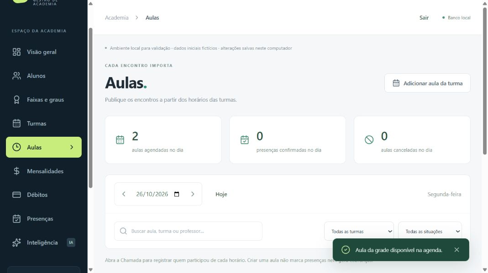
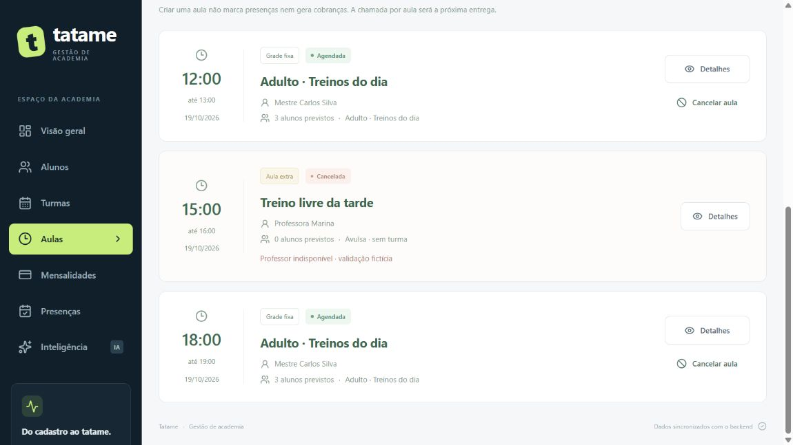
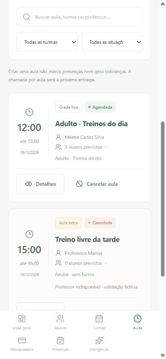
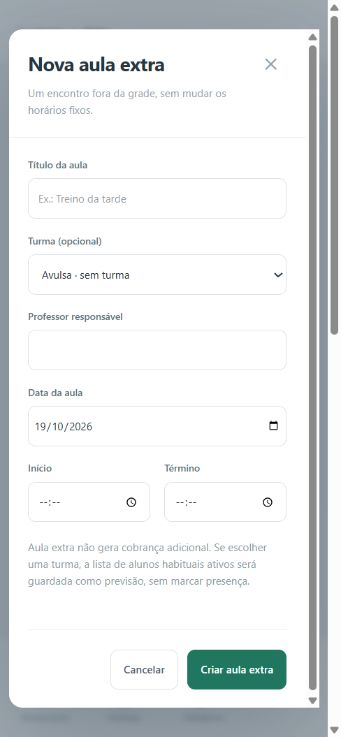
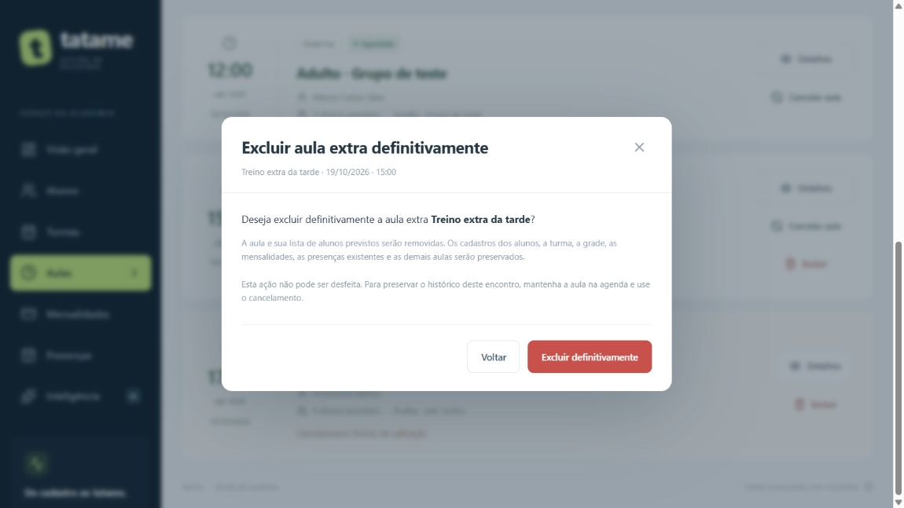
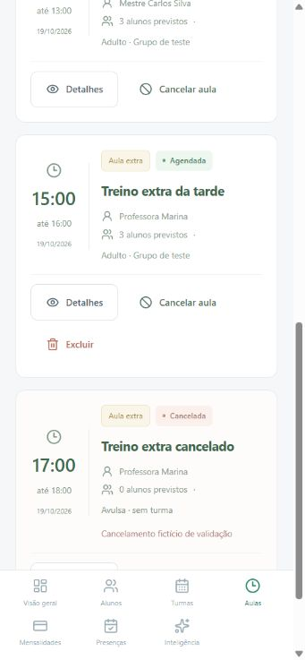

# Aulas datadas — entrega 1B

## Nome de um encontro — 26/10/2026

Em **Aulas → lápis ao lado do nome no cartão**, informe o nome e clique em **Salvar nome**. **Voltar** descarta o rascunho. Permitido ao administrador, inclusive para corrigir aula cancelada ou registro anterior. Nome obrigatório, espaços externos removidos, entre 2 e 120 caracteres.

`PATCH /api/aulas/:id/nome` aceita somente `{ "titulo": "Fundamentos de guarda" }`. Atualiza apenas Aula.titulo, sem migração. O nome da turma e sua grade continuam iguais; publicar novas datas continua usando o nome da turma. Republicar um encontro existente mantém o nome editado. Chamadas, check-ins, cotas, datas e valores não são recalculados. O título guardado no débito permanece como estava na contratação, preservando o registro financeiro.

Analogia para estudar: turma é o modelo da agenda; aula é um compromisso específico. Renomear o compromisso das 15h não muda o modelo nem o compromisso das 12h.

Validação: 210 testes TypeScript e build/typecheck aprovados, incluindo permissões, entradas inválidas, outras aulas, chamada/check-in/débito, cancelamento e republicação. Navegador com dados fictícios confirmou salvar, cancelar rascunho e manter o outro encontro. Sem nova prova PostgreSQL deste incremento; utiliza a atualização parcial do repositório existente. Ainda aguardando validação do usuário para commit/envio.

## Fluxo atual: aulas publicadas pelas turmas — 26/10/2026

**Criação e exclusão de aulas avulsas retiradas a pedido do usuário.** Em Turmas, configure os dias e intervalos, usando Incluir mais horários quando necessário. Uma turma coringa pode reunir 12h, 15h e 18h. Em **Aulas → Adicionar aula da turma**, escolha o horário e publique o encontro na data correspondente.

ExtraForm, botão Aula extra, filtro de avulsas, exclusão e funções específicas foram retirados. POST /api/aulas/extras e DELETE /api/aulas/:id retornam 404. A origem extra continua legível somente para conservar registros anteriores; não houve exclusão ou conversão de aulas, presenças, check-ins ou débitos existentes. Consulta, chamada, cancelamento e utilização de avisos/reservas já existentes permanecem compatíveis. O rótulo desses encontros é Registro anterior.

O usuário confirmou **manter cobrança de aula adicional ao esgotar o plano**. Novas reservas pagas exigem uma aula publicada a partir de turma. Uma reserva antiga de avulsa já confirmada continua idempotente e utilizável, evitando perda de crédito/histórico. Isso não reativa a criação de aulas avulsas. Liberações de participação do plano continuam distintas da origem da aula.

Verificação: suíte completa de 206 testes TypeScript, 15 Python e build/typecheck aprovados; provas de retirada dos endpoints, publicação coringa, preservação do legado e adicionais. Navegador em memória publicou 15h a partir da turma e confirmou ausência dos botões de avulsas/exclusão. Supabase sintético publicou os três horários, validou rotas removidas e foi limpo com hashes das 22 tabelas iguais ao início. Detalhes do catálogo em [GRADUACOES.md](GRADUACOES.md). Registros de entregas anteriores abaixo são históricos e devem ser lidos à luz deste fluxo atual.

**Planos — incremento local em 22/10/2026:** autorização extra nominal também impede excluir definitivamente uma aula, mesmo antes do check-in; pode revogar a autorização ainda não usada ou cancelar quando permitido. A liberação não cria cobrança nem presença. A chamada continua registrando participação real; o limite comercial atua nos novos check-ins. Guia e validação: [PLANOS.md](PLANOS.md). Entrega aprovada para commit/envio após nova execução automatizada bem-sucedida.

**Evolução em 22/10/2026:** área administrativa protegida por login; aluno possui portal próprio para consulta e check-in no dia da aula. A agenda mostra avisos pendentes e a chamada permite confirmá-los. Extra com check-in não pode ser excluída; o cancelamento preserva os avisos se ainda não houver chamada. As referências abaixo a ausência de login descrevem a entrega original. Guia: [ACESSO_ALUNO.md](ACESSO_ALUNO.md). Novo conjunto local aguarda validação antes de commit/push.

Implementada e testada localmente em 19/10/2026, após o usuário responder “bora” à proposta de agenda. O conjunto, incluindo a exclusão de extras, foi aprovado para commit/envio com “pode commitar” em 20/10/2026, na branch `codex/reestruturacao`. Essa aprovação não atribui ao usuário testes manuais que ele não relatou. Não foi criada tag/release nem alterado o número de versão do produto. A versão 3 mencionada na migração é da estrutura SQLite.

**Atualização 1C — 21/10/2026:** cada aula agora possui botão **Chamada**, também acessível em Presenças. Permite vários horários por aluno/dia, inclusão pontual, correção e limpeza. **Aula com qualquer marcação não pode ser cancelada ou excluída.** O bloqueio está na API e no repositório, além dos botões desabilitados. Os previstos e registros antigos são preservados. As referências abaixo a chamada futura e exclusão sem esse bloqueio registram a entrega 1B. Guia atual: [CHAMADA.md](CHAMADA.md); esta nova entrega aguarda validação antes de commit/push.

## Entenda com uma agenda de papel

**Turma** é o grupo. **Grade** é sua programação semanal. **Aula** é uma página da agenda: tem data, horário e professor próprios. A turma pode treinar toda segunda às 12h, mas a aula de 19/10 é um registro diferente da aula de 26/10.

Ao criar a aula, copiamos os dados daquele momento. Se o professor ou a grade mudar amanhã, não reescrevemos o encontro que já estava salvo. Excluir a turma também não apaga suas aulas: o vínculo fica vazio e os nomes históricos permanecem.

## Como usar e validar

1. Em **Turmas**, crie uma turma ativa, professor, horários e alunos habituais. Ela pode ter 12h–13h e 18h–19h na mesma segunda-feira.
2. Entre em **Aulas** e escolha a segunda-feira desejada, inclusive futura. **Da grade fixa** mostra os horários ativos compatíveis com esse dia. Crie cada encontro desejado. O sistema não gera um calendário inteiro sozinho.
3. Para um encontro às 15h, inclua 15h–16h na turma (marcando Incluir mais horários, se necessário) e publique esse horário em Adicionar aula da turma. A criação avulsa foi retirada.
4. Confira os três encontros ordenados por início. Busque título/turma/professor, filtre por turma/situação e navegue pelos dias. Os três contadores resumem o dia completo, antes dos filtros.
5. Abra **Detalhes**. Alunos previstos são os habituais ativos no momento da criação; a lista não marca presença ou falta, não é reserva e não limita quem poderá participar.
6. Clique em **Cancelar aula**, leia a explicação e informe o motivo. **Voltar** não altera a aula. Confirmar mantém a aula cancelada na agenda e conserva seus dados. O primeiro motivo/data de cancelamento é mantido mesmo se a requisição for repetida.
7. Nas **aulas extras**, agendadas ou canceladas, **Excluir** aparece no cartão e nos detalhes. A confirmação explica a remoção definitiva da aula e dos previstos; cadastros dos alunos, turma, grade, mensalidades, presenças existentes e outras aulas são preservados. **Voltar** não exclui. Para manter o histórico, conserve o encontro cancelado. Recriar uma extra gera novo identificador.
8. Reinicie a aplicação e confira a persistência. Para corrigir um encontro errado nesta entrega, cancele e crie uma nova aula extra. Não há edição ou reativação de aula. Aulas da grade fixa não podem ser excluídas, inclusive pela API.

Turmas/aulas começam vazias na instalação real. As turmas e encontros das capturas abaixo pertencem ao processo de teste com banco em memória, sem gravação na base do usuário.

## Regras e escolhas

- Horários HH:mm, com término depois do início no mesmo dia; datas válidas a partir de 1900 e datas futuras permitidas. Referência dos horários: America/Sao_Paulo. Não há conversão automática entre fusos de academias.
- Criar da grade exige turma ativa, horário existente e data compatível. Repetir a combinação do mesmo identificador de horário e data retorna a aula existente. A unicidade no banco também protege requisições simultâneas. Aula cancelada não é recriada/reativada por repetição.
- Um horário removido da grade deixa de poder gerar novas datas. O identificador de origem continua no histórico para permitir reconhecer uma requisição repetida de uma aula já existente. Não há FK para HorarioTurma porque a edição da grade substitui suas linhas.
- Extras não exigem grade e podem ser avulsas. Extra de agenda não significa adicional financeiro. Não é aplicada restrição global de sobreposição de professores/locais; ainda não há esses cadastros estruturados.
- Aula guarda título, professor, horários e nome da turma. `AulaAlunoPrevisto` guarda nomes e referências aos habituais ativos. Gravar aula e previstos usa uma transação: falha numa parte desfaz tudo.
- A FK da turma e a do aluno previsto usam SET NULL: excluir o cadastro remove a referência, preservando a aula e os nomes históricos. As proteções anteriores contra exclusão de aluno com cobranças/vínculos habituais continuam. A previsão não acrescenta um bloqueio de exclusão de aluno.
- “Agendada” é uma situação de agenda, inclusive após a data passar; não prova que a aula foi realizada. Cancelar não gera faltas. Aulas não entram nos cálculos Python ou na IA como treinos realizados.
- Exclusão definitiva de extras foi acrescentada após o pedido do usuário durante a validação. `removeAulaExtra` confere a origem e remove previstos/aula numa transação SQLite/Prisma; se falhar, desfaz o conjunto. O repositório também protege aulas da grade, sem remover seus previstos. Não foi necessária outra migração. Antes de implementar presença por aula na parte 1C, rever a exclusão de encontros com presenças vinculadas; o modelo atual ainda não possui esse vínculo.

## Arquivos e contratos

| Arquivos | Papel |
| --- | --- |
| `packages/shared/src/index.ts` | Contratos Aula, AulaView, AulaAlunoPrevisto e entradas de grade/extra |
| `apps/api/src/modules/aulas/schema.ts` | Valida datas, horários, entradas, filtros e motivo |
| `apps/api/src/modules/aulas/service.ts` | Regras, fotografia dos dados, repetição e consultas |
| `apps/api/src/modules/aulas/routes.ts` | Recebe HTTP e devolve respostas |
| `apps/api/src/repository.ts` | Criação transacional e cancelamento condicional nos dois bancos |
| `apps/api/src/database/sqlite/migrations/003_aulas.sql` | Acrescenta duas tabelas sem reescrever as sete anteriores |
| `prisma/schema.prisma` e `prisma/migrations/202610190002_aulas/` | Modelos e migração equivalente PostgreSQL, sem validação externa comprovada |
| `apps/web/src/pages/AulasPage.tsx` | Agenda, filtros, grade, extras, detalhes e cancelamento |
| `apps/web/src/App.tsx`, `data.ts` e `load-data.ts` | Navegação e consultas independentes |
| `apps/api/src/aulas.test.ts`, `sqlite-migrations.test.ts`, `apps/web/src/load-data.test.ts` | Regras HTTP/SQL, preservação, persistência e falha isolada |

| Método/rota | Entrada e resultado |
| --- | --- |
| GET `/api/aulas` | Lista cronológica; filtros opcionais dataInicio, dataFim, turmaId e situacao |
| GET `/api/aulas/:id` | Aula com alunosPrevistos |
| POST `/api/aulas/da-grade` | horarioId/dataAula; 201 se criada, 200 se já existente |
| POST `/api/aulas/extras` | Removido em 26/10/2026; retorna 404. |
| PATCH `/api/aulas/:id/cancelamento` | motivo de 3 a 300 caracteres; 200, mantendo primeiro cancelamento |
| DELETE `/api/aulas/:id` | Removido em 26/10/2026; retorna 404. Use cancelamento quando permitido. |

Entradas estritas: campos extras são rejeitados. Datas/regras inválidas geram 400; referências inexistentes e ID de aula inválido geram 404. Excluir novamente uma extra já removida retorna 404. Listagens ainda carregam o conjunto e filtram na interface; paginação/consulta por janela deve ser revista quando o volume crescer.

## Verificações realizadas nesta entrega

- **65 testes TypeScript aprovados, zero falhas:** 44 anteriores, 19 de aulas, um da migração v2→v3 e um de carregamento isolado. Incluem grade 12h/18h + extra 15h, datas inválidas/futuras, turma inativa, alunos previstos, edição/exclusão de cadastros sem perder histórico, concorrência na criação/cancelamento/exclusão e rollback. Um teste força falha após a exclusão da turma e confere que até os vínculos históricos são restaurados. Os quatro testes do incremento cobrem extras avulsas/vinculadas e agendadas/canceladas, proteção de aulas fixas, preservação dos outros registros, recriação, rollback e exclusões concorrentes.
- **12 testes Python aprovados em nova execução**, sem mudança de fórmulas. **Build/typecheck, Prisma generate e validate aprovados.** O build foi repetido após ajustes de texto da interface.
- Uma execução no ambiente restrito bloqueou as conexões locais HTTP com EACCES. Foi repetida com acesso local autorizado e passou. O bloqueio não foi apresentado como sucesso nem corrigido alterando regras da aplicação.
- **Navegador em memória:** criadas duas aulas fixas e uma extra avulsa; erro de término antes do início conferido e corrigido no formulário; busca por professor, filtro avulsa/cancelada, detalhes dos previstos, mudança de dia/Hoje, retorno sem cancelar e cancelamento com motivo. A grade já criada passou a mostrar “Ver na agenda”. Os horários foram preenchidos com eventos de teclado para contornar a limitação observada da automação dos campos de hora.
- **Responsividade:** viewport solicitado 390×844; largura CSS observada 355, documento 341/341 (client/scroll), cartões 304/304, navegação 341/341 e diálogo 309/309. Sem transbordamento horizontal. Os sete destinos da navegação móvel ficam em duas linhas; não é teste em aparelho físico. Override removido após a conferência.
- **Base local v2→v3:** backup anterior criado. Mesmas contagens e hashes nas sete tabelas anteriores: 20 alunos, 110 mensalidades, 432 presenças, zero análises, turmas, horários e vínculos. Novas tabelas vazias; foreign_key_check sem inconsistências. Os zeros de turmas são o estado observado antes desta migração; não houve exclusão feita por esta entrega na base do usuário.
- **Serviços reais locais:** nove rotas da API e a interface responderam 200; Python disponível, IA sem chave. Não houve execução de migração ou operações em PostgreSQL/Supabase nem chamada de IA externa. Gerar cliente e validar schema não comprovam essas integrações.

Após adicionar a exclusão, `npm test` e build/typecheck foram reexecutados e passaram. Os 12 testes Python acima são da execução anterior da entrega 1B; não foram repetidos neste incremento porque o Python não mudou. No navegador isolado foram conferidos botões de extras agendadas/canceladas, detalhes, confirmação e **Voltar** preservando os três encontros. A remoção efetiva foi exercitada nos testes HTTP/SQL, sem confirmar exclusões pelo navegador ou na base do usuário.

Na conferência estreita do incremento, documento 341/341 px, cartões 304/304 e ações 270/270 (client/scroll), diálogo 323/323: sem transbordamento horizontal e botão Excluir com quebra de linha quando necessário. Viewport restaurado. O servidor real foi atualizado preservando contagens/hashes das nove tabelas, incluindo uma aula já existente: 20 alunos, 110 mensalidades, 432 presenças, uma aula e zero nas demais tabelas. Não houve migração adicional nem remoção de dados reais. Seis rotas locais de consulta e a interface responderam 200 após o reinício.

## Próxima entrega e defesa oral

A parte 1C ligará presenças a cada aula, permitindo ao mesmo aluno treinar às 12h, 15h e 18h, inclusive na mesma modalidade. Hoje a chamada antiga continua por data/tipo. Não foram migradas presenças antigas para aulas inventadas. Autenticação, portal, consumo de planos, pagamentos adicionais, modalidades/objetivos finais e confirmação de realização permanecem para suas etapas.

Explicação curta: “A grade descreve a rotina. A aula guarda o encontro de uma data específica e copia os dados necessários para não mudar o passado quando o cadastro mudar. A criação é transacional. Há uma chave única por horário de origem e data, para uma repetição não duplicar a aula. Cancelar mantém o histórico e exige motivo; presença será registrada separadamente.”

Perguntas para estudar: por que a lista de previstos não equivale à presença? Por que usamos SET NULL ao excluir uma turma em vez de apagar suas aulas?

## Confirmados e retirada de check-in — 26/10/2026

O cartão mostra lápis junto ao título; salvar ou cancelar volta à agenda. Não há outro botão de edição nos detalhes. A lista de confirmados considera check-in ainda não marcado como ausência e presença manual do professor, sem duplicar aluno. Check-in é intenção de participar; presença continua dependente da chamada. Alunos previstos deixaram de aparecer no cartão, nos detalhes e na chamada; snapshots anteriores continuam no banco para preservar dados.

Em Detalhes ou Chamada, Remover check-in pede confirmação. DELETE /api/aulas/:id/checkins/:alunoId é administrativo: em transação, registra/atualiza ausência, remove o check-in e sincroniza o saldo mensal. A ausência permite análise do não comparecimento e impede o aluno de simplesmente repetir o check-in na aula já avaliada. O professor pode corrigir a chamada depois. A repetição não devolve crédito duas vezes, e outra aula permanece intacta. Mensalidade, autorização e débito adicional contratado, pago ou pendente, não são cancelados pela remoção. A UI informa isso antes de confirmar. Aula cancelada/futura não permite a operação. Sem migração: usa os registros existentes.

Validação nova: 222 testes TypeScript, build/typecheck e navegador isolado. Cobertura de permissões, repetição/concorrência, rollback, saldo, outra aula e débitos. A UI confirmou edição pelo lápis, retirada do confirmado e ausência na chamada. Implementado nos repositórios SQLite e Prisma/PostgreSQL; sem nova execução externa PostgreSQL deste incremento.

## Vários professores por encontro — 26/10/2026

Em Aulas → Detalhes → Editar professores, adicione/remova nomes e salve. Lista de 1 a 8 nomes, com professor da turma como padrão inicial. Edição afeta só a aula escolhida. Guia e motivos técnicos em [PROFESSORES_AULA.md](PROFESSORES_AULA.md). Novo incremento local, aguardando validação para commit; migração SQLite 11 validada e PostgreSQL preparado sem execução externa.
