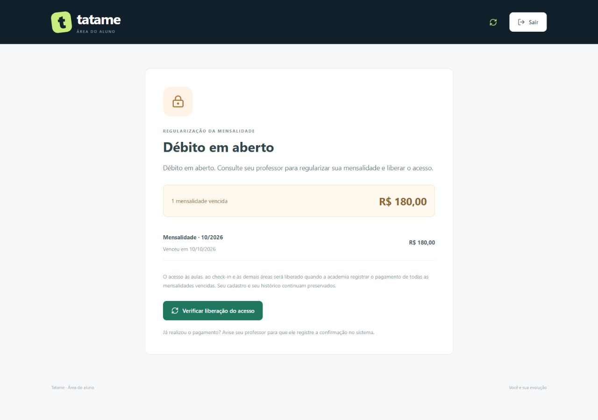
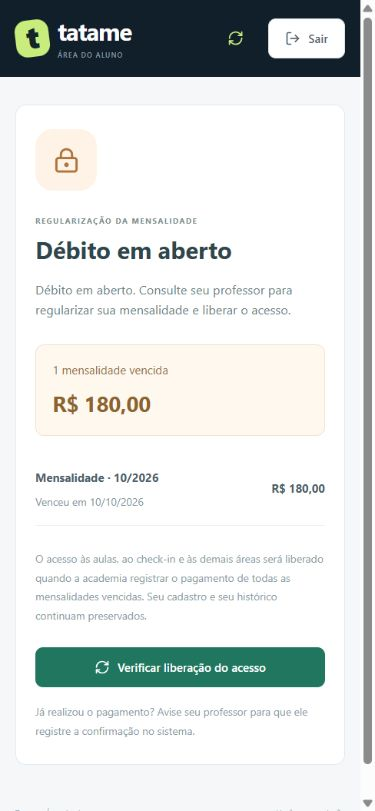

# Bloqueio de acesso por mensalidade vencida

**Estado em 22/10/2026:** conjunto aprovado para commit/envio após nova execução bem-sucedida de 121 testes TypeScript, 13 Python, build/typecheck e validação Prisma. Essa autorização supera as pendências históricas abaixo. Registro em [PROCESSO.md](PROCESSO.md).

Incremento solicitado em 22/10/2026, implementado/testado localmente. Aguarda validação do usuário antes de commit/push. O envio de e-mails e a confirmação automática de pagamento por integração externa continuam para etapa posterior.

## Regra para usar

- Vencimento no dia 10: o aluno acessa normalmente até o fim do dia 10. A partir do dia 11 em São Paulo, uma cobrança não paga restringe o portal.
- O aluno consegue se identificar, mas vê somente **Débito em aberto**, as próprias mensalidades vencidas, seus valores/vencimentos e a orientação para procurar o professor. Aulas, check-in, perfil e histórico não são liberados nessa tela.
- Mensagem: **“Débito em aberto. Consulte seu professor para regularizar sua mensalidade e liberar o acesso.”**
- A gestão continua acessível ao administrador. Em **Mensalidades → Registrar pagamento**, confirme a data correta. Quitar todos os vencidos libera o aluno na próxima consulta, sem nova senha ou novo login.
- O aluno pode usar **Verificar liberação do acesso**. A atualização periódica também verifica a situação quando a página está visível. O botão consulta o servidor; ele não registra ou confirma um pagamento.
- Se ainda existir outra mensalidade vencida, o bloqueio permanece. Pagas, com vencimento hoje, futuras ou pertencentes a outra pessoa não bloqueiam.
- Se o responsável editar uma cobrança vencida e remover a data de pagamento, ela volta a ficar em aberto e o portal será novamente restringido.

O bloqueio depende de uma cobrança realmente cadastrada, com vencimento e sem pagamento. Não cria mensalidades automaticamente a partir de uma promessa verbal ou da data de matrícula. Não gera multa, juros, cobrança adicional ou mensagem externa.

## Por que foi feito assim

O sistema já tem data de vencimento e data de pagamento. Calcular o acesso com esses dados evita guardar uma flag de bloqueio que poderia ficar desatualizada quando um pagamento fosse corrigido. Não depende de tarefa noturna, cron ou API de e-mail/banco. O cadastro continua ativo e o histórico permanece guardado: restrição financeira não é exclusão nem inativação cadastral.

Login significa identificar a pessoa, por isso continua disponível para mostrar uma orientação privada e permitir sair da conta. GET /api/portal responde 200 com o estado restrito, pois a sessão é válida; não entrega os demais dados. PUT do check-in responde 403 enquanto houver débito. A verificação ocorre também dentro da transação SQLite/Prisma: ter aberto a agenda antes do atraso não autoriza gravar um check-in depois.

O responsável ainda pode registrar chamada administrativa. A restrição protege o acesso do aluno ao sistema; não decide automaticamente a ocorrência de um treino, não apaga presenças anteriores e não impede o responsável de corrigir o histórico.

## Arquivos e contrato

| Arquivo | Responsabilidade |
| --- | --- |
| apps/api/src/modules/auth/financial-access.ts | Deriva pendências pelo mesmo status de cobrança já usado no sistema; restringe aos dados do próprio aluno |
| apps/api/src/modules/auth/portal.ts | Devolve somente o estado restrito quando há vencidos, antes de consultar aulas/histórico |
| apps/api/src/repository.ts | Revalida o financeiro dentro da transação de check-in nos dois repositórios |
| packages/shared/src/index.ts | RespostaPortalAluno distingue PortalAluno com bloqueado=false de BloqueioAluno com bloqueado=true |
| apps/web/src/pages/StudentPortal.tsx | Substitui o conteúdo pela tela de débito; recarrega após check-in recusado e descarta conteúdo anterior se a consulta falhar |
| apps/web/src/components/BloqueioFinanceiro.tsx | Mensagem, vencimentos, total e botão de consulta da liberação |
| apps/api/src/bloqueio-financeiro.test.ts e auth.test.ts | Datas-limite, privacidade, restrição por HTTP, pagamentos, liberação e preservação |

Resposta restrita: bloqueado=true, mensagem e pendencias. Cada pendência contém somente id, competencia, valorCentavos e dataVencimento. Não inclui cadastro, lista de aulas, histórico ou cobranças de colegas. Resposta normal continua com dados próprios e bloqueado=false.

Sem alteração de schema: nenhuma migração nova e nenhuma mudança nas migrações já aplicadas. Prisma passa a consultar mensalidades do aluno dentro da transação existente; essa implementação equivalente ainda não foi executada em PostgreSQL externo.

## Verificação desta entrega

Em 22/10: **121 testes TypeScript aprovados, zero falhas**, e build/typecheck aprovados. Nove casos novos: quatro do helper e cinco de integração HTTP. Foram conferidos vencimento hoje, dia seguinte, meses anteriores, dívida alheia, pagamento parcial do conjunto de débitos, liberação da mesma sessão, reversão pela edição existente e preservação de senha/cadastro/chamada/check-in.

No navegador, com base isolada em memória e aluna fictícia: aviso de mensalidade vencida em 10/10, ausência das áreas normais, responsividade e liberação após pagamento fictício registrado via API administrativa. A mesma sessão voltou à agenda e conseguiu fazer check-in. Documento estreito: 375/375 px e cartão 342/342 px, sem transbordamento (client/scroll). Viewport restaurado; não é teste em aparelho físico. Os 13 testes Python passaram antes deste incremento; não foram reexecutados porque esta mudança não altera os cálculos ou o serviço Python.

## Integração futura pedida pelo usuário

Fica para a etapa final reconhecer pagamento sem lançamento manual, consultando/recebendo confirmação de um serviço de pagamentos. O aviso destacado **paga**, **a vencer** ou **vencida** ficará na área identificada do aluno, próximo ao início da jornada e ao check-in. A antecedência de “a vencer” e o período da cobrança de referência ainda precisam ser definidos. Isso é diferente da integração de e-mail.

Já existe consulta de status em Mensalidades e agora o bloqueio derivado dos registros locais. Ainda não existem sincronização bancária, PIX/boleto integrado, webhook de pagamento ou esse novo banner destacado. Antes da integração, será necessário definir provedor, identificação da cobrança, confirmação verificável, tratamento de eventos repetidos e estornos. A tela nunca deverá marcar uma cobrança como paga somente porque o aluno declarou pagamento.

## Para sua defesa oral

“Eu calculo o acesso a partir das mensalidades cadastradas. Se a cobrança venceu ontem e não tem pagamento, o portal mostra a restrição. Quando a academia confirma todos os vencidos, a próxima consulta libera o acesso. A regra está no servidor e na gravação do check-in, não apenas no botão.”

Perguntas: por que não bloquear uma mensalidade que vence hoje? Por que o sistema precisa conferir o débito novamente quando recebe o check-in?
