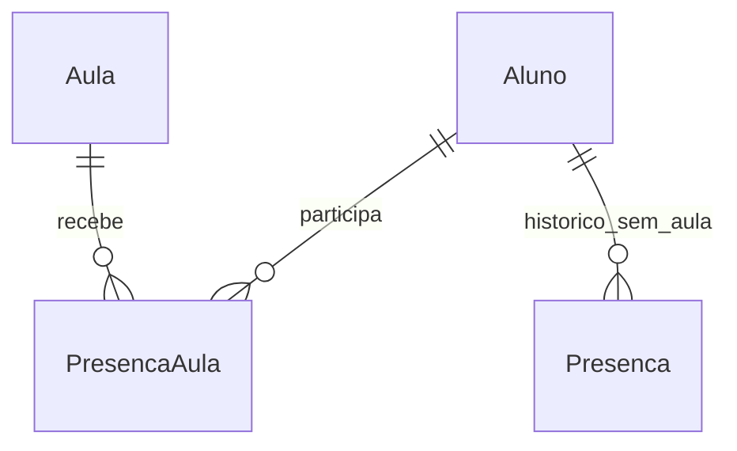
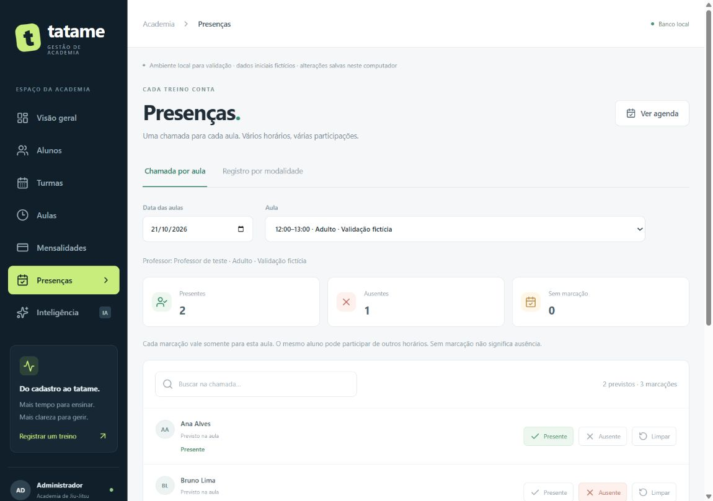
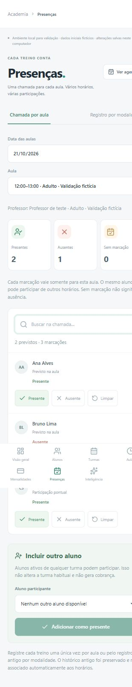

# Chamada por aula — entrega 1C

**Estado em 22/10/2026:** conjunto aprovado para commit/envio após nova execução bem-sucedida de 121 testes TypeScript, 13 Python, build/typecheck e validação Prisma. Essa autorização supera as pendências históricas abaixo. Registro em [PROCESSO.md](PROCESSO.md).

**Evolução em 22/10:** login/área do aluno acrescentam CheckinAula e levam o schema a 5. O aviso do aluno aparece na chamada, inclusive para participante de outra turma, com “Check-in · aguardando validação”. O administrador confirma presente/ausente; o check-in sozinho não entra nos indicadores. Ao limpar uma marcação, o aluno com check-in continua como pendente; sem check-in nem previsão, sai da lista. Extra com check-in fica protegida contra exclusão; cancelar preserva avisos quando não há chamada. As descrições abaixo do fluxo sem login são históricas. Guia atual: [ACESSO_ALUNO.md](ACESSO_ALUNO.md).

Implementada e testada localmente em 21/10/2026, após o usuário autorizar começar as melhorias discutidas. Branch de trabalho: `codex/evolucao-tatame`, base `1778e67`. O conjunto aguarda validação do usuário antes de commit/push. Produto permanece 1.0.0 nos manifests; schema SQLite passa de 3 para 4. A tag v1.0.0 não foi alterada.

## O que mudou para quem usa

1. Em **Aulas**, crie um encontro da grade ou uma aula extra, ou escolha um já cadastrado. Clique em **Chamada** no cartão ou nos detalhes.
2. Confira data e horário. Os previstos começam **sem marcação**. Marque **Presente** ou **Ausente** individualmente; cada ação é salva na API.
3. Em **Incluir outro aluno**, selecione um aluno ativo e clique em **Adicionar como presente**. Não altera sua turma habitual nem gera cobrança.
4. Para corrigir, escolha a outra situação. **Limpar** abre uma confirmação: o previsto volta a ficar sem marcação e o participante pontual sai da lista. **Voltar** conserva o registro.
5. A mesma chamada também está em **Presenças → Chamada por aula**, com data e seletor de aula. Busca filtra os nomes visíveis; os totais continuam sendo da aula completa.

Exemplo: Ana participa às 12h, 15h e 18h no mesmo dia. São três registros diferentes, um por aula. Clicar novamente na presença da aula das 12h atualiza aquele registro, sem criar uma quarta participação. Nome igual não identifica aluno: a chave usa os identificadores da aula e do cadastro.

Sem marcação não é ausência. Não é necessário registrar falta de todo aluno da academia ou de quem não estava previsto. A lista histórica de previstos não impede receber participantes de outras turmas. Cadastro excluído que só existia nessa previsão mantém seu nome histórico, mas não pode receber nova marcação.

## Proteções e limites

- A chamada só é liberada na data da aula ou depois, em America/Sao_Paulo. Não há bloqueio pelo minuto de início nem comprovação automática de realização.
- Aula cancelada não recebe marcação ou limpeza. Aluno inexistente ou treino anterior à matrícula são rejeitados. Nova marcação exige aluno ativo; marcação já existente pode ser corrigida após inativação e pode ser limpa.
- Qualquer marcação, presente ou ausente, impede cancelar ou excluir a aula. Para corrigir uma aula cadastrada errada, primeiro confira e limpe suas marcações incorretas. A grade fixa continua sem exclusão definitiva.
- Aluno com chamada por aula não pode ser excluído; inativar conserva o histórico. Excluir turma preserva aula, chamada e nomes históricos.
- Não há autenticação/permissão por professor ainda. Este é o fluxo administrativo local. Nome do professor não é conta autenticada.
- Não há reserva, plano limitado, fechamento automático de chamada, cobrança extra, QR Code ou modalidade estruturada própria por aula neste incremento. Título e horários identificam o encontro.
- Limpar apaga a marcação selecionada e altera os indicadores. Há confirmação, mas não há lixeira ou auditoria completa de todas as edições. `criadoEm`/`atualizadoEm` não substituem um log de ações por usuário.

## Por que o histórico antigo continua separado

A tabela `Presenca` guarda aluno, data, modalidade e presente/ausente. Ela não informa qual aula ou horário ocorreu. Associar esses registros automaticamente às novas aulas seria adivinhar o passado.

Por isso, a migração cria `PresencaAula` sem modificar os registros antigos. Pense em guardar as fichas antigas e começar uma nova ficha com o número exato de cada aula. A aba **Registro por modalidade** continua disponível para consultar e corrigir esse formato anterior.

**Registre cada treino uma única vez:** na chamada por aula ou no formato anterior. O sistema soma as duas fontes nos indicadores e não consegue descobrir se uma marcação antiga e uma nova descrevem o mesmo evento. Não deduplicar por data é necessário para permitir vários treinos reais no dia. Reconciliar registros entre os formatos exige uma decisão explícita futura, não uma associação presumida nesta migração.

## Modelo de dados e responsabilidade dos arquivos

`PresencaAula`: id, aulaId, alunoId, nome histórico, presente booleano, criadoEm e atualizadoEm. Unicidade por aulaId/alunoId; FKs RESTRICT para Aula e Aluno. A data vem da aula, evitando armazenar duas datas que poderiam divergir. O nome é copiado na primeira marcação e mantido em correções.

| Arquivo/área | Responsabilidade |
| --- | --- |
| `packages/shared/src/index.ts` | Tipo PresencaAula; AulaView passa a conter chamada |
| `apps/api/src/modules/chamada/service.ts` | Validação estrita do corpo e identificadores das novas rotas |
| `apps/api/src/modules/chamada/rules.ts` | Regras de data, situação do aluno e proteção do histórico |
| `apps/api/src/modules/aulas/` | Expõe marcação/limpeza e inclui chamada nas consultas de aula |
| `apps/api/src/repository.ts` | Transações, unicidade, atualização individual e bloqueios concorrentes |
| `apps/api/src/database/sqlite/migrations/004_chamada.sql` | Acrescenta tabela/índice; não altera SQL já aplicado |
| `prisma/schema.prisma`, `prisma/migrations/202610210001_chamada/` | Modelo e migração PostgreSQL equivalentes, ainda sem execução externa |
| `apps/api/src/modules/analytics/service.ts` | Projeta registros antigos e por aula no contrato do Python |
| `apps/web/src/components/ChamadaAula.tsx` | Componente compartilhado pela agenda e pela página de presenças |
| `apps/web/src/pages/AulasPage.tsx`, `AttendancePage.tsx`, `App.tsx`, `styles.css` | Entradas, seleção, estados de erro, avisos e adaptação para celular |
| `apps/api/src/chamada.test.ts`, `analytics.test.ts`, `sqlite-migrations.test.ts`, `services/analytics/test_analytics.py` | Verifica regras, integração, preservação e contagem de vários treinos |

## Contratos HTTP

| Método/rota | Resultado |
| --- | --- |
| GET `/api/aulas` e `/api/aulas/:id` | Incluem `chamada` com os registros explícitos; criação devolve lista vazia |
| PUT `/api/aulas/:id/chamada/:alunoId` | Corpo estrito `{ "presente": true }` ou false. 201 na primeira marcação; 200 nas correções/repetições |
| DELETE `/api/aulas/:id/chamada/:alunoId` | Limpa somente essa marcação; 204, ou 404 se não existe |
| PATCH `/api/aulas/:id/cancelamento` | Agora retorna 409 se há chamada |
| DELETE `/api/aulas/:id` | Continua somente para extras; agora retorna 409 se há chamada |

400: corpo/data inválidos; 404: aula, aluno ou marcação inexistentes; 409: aula cancelada, aluno inativo para nova marcação ou histórico protegido. A API antiga `/api/presencas` continua atendendo somente registros sem aula vinculada.

No SQLite, validações e gravação/remoção acontecem em `BEGIN IMMEDIATE`, sem awaits intercalados. No Prisma, a transação bloqueia a linha da aula com `SELECT ... FOR UPDATE`; marcar, limpar, cancelar e excluir passam por esse mesmo bloqueio. Marcação também bloqueia o aluno antes de conferir o estado. Isso evita presença concorrente em aula cancelada/excluída. O caminho Prisma foi gerado e validado estaticamente, sem afirmar teste real de concorrência PostgreSQL.

## Indicadores e evidências de validação

O Node reúne os dois formatos e envia ao Python apenas alunoId, dataTreino e presente de cada marcação. Uma participação por aula é um treino; duas aulas no dia são dois treinos. O Python desconsidera ausências. A fórmula de risco e as regras financeiras não foram alteradas.

- **81 testes TypeScript aprovados, zero falhas:** 65 anteriores e 16 novos (13 de chamada, um de migração v3→v4 e dois de analytics). Exercitam três horários por aluno, repetição/concorrência, inclusão pontual, ausência explícita, corpo estrito, datas, inativação, limpeza, proteção de aluno/aula, exclusão de turma e rollback em falhas SQL. Na revisão final, foi acrescentado erro 503 controlado quando consultas separadas observam uma chamada cuja aula deixou de aparecer durante uma limpeza/exclusão concorrente; não há descarte silencioso de treinos ou chamada ao Python com esse contexto inconsistente.
- **13 testes Python aprovados:** um cenário adicional confirma vários treinos no mesmo dia, exclusão de ausências e dias sem treinar. Build/typecheck e Prisma generate/validate aprovados. Build repetido após ajustes de interface, sem nova mudança de regras.
- **Navegador com base fictícia em memória:** presença de Ana nas aulas 12h/15h/18h, ausência de Bruno às 12h e Carla incluída pontualmente. Totais independentes; previstos da aula das 18h sem falta automática. Conferidos busca, seleção, acesso pela agenda/Presenças, aviso de aula cancelada/futura e histórico antigo. Limpar abriu confirmação e Voltar manteve o registro; a limpeza efetiva foi testada em HTTP/SQL, sem confirmação de remoção no navegador. Campos nativos de data exigiram eventos reais de teclado na automação para disparar a alteração do React.
- **Integração local Node → FastAPI/Pandas real:** na base fictícia, resultado de cinco presenças (quatro por aula e uma antiga); Ana com quatro treinos no mês, sendo três no mesmo dia e um antigo. Ausência de Bruno não contou. Essa verificação não usou API externa de IA.
- **Responsividade:** viewport solicitado 390×844; medição final do documento client/scroll 355/355, ações de chamada 285/285 px, sem transbordamento horizontal. Conferida também a prévia em 1280×900 (documento 1150/1150 px, três participantes); os dados fictícios foram reconstituídos em memória para essa captura de computador após encerrar o roteiro original. Overrides restaurados. Não equivale a testar em aparelho físico.
- **Base local v3→v4:** backup automático `antes-v4`; nove tabelas com contagens e hashes idênticos antes/depois. Estado observado: 20 alunos, 110 mensalidades, 433 presenças antigas e zero nas outras seis tabelas. PresencaAula vazia, sem vínculos inválidos. Os zeros já existiam antes do reinício; nenhum teste apagou turmas/aulas do usuário. O teste visual não grava nessa base.
- **Serviços atualizados:** oito consultas da API (incluindo analytics e health) e interface responderam HTTP 200.

O primeiro servidor fictício iniciado sob restrição de rede não pôde ser acessado pelo navegador. Foi encerrado e iniciado com acesso local autorizado; isso não exigiu mudar a lógica. Na primeira compilação, TypeScript apontou dois acessos possivelmente indefinidos no repositório; foram corrigidos com validação da variável concreta antes do uso. Não foi usado `any` para silenciar os erros. Nenhum resultado com falha foi apresentado como aprovação.

Não houve execução externa PostgreSQL/Supabase ou IA, teste físico de celular, publicação, nova tag ou mudança na main. Ainda não há CI de navegador. A entrega permanece local para validação.

## Para explicar na chamada oral

“Agora a presença identifica a aula exata. Assim o mesmo aluno pode treinar várias vezes no dia. A chave aula/aluno evita repetição. Preservei os registros antigos porque não havia informação suficiente para descobrir seus horários. Uma marcação exige ação explícita, e a transação impede que outra operação apague ou cancele a aula enquanto a chamada está sendo salva.”

1. **Por que data e modalidade não bastam?** Porque duas aulas podem ter a mesma modalidade no mesmo dia e precisam de chamadas diferentes.
2. **Por que criar uma tabela sem converter as fichas antigas?** Porque elas não informam a aula. A migração preserva dados sem inventar vínculos.
3. **Por que PUT?** A combinação aula/aluno já identifica o recurso: repetir a mesma marcação mantém um registro; pode atualizar sua situação e timestamp.
4. **Por que ausência não nasce automaticamente?** Estar previsto é uma expectativa; marcar ausência é uma decisão explícita do responsável.
5. **O que a transação resolve?** Verificações e gravação precisam ser coerentes mesmo se houver cancelamento, exclusão ou duas marcações simultâneas.
6. **Você escreveu tudo manualmente?** Não. Codex implementou e testou; o usuário definiu a rotina e validará a entrega. Os prompts, decisões e correções estão documentados.
