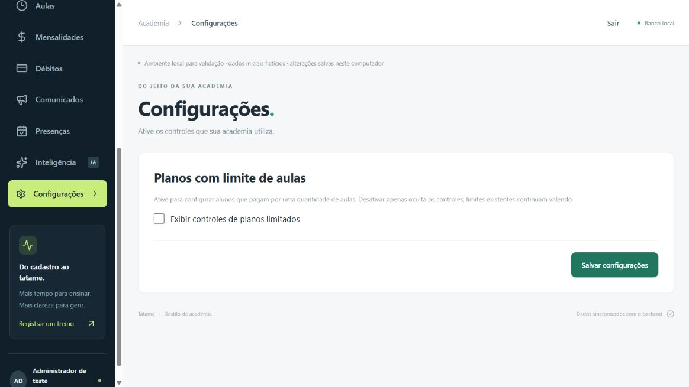
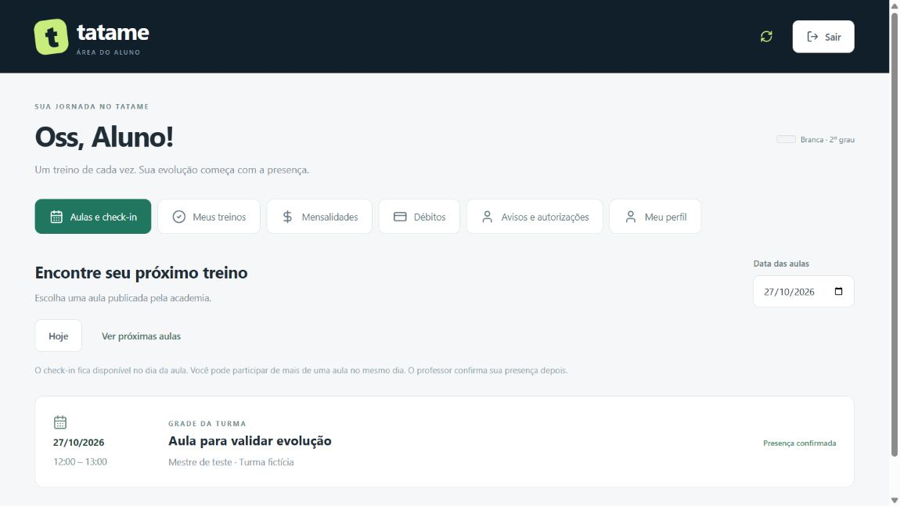
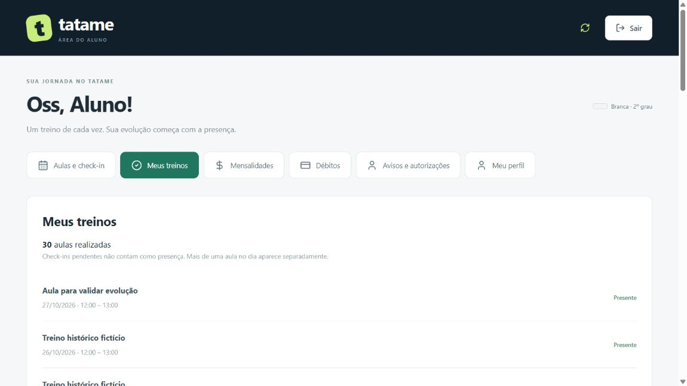
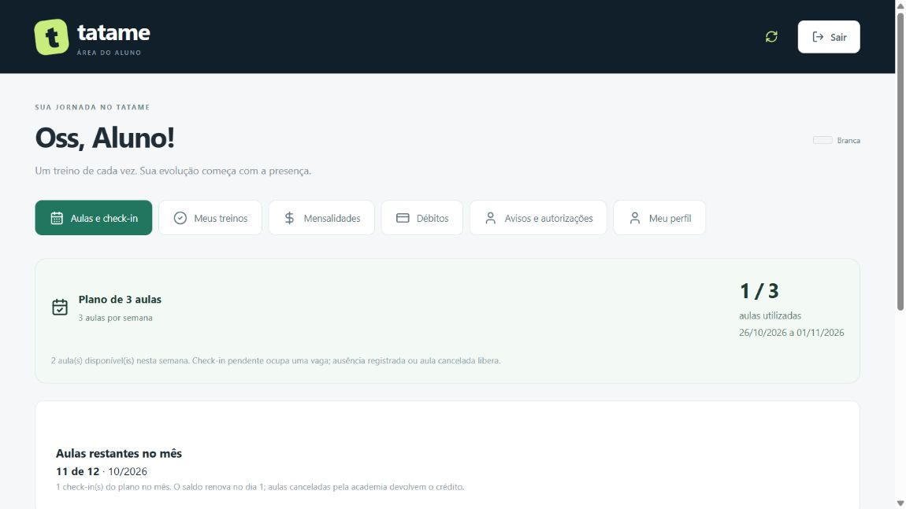

# Configurações da academia e planos opcionais

Entrega local de 27/10/2026, aguardando validação humana antes de commit/push.

## Como usar

Abra **Configurações → Exibir controles de planos limitados → Salvar configurações**. A opção começa desativada. Serve para academias que trabalham com uma quantidade de aulas por plano.

Com a opção ativada, a ficha mostra os controles dos alunos que já têm limite semanal ou mensal. Para um aluno sem limite, aparece somente **Definir plano com limite de aulas**, que abre a configuração quando o professor precisar. A coluna de saldo mensal na lista e as condições de aulas adicionais no menu Débitos também acompanham essa preferência.

**Decisão explícita do usuário:** desativar apenas esconde controles administrativos. Não remove, suspende, zera nem renegocia limites já configurados; não apaga planos, check-ins, saldos, débitos ou pagamentos. Alunos que continuam limitados ainda precisam ver e respeitar suas cotas. O painel de débitos e os bloqueios financeiros permanecem disponíveis.

## Área do aluno

- Sem limite semanal: não exibe cartão Sem limite semanal/Ilimitado.
- Sem limite mensal: não exibe Aulas restantes no mês/Ilimitadas.
- Aluno totalmente ilimitado: em **Meus treinos**, exibe **Aulas realizadas**, contando encontros únicos da agenda, com presença confirmada, não cancelados e até o dia atual. Check-in pendente, ausência e aula futura não contam. Registros antigos por modalidade permanecem separados.
- Aluno limitado: os cartões do período pertinente mantêm **Aulas utilizadas**, saldo e avisos de cota. A contagem de consumo inclui reserva/check-in conforme as regras já existentes.
- Mensalidades, Débitos e impedimentos financeiros permanecem como antes. Ocultar um controle não autoriza um treino fora das condições do aluno.

## Por que uma preferência separada

`PreferenciasAcademia` guarda somente a preferência visual, sua data e o administrador que a alterou. Separar apresentação e regras evita que limpar a tela mude cobranças ou limites sem intenção. A ausência de registro significa controles ocultos. O backend de check-in não consulta essa preferência para decidir cotas: continua usando os planos e saldos reais.

GET/PUT **/api/configuracoes/academia** são administrativos. PUT aceita somente `{exibirControlePlanos:boolean}`; não permite enviar limites por esse contrato. SQLite grava por upsert; Prisma usa upsert equivalente. A migração 15 cria apenas essa tabela, sem alterar cadastros anteriores. Colunas e restrições foram preparadas para PostgreSQL, sem executar no Supabase.

A interface administrativa usa um provider de preferências e informa falha de leitura, sem apresentar erro como preferência válida. A preferência persiste entre sessões/dispositivos que acessam a mesma instalação; não é apenas uma opção do navegador.

## Verificação real

**256 testes TypeScript**, build/typecheck, geração e validação Prisma passaram. Provas novas conferem padrão oculto, alternância sem alterar dados de outros módulos, limites ainda bloqueando após ocultação, permissão só administrativa, contrato estrito, migração aditiva e diferença entre aulas realizadas e check-in pendente.

SQLite principal e QA persistida foram atualizados para v15 com backup e hashes das **26 tabelas anteriores iguais**, FKs válidas. Depois dessa prova, foi acrescentado apenas na QA um segundo aluno fictício, com 3 aulas semanais e 12 mensais, para comparar as telas. O aluno usado anteriormente e os testes do usuário foram preservados.

Na UI: ativar/desativar e recarregar manteve preferência; ficha limitada mostrou controles quando ativa; ficha ilimitada mostrou apenas entrada opcional; desativada ocultou ambos os formulários e coluna de saldo. Portal ilimitado ficou sem cartões de cota, mostrou 30 aulas realizadas e manteve Débitos. Portal limitado manteve 1/3 utilizadas e 11/12 mensais mesmo com controles administrativos ocultos. Valores são fixtures de teste, não configurações impostas à academia real.

Python não foi alterado/retestado. Nenhuma chamada ou migração externa Supabase nesta entrega; ele aguarda autorização expressa. Nenhum WhatsApp/e-mail externo enviado.

