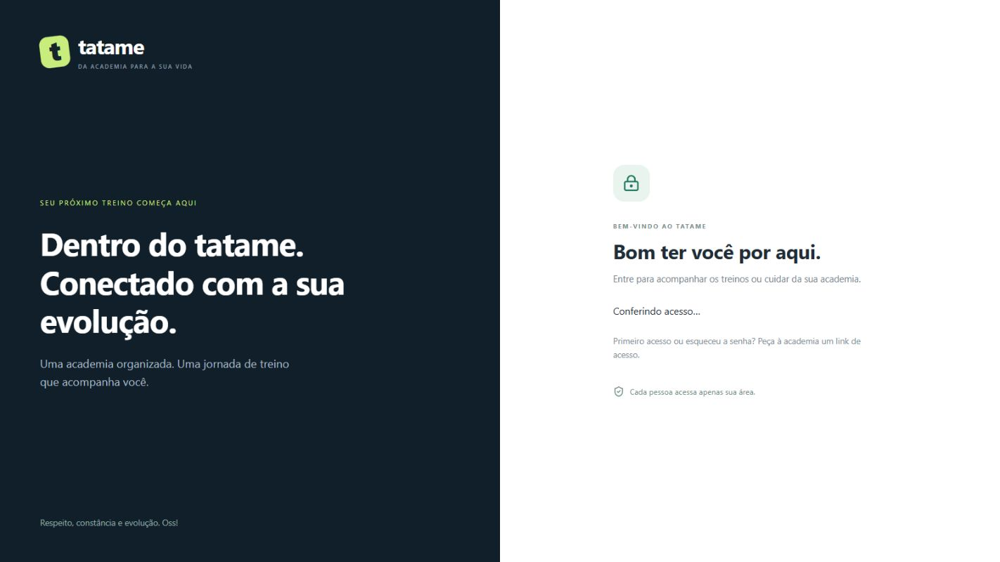
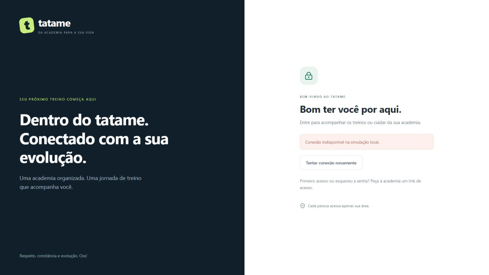

# Botão no refresh —01/11/2026

Relato de Gabriel: o botão “Tentar conexão novamente” aparecia brevemente ao recarregar.

Causa: o AuthGate mostrava esse botão quando state ainda era nulo, inclusive enquanto a primeira consulta do login estava em andamento.

Correção em apps/web/src/AuthGate.tsx: enquanto não há resposta nem erro, mostrar “Conferindo acesso…” com role=status; depois de erro real, manter a mensagem e a opção de tentar novamente. Não esconde falhas nem altera validação de sessão.

Verificado em prévia local3355 com banco fictício em memória e resposta controlada: espera sem botão,503 com botão, clique após recuperação abre painel. Build/typecheck passaram. Disponível para validação em https://tatame-homologacao-f1fi4dmth-cleiton-pirola.vercel.app. A correção visual ainda não foi commitada.

