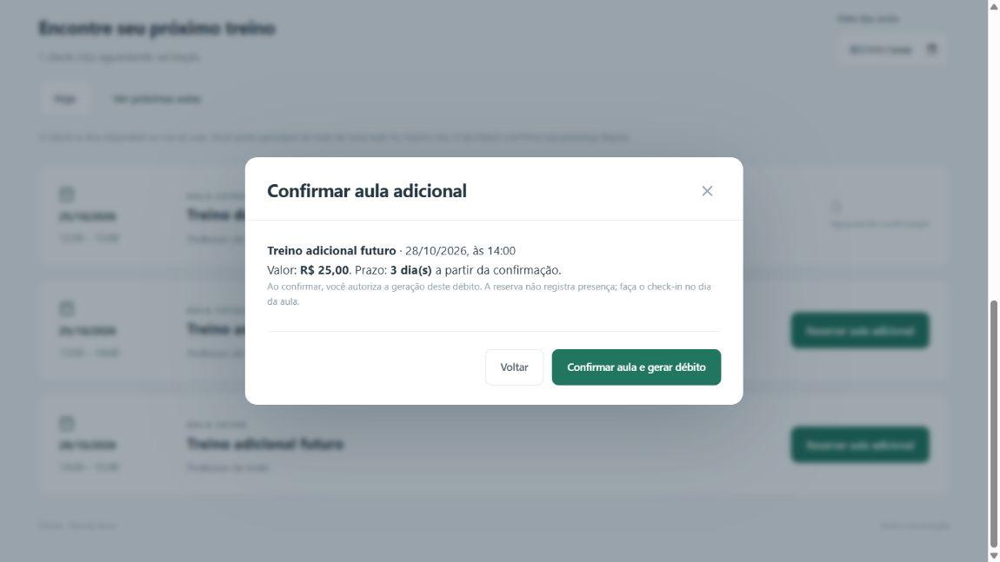
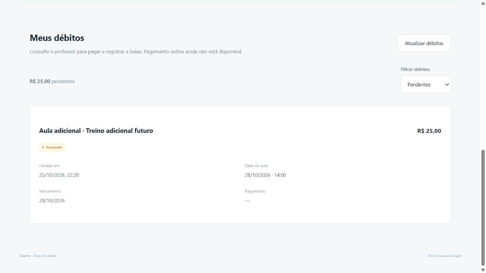
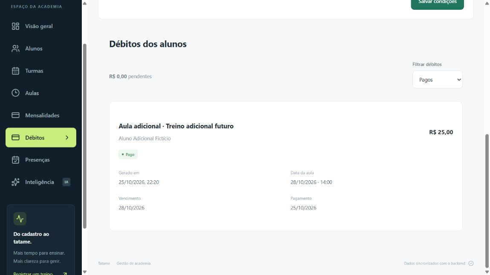

# Aulas adicionais e débitos

## Aulas publicadas por turmas — 26/10/2026

A retirada de criação/exclusão de avulsas não remove este recurso. O usuário confirmou manter adicionais pagos. Novas reservas exigem aula publicada pela grade de uma turma; reserva legada já confirmada continua idempotente e utilizável. Testes e fluxo atual em [AULAS.md](AULAS.md).

## Regras da implementação — 25/10/2026

Solicitação: quando a cota mensal terminar, oferecer aula adicional pelo preço da academia, permitir escolher aula/dia, confirmar e gerar débito automaticamente; menu Débitos do aluno e baixa manual pelo professor/administrador. Usuário confirmou que débito vencido deve bloquear novos check-ins, mantendo acesso ao menu Débitos.

O saldo mensal existente continua na tabela Aluno. Aulas adicionais não criam outro contador de aulas do plano: cada confirmação gera uma reserva vinculada a uma aula publicada e um DebitoAula. No dia da aula, o aluno faz check-in. Presença continua dependendo da validação do responsável. O adicional confirmado dispensa a cota semanal/mensal para aquela aula, mas não ignora cadastro inativo, aula cancelada, mensalidade vencida ou débito adicional vencido.

Não há valor inventado: vender aulas adicionais começa desativado, até a administração configurar o preço em Débitos. Prazo padrão é 3 dias corridos, de 1 a 90 configuráveis, contados da confirmação em America/Sao_Paulo. O vencimento ainda permite check-in; fica vencido no dia seguinte. A administração configura limite mensal na ficha do aluno, preço/prazo na tela Débitos e registra pagamentos recebidos nessa mesma tela.

## Confirmação e proteção financeira

Antes de confirmar, o aluno vê título, dia/horário, preço e prazo. Botão explícito confirma a aula e gera o débito; visualizar a oferta ou abrir a confirmação não cobra. O servidor verifica preço/prazo aceitos contra a configuração atual e rejeita condições desatualizadas. O cliente não define valor, aluno, vencimento ou status do débito. Unicidade aluno+aula e bloqueios transacionais impedem cobranças duplicadas por cliques/requisições repetidos.

A aula escolhida precisa estar publicada, ativa, hoje ou no futuro e ter sua cota mensal do mês correspondente esgotada. O seletor de data e a agenda permitem escolher as aulas restantes do mês atual; não é cobrada uma aula do mês seguinte quando a cota desse mês ainda está disponível. Não existe reserva comum futura de aulas incluídas nesta entrega. A compra não aumenta saldo genérico nem pode ser usada em outra aula. Se o limite for alterado depois, o débito confirmado não muda automaticamente.

## Dados e histórico

Migração aditiva 8 acrescenta ConfiguracaoAcademia (preço/prazo e autor/data de edição) e DebitoAula. Cada débito guarda motivo, valor em centavos, geração, aula/dia/horário, prazo e vencimento congelados, status, data de pagamento e administrador que registrou a baixa. Alterações futuras na configuração não reescrevem cobranças antigas.

Status persistidos: pendente, pago e cancelado; atraso é calculado pelo vencimento. Somente administrador registra pagamento, com data entre geração e hoje. Repetir uma baixa não sobrescreve a primeira data/autor. Não há gateway, PIX automático, leitura de extrato, notificação externa ou reconhecimento automático nesta entrega.

Ao cancelar uma aula, débitos pendentes são cancelados e deixam de bloquear; pagamentos já registrados são preservados e recebem indicação de aula cancelada para acerto manual de eventual devolução. Não há reembolso automático. Aulas e alunos com débitos/reservas são preservados contra exclusão destrutiva. A chamada já registrada continua impedindo cancelamento, conforme regra anterior.

## Acesso

GET /api/portal/debitos retorna só os débitos do aluno autenticado, inclusive se o portal estiver restrito por mensalidade vencida. POST /api/portal/aulas/:id/adicional confirma a reserva com aceite explícito de preço/prazo. Rotas /api/debitos, /configuracao e /:id/pagamento exigem administração. O aluno não marca pagamento nem acessa o financeiro de outros alunos.

Check-in e reserva usam transações: SQLite BEGIN IMMEDIATE e PostgreSQL bloqueio da aula e do aluno; baixa usa bloqueio do débito. Débitos ativos são descontados das contagens de cota regular para que o treino adicional não consuma também uma aula incluída. O histórico do check-in e o débito continuam separados para auditoria.

## Validação da entrega — 25/10/2026

166 testes TypeScript aprovados, incluindo 13 cenários novos de débito e uma prova de migração v7→v8 com backup/reabertura. Conferidos configuração, preço ausente, aceite desatualizado/forjado, reserva futura sem presença antecipada, isolamento de aluno, concorrência sem débito duplicado, consumo separado das cotas, atraso, vencimento hoje, baixa manual/idempotência, cancelamento pendente/pago, restrição de exclusão e rollback. Os 13 testes Python passaram; Prisma Client gerado, schema validado e build/typecheck aprovados. Após a suíte completa, o conjunto direcionado de 13 testes passou novamente com verificações adicionais de aula já incluída, passada e cancelada.

SQLite local real migrou para versão 8 com backup v7; hashes das 15 tabelas anteriores preservados, FK check vazio e nenhuma configuração de preço ou cobrança real criada. Supabase de homologação também recebeu migração aditiva 8, com TLS validado. Teste externo confirmou concorrência para a mesma reserva sem duplicar, check-in adicional, bloqueio por atraso, baixa, preço congelado, rejeição de aceite antigo e cancelamentos. Configuração, operador sem credencial de login, aluno, aulas, check-ins e débitos sintéticos foram removidos ao final; hashes anteriores das 15 tabelas preservados e oito migrações concluídas.

Navegador com SQLite em memória: academia fictícia configurou R$ 25,00 e 3 dias; aluno com limite esgotado escolheu aula futura publicada, conferiu preço/data/prazo e confirmou. Consulta antes da confirmação comprovou ausência de débito; após ela, menu Débitos abriu com o registro completo. Administração marcou como pago; aluno e administrador viram status e data de pagamento iguais. Os valores da demonstração não foram aplicados aos bancos reais. Registro visual abaixo. Seletores de listas foram ajustados a partir da árvore atual; tentativas intermediárias não foram tratadas como sucesso. Não houve teste físico de celular, gateway, pagamento bancário ou hospedagem pública.

Para validar localmente: abra Débitos, habilite aulas pagas, informe o valor real e salve; configure o limite de cada aluno na ficha; no perfil de aluno, selecione uma aula pela data ou Ver próximas aulas e confirme. Débitos mostra os registros imediatamente. Pagamento é registrado pela gestão com Marcar como pago. O perfil de professor separado ainda não existe: ações financeiras exigem a conta administrativa atual. O modo temporário de administrador local deve ser desativado para avaliar acesso anônimo; uma sessão válida de aluno continua com perfil aluno.

As cobranças adicionais são acompanhadas neste menu; receitas/indicadores de mensalidades e Python continuam separados e não incorporam esses valores nesta entrega. Reconhecimento de pagamento, emissão de PIX e reembolsos automáticos são futuros. Não existe alteração automática da cota mensal quando uma aula adicional é comprada.

Entrega local pronta para validação. Sem commit/push aprovado para este conjunto; pendências anteriores preservadas.
