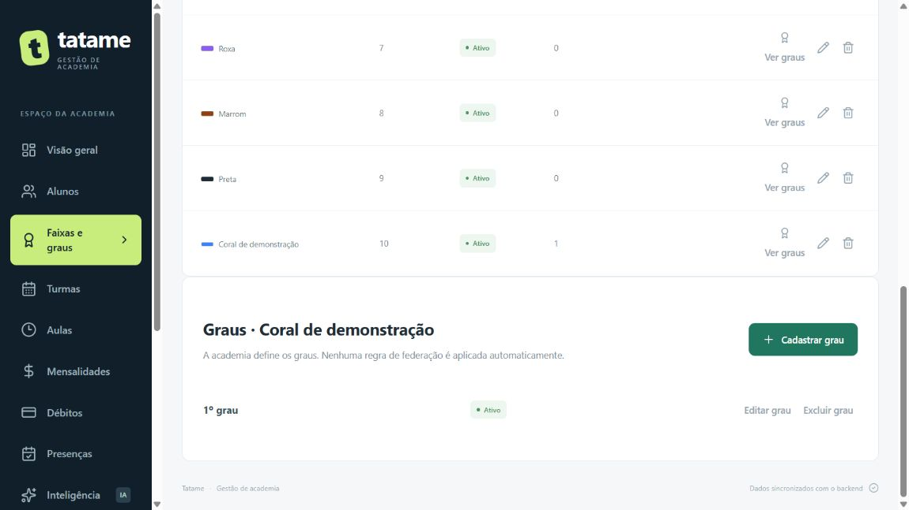

# Faixas e graus configuráveis

Entrega de 26/10/2026. Implementada, testada e autorizada pelo usuário para commit/envio após os testes. O cadastro pertence à instância atual da academia; não implementa separação de várias academias na mesma instalação.

## Como usar

1. Abra **Faixas e graus → Cadastrar faixa**. Informe nome, cor, ordem de exibição e situação.
2. Na faixa escolhida, clique em **Ver graus → Cadastrar grau**. Cada grau pertence somente àquela faixa. A academia define os números utilizados, de 0 a 99; esse intervalo é uma validação do aplicativo, não uma regra de federação.
3. O número 0 é exibido como **Sem graus**. **Não informado** significa que a graduação do aluno ainda não foi definida, sendo diferente de cadastrar explicitamente grau zero.
4. Em **Alunos → Cadastrar aluno/Editar**, selecione a faixa e depois o grau. Trocar a faixa limpa a seleção de grau. A lista e a ficha mostram a graduação atribuída.
5. Edite uma faixa ou grau para ajustar os dados ou inativar. Uma atribuição já existente pode ser mantida ao editar outros dados do aluno, mas cadastros inativos não podem receber novas atribuições.
6. Exclua somente itens sem vínculos. Uma faixa com alunos ou graus cadastrados e um grau usado por aluno ficam protegidos; use inativação para preservar os vínculos.

As nove faixas anteriores são mantidas no catálogo. Nenhum grau é inventado para alunos antigos. A migração também conserva eventual nome anterior fora da lista inicial como uma faixa legada. O aluno consulta a graduação, mas não pode alterá-la pelo formulário de dados básicos.

Renomear uma faixa atualiza a ficha dos alunos vinculados em uma transação. Os identificadores e os graus continuam os mesmos. O recurso registra a graduação atual; não é um histórico completo de promoções, não promove alunos automaticamente e não aplica regras etárias ou de uma federação.

## O que mudou na arquitetura

- `FaixaGraduacao`: identificador, nome, chave normalizada para unicidade, cor, ordem, situação e datas.
- `GrauFaixa`: identificador, faixaId, número, situação e datas; número único dentro de cada faixa.
- `Aluno`: novos faixaId e grauId. O texto faixa permanece para compatibilidade com telas, relatórios e integrações anteriores. Renomeação mantém esse texto sincronizado com o catálogo.
- O grau deve pertencer à faixa. Há validação de servidor e proteção de banco: chaves estrangeiras e verificação por trigger no SQLite; chave composta/check e trigger de nome no PostgreSQL.
- Migração **10**, aditiva para o Aluno e sem reescrever migrações já aplicadas. SQLite faz backup antes de aplicar. Os campos antigos são preservados; faixaId é vinculado ao catálogo e grauId começa nulo.
- `modules/graduacoes/rules.ts` concentra schemas, unicidade, vínculo, situação e proteção de exclusão. `Repository.saveCatalogoGraduacao` e `saveCadastroAluno` gravam em transação nos dois bancos. No PostgreSQL, alterações de catálogo usam trava transacional para serializar cadastros concorrentes.
- Cadastro de menor com responsável também valida a graduação dentro da transação familiar, evitando cadastro parcialmente gravado.
- `GraduacoesProvider` consulta o catálogo após autenticar e o compartilha com selects e indicadores visuais. O catálogo é atualizado ao salvar, a cada 30 segundos e ao voltar à janela. Falha de consulta aparece como erro; não é apresentada como catálogo vazio válido.
- Python recebe o nome da faixa como texto validado, permitindo configurações próprias. O cálculo de frequência/risco continua o mesmo.

## Contratos da API

| Método/rota | Permissão | Uso |
| --- | --- | --- |
| GET /api/graduacoes | Pessoa autenticada | Faixas e graus para consulta/seleção. |
| POST /api/graduacoes/faixas | Administração | Criar faixa com nome, cor, ordem, situacao. |
| PUT /api/graduacoes/faixas/:id | Administração | Editar/renomear/inativar faixa. |
| DELETE /api/graduacoes/faixas/:id | Administração | Excluir faixa sem vínculos. |
| POST /api/graduacoes/faixas/:id/graus | Administração | Criar grau com numero e situacao. |
| PUT /api/graduacoes/graus/:id | Administração | Editar/inativar grau dentro da própria faixa. |
| DELETE /api/graduacoes/graus/:id | Administração | Excluir grau sem alunos vinculados. |
| POST/PUT /api/alunos | Administração | Atribuir faixa/grau no cadastro existente. |

## Verificação executada

- **206 testes TypeScript aprovados**, abrangendo 11 casos novos do catálogo e duas provas de migração, além de atualização da cobertura de aulas e cobrança adicional.
- **15 testes Python**, incluindo faixa personalizada e rejeição de nome vazio; **3 testes de configuração de homologação**; build/typecheck, Prisma gerado e schema válido.
- SQLite local: migração 10 com backup, comparação das 20 tabelas anteriores sem mudança em seus campos originais e verificação de vínculos válida.
- Supabase de homologação: migração 10 com TLS/certificado verificado, 20 tabelas anteriores preservadas e vínculos conferidos. Prova sintética de catálogo, graus concorrentes (201/409), associação e rejeição de faixa/grau incompatíveis no banco, renomeação, proteção de exclusão, turma coringa e rotas de avulsas removidas. Limpeza por IDs exclusivos e hashes das 22 tabelas iguais ao início; sem chamada de login/ativação ou limpeza global de sessões.
- Navegador em memória: criação de faixa, criação de grau, seleção no aluno, salvamento e exibição da faixa personalizada com o grau; publicação de aula às 15h a partir da turma coringa. Capturas somente fictícias.

## Para defender na avaliação

**Por que o grau guarda faixaId?** Porque um grau só faz sentido dentro da faixa à qual foi cadastrado. Número igual pode existir em faixas diferentes, mas não se repete dentro da mesma faixa.

**Por que manter o texto faixa no aluno?** Ele já era usado pelas telas e pelo serviço de dados. A migração acrescenta os vínculos e mantém o texto sincronizado, evoluindo os contratos sem apagar os dados anteriores.

**Por que inativar em vez de sempre excluir?** Porque outros registros podem depender daquele cadastro. A inativação impede novas atribuições e conserva os vínculos existentes.

**Por que a transação na renomeação?** Para que o catálogo e os alunos vinculados mudem juntos. Uma falha não pode deixar parte dos alunos com um nome e parte com outro.
