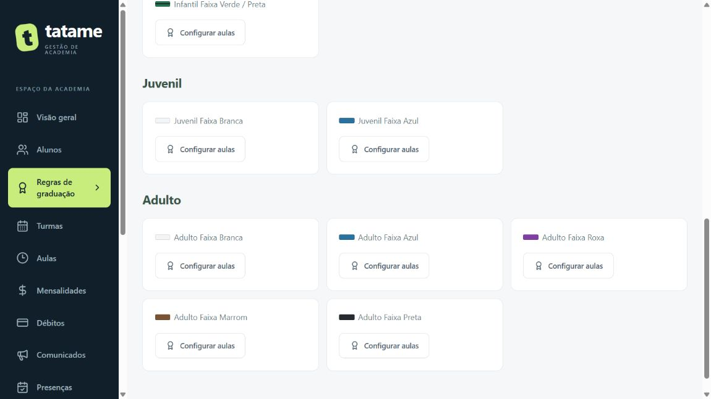
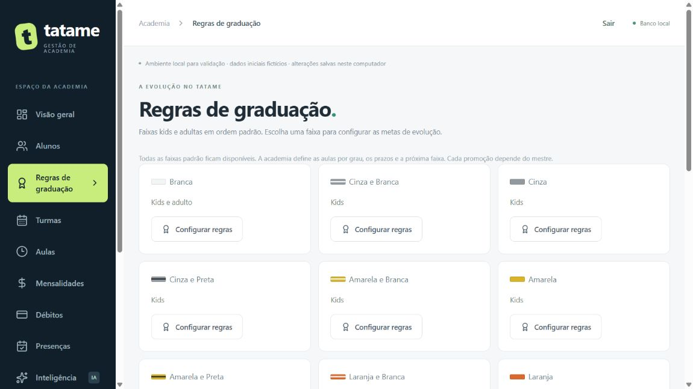
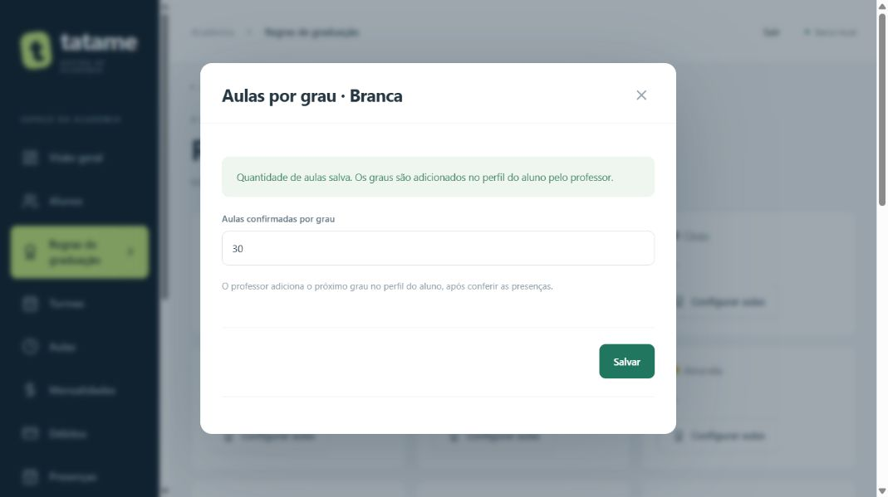
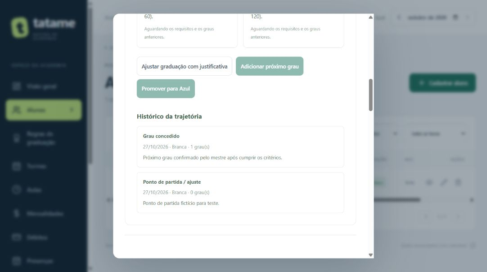

# Faixas padrão e graus da academia

No registro manual da ficha, as opções padrão aparecem mesmo sem metas configuradas. O limite é de quatro graus até a marrom e seis na preta. [Registro manual e referência da IBJJF](EVOLUCAO_GRADUACAO.md#registro-manual-de-graus--05112026).

**Simplificação final:** a tela mostra somente Infantil, Juvenil e Adulto. O bloco Cadastros anteriores foi removido; não houve exclusão dos registros preservados. As referências antigas a essa seção recolhida estão superadas. Validação atual conjunta: 256 testes TypeScript, build/typecheck e UI fictícia aprovados.

## Fluxo vigente — categorias independentes (27/10/2026)

Esta seção substitui a sequência antiga sem categoria descrita mais abaixo. Em **Regras de graduação → Configurar aulas**, cada opção possui sua própria meta editável:

| Categoria | Opções |
|---|---|
| Infantil | Branca; Cinza / Branca; Cinza; Cinza / Preta; Amarela / Branca; Amarela; Amarela / Preta; Laranja / Branca; Laranja; Laranja / Preta; Verde / Branca; Verde; Verde / Preta |
| Juvenil | Branca; Azul |
| Adulto | Branca; Azul; Roxa; Marrom; Preta |

São **20 opções**, com nomes como Infantil Faixa Branca e Adulto Faixa Branca. Coral/vermelha e preta, vermelha e branca e vermelha inteira não fazem parte das opções atuais, conforme pedido. Não foram criados limites numéricos de idade nem classificação automática pela data de nascimento.

Configurar apenas aulas e Salvar continua sendo o fluxo. Branca infantil pode usar 20 aulas e branca adulta 30, sem compartilhar a mesma RegraGraduacao. Esses números foram usados somente na cópia fictícia para provar independência; não foram impostos ao banco principal.

**Preservação:** migração 14 acrescenta as categorias com IDs novos; não renomeia/apaga/reclassifica alunos, faixas, graus, regras ou histórico anteriores. No banco há também as vinte definições anteriores preservadas. A seção **Cadastros anteriores foi retirada da tela** a pedido do usuário. Os registros continuam no banco, sem alteração de graduações ou metas antigas. No seletor da ficha, uma faixa antiga atual permanece marcada como cadastro anterior até o professor escolher explicitamente a categoria correta. Novo cadastro mantém Branca neutra inicial, sem presumir Infantil/Adulto. Cores/listras continuam fixas.

252 testes TypeScript e build/typecheck passaram. Local e QA persistida migrados para v14, com backup e preservação das outras 25 tabelas e de todas as 20 faixas anteriores, FKs válidas. UI conferiu categorias até preta, metas infantil 20/adulta 30 independentes e seletor da ficha. PostgreSQL preparado, sem execução no Supabase (aguarda autorização).

Estado local de 27/10/2026, aguardando validação humana antes de commit/push. O Supabase continua aguardando autorização; nenhum acesso ou migração externa nesta entrega.

## Como usar agora

1. Abra **Regras de graduação**. Todas as faixas padrão kids e adultas já aparecem na ordem definida, com cores fixas um pouco mais escuras e listras brancas/pretas quando aplicáveis.
2. Clique em **Configurar aulas** na faixa desejada. Edite somente **Aulas confirmadas por grau** e clique em **Salvar**. Não há seleção de total de graus, destino ou lista para cadastrar/editar/excluir graus nessa tela.
3. Salvar a quantidade cria os graus faltantes de 0 a 4 nas faixas branca, kids e coloridas até a marrom, conforme a decisão de produto do usuário. **Sem graus** é o número 0; **Não informado** é uma graduação ainda não conferida. Faixa preta, corais e registros personalizados anteriores não são convertidos automaticamente para quatro graus; seus dados prévios são preservados.
4. Abra **Alunos → Ver ficha → Evolução da graduação** para registrar o ponto de partida, registrar correções e usar **Adicionar próximo grau**, um de cada vez até o 4º nas faixas coloridas, com confirmação e histórico. O botão só libera quando a meta é atingida; correções seguem em Ajustar graduação. O formulário comum de aluno cuida dos dados cadastrais e não altera graduação.
5. O aluno acompanha **Meu perfil → Minha trajetória**, vê metas e pode sinalizar o professor quando elegível. Só contam presenças confirmadas; o mestre confirma a promoção.

Não existem mais controles de cadastrar/excluir/renomear faixa, escolher cor, ordem ou ativação. Meses por grau e permanência mínima também foram removidos; valores temporais antigos não criam exigências ocultas. A data de início na ficha permanece apenas para delimitar quais presenças entram na contagem. Todas as faixas padrão ficam disponíveis, mesmo se a academia ainda não tiver aulas kids. As categorias são descritivas: não foi implementado bloqueio por idade a partir da imagem enviada. A ordem visual não escolhe automaticamente o destino de uma promoção. Editar aulas preserva um destino já configurado; novos destinos não são escolhidos nessa tela. Não há alteração automática da faixa do aluno ao atingir quatro graus.

## Sequência fixa

Branca → Cinza e Branca → Cinza → Cinza e Preta → Amarela e Branca → Amarela → Amarela e Preta → Laranja e Branca → Laranja → Laranja e Preta → Verde e Branca → Verde → Verde e Preta → Azul → Roxa → Marrom → Preta → Vermelha e Preta → Vermelha e Branca → Vermelha.

Uma faixa personalizada cadastrada anteriormente permanece identificada como registro anterior preservado, ao final do catálogo. Não foi apagada, renomeada ou mesclada com outra. Seus vínculos, graus, regras e histórico continuam existentes.

## Modelo e preservação

- `FaixaGraduacao`: mantém os campos técnicos de identidade, nome, chave, cor, ordem e situação por compatibilidade. Os controles públicos desses metadados foram encerrados.
- `GrauFaixa`: pertence a uma faixa, com número único dentro dela, de 0 a 99. O intervalo é uma validação do aplicativo, não uma norma de federação.
- `Aluno.faixaId/grauId`: preservam a associação; o texto faixa permanece compatível com relatórios e analytics. Trigger e chaves estrangeiras impedem associação incompatível.
- Migração **10** criou catálogo e vínculos; **12** acrescentou regras, estado e eventos de graduação; **13** completa o catálogo padrão e atualiza apenas seus metadados visuais/ativação, preservando IDs, nomes, chaves e datas originais. Migrações anteriores não foram reescritas.
- `packages/shared/src/faixas.ts` centraliza paleta, sequência e padrões de listras usados pela interface. As migrações contêm uma fotografia explícita desses valores, conferida por teste.
- Regras de evolução são independentes da apresentação. Alterar a meta não muda a cor nem promove alunos automaticamente.

## Contratos públicos

| Método/rota | Permissão | Uso |
| --- | --- | --- |
| GET /api/graduacoes | Pessoa autenticada | Catálogo em ordem fixa e graus para consulta. |
| POST /api/graduacoes/faixas | Administração | Encerrado: responde 409 e explica o catálogo fixo. |
| PUT/DELETE /api/graduacoes/faixas/:id | Administração | Encerrado: responde 409, sem alterar dados. |
| POST /api/graduacoes/faixas/:id/graus | Administração | Criar grau. |
| PUT/DELETE /api/graduacoes/graus/:id | Administração | Ajustar grau ou excluir apenas sem vínculos. |
| PUT /api/graduacoes/faixas/:id/regra | Administração | Salvar critérios editáveis. |
| GET/POST /api/alunos/:id/graduacao | Administração | Consultar trajetória e registrar ações auditadas. |

Operações internas antigas do repositório permanecem por compatibilidade e testes de dados legados; não constituem uma opção pública para mudar o catálogo.

## Verificação desta entrega

- **248 testes TypeScript passaram**, incluindo preservação da migração 13, catálogo completo, bloqueio dos antigos comandos de faixa, regras kids editáveis e listras.
- Build/typecheck passaram. Navegador com dados fictícios confirmou o formulário com apenas aulas/Salvar e concessão do primeiro grau no perfil, com histórico e bloqueio da próxima meta. Prova focada de 16 testes confirmou também a recusa de um quinto grau. As capturas antigas de configurações maiores são históricas.
- SQLite local na versão **13**, com backup, dados das outras **25 tabelas preservados**, identidade das nove faixas anteriores mantida e chaves estrangeiras válidas. Nenhum aluno real foi graduado para demonstrar.
- Scripts PostgreSQL preparados, **sem execução externa**. Python não foi alterado nem retestado neste incremento. Testes anteriores de Prisma pertencem à evolução da graduação, conforme registro de processo.

Guia da trajetória, regras e defesa oral: [EVOLUCAO_GRADUACAO.md](EVOLUCAO_GRADUACAO.md).

## Para explicar na avaliação

**Por que cores e ordem são fixas, mas as metas são editáveis?** Porque o usuário pediu uma apresentação padronizada e regras de ensino livres para cada academia. Essas responsabilidades ficam separadas.

**Por que guardar faixaId e grauId?** Porque um grau pertence a uma faixa específica. O nome exibido pode ser parecido, mas o identificador preserva o vínculo correto.

**Por que uma nova migração?** Porque instalações que já têm alunos não podem perder seus vínculos. A atualização modifica o catálogo com backup e preservação; não recria o banco.

**Check-in dá grau?** Não. O professor confirma a presença; o sistema calcula as metas, e o mestre confirma a graduação.

## Tela atual da configuração

## Apresentação atual da ficha

Ajustar graduação não pede justificativa. Registros internos de autoria, data e graduação anterior/nova são automáticos. A lista **Graus recebidos** exibe só grau/faixa e data de concessão; ponto de partida e ajustes não aparecem como graus recebidos. Nenhum evento antigo foi apagado. O fluxo foi validado em navegador fictício, com 249 testes de backend/funcionalidades e build/typecheck aprovados; a lista em si foi conferida visualmente.
