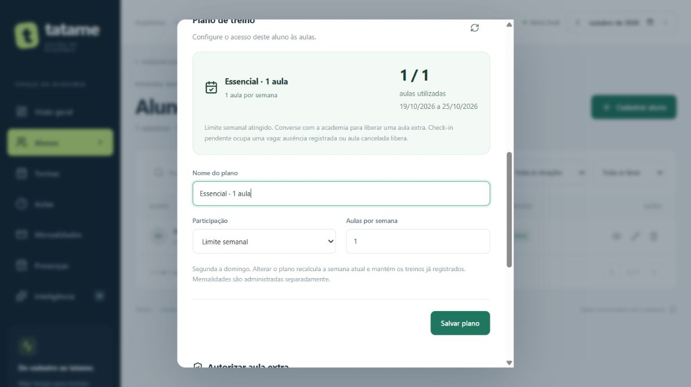
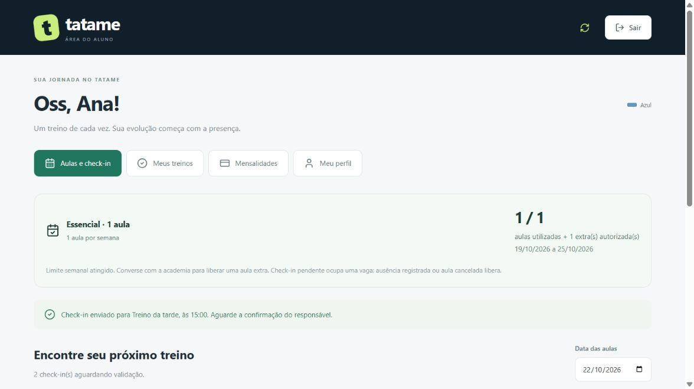
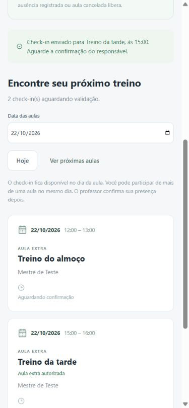

# Planos de treino e liberações extras

## Adicionais com cobrança — 25/10/2026

Implementado fluxo distinto da liberação nominal gratuita descrita abaixo: a academia habilita preço/prazo, o aluno com cota mensal esgotada confirma uma aula publicada e recebe um débito. Essa reserva permite a aula específica sem consumir novamente cotas regulares; respeita bloqueio financeiro e check-in somente no dia. Baixa manual e atraso em [DEBITOS.md](DEBITOS.md). Uma liberação semanal gratuita continua sem ignorar o limite mensal. Não há catálogo de planos por preço nem integração bancária automática nesta entrega.

## Complemento mensal — 25/10/2026

Além da cota semanal descrita neste documento, agora existe [saldo mensal de aulas](SALDO_MENSAL.md) individual no Aluno, configurado separadamente na ficha. As duas cotas se aplicam quando habilitadas; liberação extra semanal não ignora limite mensal. Saldo mensal usa check-ins únicos de aulas não canceladas, renova no dia 1 e não devolve crédito automaticamente por ausência após o check-in. A regra semanal anterior de ausência continua a mesma. Mensalidade/financeiro permanecem independentes. Migração 7 e validações registradas no guia mensal; o restante deste documento descreve a entrega semanal original.

## Desenho antes da implementação — 22/10/2026

Pedido: implementar agora plano ilimitado ou limitado por semana, mostrar uso e permitir autorização administrativa de aula extra. Pagamento automático, preço de excedente, e-mail e hospedagem ficam para depois. A configuração será individual na ficha do aluno: nome do plano e limite semanal opcional. Não altera mensalidades nem gera cobranças.

Semana: segunda a domingo, pela data da aula e calendário de São Paulo. Alunos sem configuração continuam ilimitados. Check-in pendente ocupa uma vaga, confirmação não duplica, ausência explícita ou cancelamento libera. Presenças manuais por aula também contam; registros antigos por modalidade marcados como presentes contam individualmente, sem inventar associação com uma aula. O mesmo treino deve ser registrado por apenas um dos formatos.

Limite restringe novos check-ins do aluno; a administração continua podendo registrar a presença real. A liberação é nominal, para uma aula publicada do dia, quando a cota já terminou. Não libera outra aula, não ignora débito financeiro e não gera pagamento. Uma aula com liberação usada aparece como extra e não ocupa a cota regular. Autorização ainda não usada pode ser revogada; se já houver check-in ou chamada, fica preservada. Exclusão definitiva de uma aula com liberação é impedida; pode ser cancelada respeitando as proteções da chamada.

Modelo aditivo: `PlanoAluno` (um por aluno, nome e limite nulo = ilimitado) e `LiberacaoAula` (aluno/aula únicos, motivo, administrador e data). Migração SQLite 6 com backup automático e SQL/Prisma equivalentes; nenhum aluno recebe limite automaticamente. Mudança de plano recalcula a cota da semana atual, sem apagar histórico ou zerar uso. Convites, login e dados existentes são preservados.

A API deve aplicar a regra dentro da transação do check-in, serializando pelo aluno para duas aulas concorrentes não ultrapassarem a última vaga. Autorizações/configuração ficam restritas à administração. O portal recebe somente uso e liberações do próprio aluno. Uso não muda a frequência Python: check-in pendente continua sem ser presença confirmada nos indicadores.

Estado: implementado e testado localmente. Em 22/10/2026, após apresentação, o usuário autorizou “testa e commita” para esta entrega. Nova execução: 136 testes TypeScript, 13 Python, build/typecheck e geração/validação Prisma aprovados. Commit/envio autorizado à branch `codex/evolucao-tatame`, sem merge, nova tag ou implantação. Evidências de navegador/migração abaixo pertencem à implementação anterior e não foram repetidas nesta etapa de envio. PostgreSQL/Supabase externo continua sem execução.

## Como usar

1. Entre como administrador e abra **Alunos → Ver ficha → Plano de treino**.
2. Informe um nome (por exemplo, Essencial), escolha participação ilimitada ou limite semanal e salve. O limite aceita um número inteiro de 1 a 100. O mesmo bloco mostra o uso da semana.
3. Na área do aluno, o resumo aparece junto à navegação. Com uma cota de três aulas, três check-ins pendentes/confirmados ocupam as três vagas; repetir a mesma solicitação não ocupa outra. A quarta aula fica indisponível sem autorização.
4. Quando a cota terminar, volte à ficha, selecione uma aula publicada de hoje, explique o motivo e clique em **Autorizar esta aula**. O aluno atualiza a área, encontra **Aula extra autorizada** e pode fazer esse check-in. Outras aulas continuam exigindo cota ou autorização própria.
5. A lista de liberações permite **Revogar** antes de existir check-in/chamada. Depois, a autorização é preservada. O servidor também impede exclusão definitiva da aula com autorização; use cancelamento quando permitido.

A semana reinicia pela data de referência, sem tarefa agendada e sem zerar registros. Alterar de três para cinco aulas considera as que já foram usadas nesta semana. Reduzir o limite pode bloquear novos check-ins imediatamente; não remove os anteriores. A administração pode registrar a presença real mesmo acima da cota ou com débito; isso não transforma uma presença em falta para esconder a situação comercial.

Check-ins pendentes de dias anteriores da mesma semana continuam ocupando vaga até a administração registrar ausência ou cancelar a aula. Limpar uma ausência com check-in faz esse aviso voltar a ocupar vaga. Cada treino deve ser registrado uma vez: formato por aula ou legado por modalidade. A liberação extra vale para aquela aula e não é transferida se ela for cancelada. Não há preço, multa, pagamento, turmas incluídas, catálogo compartilhado ou reservas futuras neste incremento.

## Arquivos e responsabilidades

| Arquivo | O que faz e por quê |
| --- | --- |
| `packages/shared/src/index.ts` | Contratos de plano, uso e autorização usados pela tela e API |
| `modules/planos/rules.ts` na API | Calcula semana/uso e decide cota; funções separadas facilitam explicar e testar a regra |
| `modules/planos/routes.ts` e `service.ts` na API | Administrador configura plano e liberações; reúne dados e valida entradas |
| `repository.ts` na API | Grava com transação e verifica cota dentro da operação, evitando disputa pela última vaga |
| `modules/auth/portal.ts` na API | Acrescenta apenas resumo e autorizações próprias; respeita bloqueio financeiro primeiro |
| `PlanoAluno.tsx` e `ResumoPlano.tsx` no frontend | Editor na ficha e resumo compartilhado com o portal |
| `StudentPortal.tsx` | Orienta o aluno e desabilita a ação quando a cota terminou; API continua sendo a autoridade |
| `006_planos.sql` e migration Prisma equivalente | Acrescentam tabelas e vínculos sem reescrever o histórico |
| `planos.test.ts` e `planos-migration.test.ts` | Verificam regras, permissões, concorrência, preservação e persistência |

## Validação real — 22/10/2026

- **136 testes TypeScript aprovados, zero falhas**, sendo 15 novos de planos/migração. Cenários de segunda/domingo e troca de mês/ano; ilimitado; confirmação sem duplicar; ausência/cancelamento; registros antigos; limite e mudança sem zerar uso; autorização nominal; dívida prioritária; concorrência HTTP de duas aulas pela última vaga; autorização/validação de entradas; migração e reabertura.
- **13 testes Python aprovados**, sem mudar fórmula ou serviço. Build/typecheck, Prisma Client e validação do schema aprovados. SQL PostgreSQL preparado, sem execução em Supabase externo; concorrência executada em SQLite local, não comprovada em PostgreSQL.
- **Navegador com SQLite em memória e Ana fictícia:** resumo 1/1, outros check-ins indisponíveis; administrador autorizou treino das 15h, alterou limite para três mantendo uso e voltou para um. Ao entrar novamente, Ana fez check-in só na aula autorizada; resumo mostrou 1/1 mais uma extra, e treino das 18h continuou restrito. Não houve cobrança ou dados fictícios inseridos na base real.
- **Tela estreita:** viewport solicitado 390×844. Ficha/documento 390/390 px, diálogo 343/343, resumo 302/302 (client/scroll); portal/documento 375/375 e resumo 342/342, sem transbordamento. Override restaurado. Não houve teste em telefone físico.
- **Banco real:** backup automático antes da versão 6. As treze tabelas anteriores mantiveram hashes e contagens: 21 alunos, 110 mensalidades, 433 registros antigos, uma turma, três horários, uma conta, uma sessão e demais vazias. PlanoAluno/LiberacaoAula vazias após evolução, nenhuma FK inválida. Nenhum limite, senha ou cobrança real foi alterado.

Capturas abaixo usam somente dados fictícios da instância isolada:

## Para explicar na avaliação oral

Pense na cota como ingressos da semana. O check-in separa um ingresso para uma aula; quando o professor confirma, ele continua sendo o mesmo ingresso. Marcar ausência ou cancelar devolve essa vaga. Uma autorização extra é um ingresso adicional com o nome do aluno e da aula, sem promessa de pagamento.

**Por que conferir a cota na API se o botão já está desabilitado?** O navegador pode ser alterado e duas solicitações podem chegar juntas. O servidor verifica novamente dentro da transação e serializa pelo aluno.

**Por que check-in ocupa cota, mas não aumenta a frequência dos indicadores?** Cota controla acesso solicitado; frequência representa treino confirmado pelo responsável. São decisões diferentes, com os mesmos registros de origem.

**Por que não apagar autorizações utilizadas?** Elas explicam por que uma participação excedente foi permitida e mantêm o vínculo com a aula e o administrador que autorizou.
