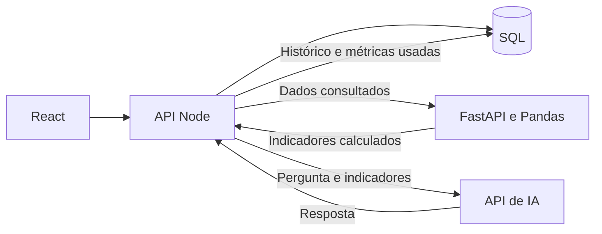

# Plano de evolução para o desafio técnico

Data: 10/10/2026. Referência preservada: tag `v1.0.0`, commit `618c1b3`.

Este documento analisa as duas imagens fornecidas pelo usuário e o código atual. É um plano; não implementa as mudanças propostas. A delimitação final de funcionalidades dos projetos deve ser conferida com as demais páginas do desafio antes da separação.

**Atualização de 19/10/2026:** o diagnóstico e a sequência abaixo registram o planejamento inicial. Nesta data foram implementados runner SQLite, carregamentos independentes e contrato validado Node/Python, com extração do módulo de analytics. A tag remota v1.0.0 e main foram confirmadas no GitHub. A validação técnica atual está em REVISAO_IA.md; os demais módulos, as duas entregas e as integrações externas seguem pendentes. Após a apresentação dos resultados, o usuário aprovou a finalização do conjunto para commit e envio da branch de trabalho.

## 1. O que as imagens exigem

O desafio pede duas aplicações de academia de Jiu-Jitsu. A segunda deve evoluir os dados e as funcionalidades da primeira com análise de dados e IA real e verificável.

São obrigatórios: uma parte relevante em TypeScript, Node.js no backend principal, frontend com framework moderno e HTML/CSS, Python no projeto avançado, banco SQL, IA integrada no projeto avançado e repositórios públicos com histórico de commits.

PostgreSQL/Supabase são recomendados; outra opção SQL é aceita. Prisma também é recomendado, com equivalente permitido. Isso é diferente da stack escolhida pelo usuário para nossa mentoria, que inclui PostgreSQL/Supabase e Prisma. Podemos manter essa escolha sem trocar o restante da stack. SQLite já fornece persistência SQL para o MVP; a razão para validar Supabase é concluir nossa arquitetura escolhida, e não afirmar que as imagens proíbem SQLite.

n8n é opcional e pode valer até 10 pontos extras se a automação tiver utilidade real. Não deve atrasar os requisitos obrigatórios.

O uso de IA para escrever código é permitido. A avaliação exige demonstrar contexto, arquitetura, prompts, autoria, revisão, erros encontrados, testes e decisões técnicas. Não exige usar todas as ferramentas de IA citadas.

## 2. Diagnóstico do MVP

| Requisito | Evidência atual | Trabalho restante |
| --- | --- | --- |
| TypeScript e Node.js | API Express, frontend React e contratos compartilhados em TypeScript | Organizar os módulos para facilitar manutenção e defesa técnica |
| Frontend e HTML/CSS | React, Tailwind, formulários e cinco áreas funcionais | Delimitar quais telas pertencem a cada entrega |
| Banco SQL | SQLite persistente, seed e relações; implementação Prisma/PostgreSQL configurável | Validar migrations, seed e operações no Supabase, se mantida a stack escolhida |
| Python avançado | FastAPI/Pandas calcula frequência, inadimplência, receita e risco | Fortalecer os contratos de entrada e os testes da comunicação Node/Python |
| IA real | Chamada à API implementada, métricas do Python e histórico de análises | Ativar com credencial e comprovar uma execução real de ponta a ponta |
| Duas aplicações | Um projeto reúne gestão e funcionalidades avançadas | Produzir duas entregas executáveis, com evolução explícita entre elas |
| Git/GitHub | Tag local v1.0.0, origin configurado e main com referência origin/main | Confirmar a tag remota e a visibilidade; preparar o segundo repositório e histórico progressivo |
| Processo e revisão | ARQUITETURA.md, PROMPTS.md, REVISAO_IA.md e PROCESSO.md existem | Relacionar mudanças futuras a commits, testes, autoria e decisões reais |
| n8n | Não implementado | Opcional, depois da entrega obrigatória |

As validações anteriores registram 12 testes da API e 8 testes Python aprovados. Não foram reexecutados para este planejamento. Os testes atuais da API usam SQLite; eles não comprovam a integração PostgreSQL, a comunicação HTTP completa com Python ou uma resposta externa real de IA.

## 3. Estratégia para duas entregas

Proposta de escopo, sujeita à conferência das demais páginas do desafio:

- **Projeto 1 — Gestão:** cadastro de alunos, controle de mensalidades, pagamentos e dashboard básico. React/TypeScript/Tailwind, Node/TypeScript, SQL e ORM.
- **Projeto 2 — Inteligência:** preserva o núcleo de gestão e acrescenta as funcionalidades avançadas exigidas, como presenças, indicadores em Python, risco de evasão, assistente de IA e histórico de análises.

Reaproveitar o código existente. A interface, os contratos e as regras básicas não precisam ser reconstruídos. O primeiro projeto deve executar sem precisar de Python ou de chave de IA; a ausência desses serviços não pode impedir o cadastro ou a cobrança.

Ao preparar o Projeto 1, revisar também o carregamento inicial do React: hoje ele solicita presenças e análises junto com os dados de gestão. Apenas ocultar o menu Inteligência não elimina essa dependência. Da mesma forma, separar as dependências npm e os scripts de inicialização de cada entrega.

Os dois repositórios devem conter o próprio código necessário para instalação e execução, incluindo seus contratos compartilhados, migrations, seed e documentação. Evitar um pacote privado obrigatório ou a exigência de clonar o outro repositório apenas para iniciar um projeto.

Recomendação de isolamento: cada entrega usar uma base ou ambiente de demonstração próprio, mantendo modelos e dados de exemplo coerentes. A evolução é demonstrada pelo código, pelo modelo e pela comparação de funcionalidades; compartilhar um banco vivo entre versões não é necessário nas imagens e pode tornar uma mudança de schema incompatível com o Projeto 1.

Não copiar `.git`, `.env`, banco local ou dependências instaladas para montar a segunda entrega. Preservar a origem das mudanças com um commit de base identificado e documentação da derivação. O histórico existente não deve ser apagado.

## 4. Reorganizar a arquitetura sem mudar as regras

O arquivo `apps/api/src/app.ts` concentra rotas, orquestração de indicadores, chamadas de IA e tratamento de erros. Separar essas responsabilidades em passos pequenos:

1. Deixar em `app.ts` a composição da aplicação, os middlewares, a montagem das rotas e o tratamento geral de erros.
2. Organizar o código por áreas: alunos, mensalidades, presenças, analytics e assistente.
3. Isolar o acesso ao banco e os clientes HTTP de Python/IA em componentes de integração, que possam ser substituídos nos testes.
4. Manter rotas, payloads, mensagens relevantes e regras existentes durante a extração. Mudanças de comportamento devem ter uma decisão separada.
5. Formatar os trechos compactados para facilitar a leitura e a defesa técnica.

Preservar nesta refatoração: dinheiro em centavos, status de cobrança derivado, proteção do histórico financeiro, unicidade por aluno/competência e comparação de janelas equivalentes de frequência.

No Python, substituir entradas genéricas `list[dict[str, Any]]` por modelos explícitos para alunos, mensalidades e presenças. Validar o contrato entre os serviços, inclusive respostas de erro, sem alterar a fórmula de risco no mesmo passo.

Critério de conclusão: os testes anteriores continuam aprovados e os fluxos de cadastro, cobrança, pagamento e presença mantêm os mesmos resultados. Primeiro extrair um módulo, conferir e registrar; depois avançar para o seguinte.

## 5. Dados, cálculos e IA verificáveis

Fluxo do projeto avançado:

O banco é a fonte dos registros. Python calcula os indicadores; a IA interpreta esses resultados. Os valores financeiros e a pontuação de risco não devem depender de uma estimativa do modelo.

### Validação de PostgreSQL

- Configurar um ambiente de desenvolvimento separado, sem sobrescrever o banco SQLite usado na validação do usuário.
- Aplicar migrations e executar seed explicitamente.
- Validar cadastro, edição, duplicidades, vínculos, pagamentos e preservação do histórico no PostgreSQL.
- Manter o seed reexecutável sem duplicar dados.
- Se for necessário transferir dados já cadastrados no SQLite, tratar isso como migração própria, com backup e conferência de totais. Trocar DATABASE_URL não transfere esses registros.

### Validação de Python e IA

- Testar o contrato HTTP Node/Python com um conjunto pequeno de dados cujos resultados possam ser conferidos manualmente.
- Registrar também o comportamento quando Python está indisponível ou devolve dados inválidos.
- Fazer uma chamada real à IA usando registros persistidos de demonstração e guardar pergunta, resposta, período, modelo e indicadores enviados.
- Alterar um pagamento ou uma presença e comprovar que os cálculos seguintes refletem a alteração. Conferir se a resposta seguinte descreve os indicadores atuais.
- Distinguir testes com cliente substituto de testes reais com o provedor. Uma simulação de teste não vale como evidência de integração externa.
- Conferir falta de chave, indisponibilidade do provedor e pergunta fora do contexto. A aplicação deve explicar a limitação e não inventar uma resposta de sucesso.

## 6. Histórico e documentação que sustentem a defesa

Antes de cada mudança, registrar o problema, a decisão, o motivo e a forma de validar. Depois, registrar o resultado e o commit correspondente.

| Documento | Conteúdo a fortalecer |
| --- | --- |
| ARQUITETURA.md | Desenho de cada projeto, responsabilidades, contratos, alternativas consideradas e decisões antes das próximas alterações |
| PROMPTS.md | Prompt efetivamente usado, contexto fornecido, resultado aceito ou rejeitado e arquivos afetados |
| REVISAO_IA.md | Sugestão revisada, erro identificado, correção, teste e evidência do resultado |
| PROCESSO.md | Ordem real de trabalho, participação do candidato e da IA, commits e diferenças entre os dois projetos |

O rascunho inicial de ARQUITETURA.md foi escrito pelo candidato durante a mentoria. O MVP foi implementado com assistência de IA. Registrar isso com clareza; não apresentar todo o código como autoria manual nem criar uma cronologia fictícia para commits que não existiram.

O commit inicial é um retrato da versão 1.0.0. A partir dele, usar commits pequenos que representem trabalho real: uma extração de módulo, uma validação de banco, um contrato de serviço ou uma correção com seu teste. Não fragmentar artificialmente o retrato inicial para aparentar um histórico anterior.

Na defesa, praticar explicar o caminho de uma ação da tela ao banco, as chaves e relações, o significado de centavos inteiros, a derivação do status, a fórmula de risco e a diferença entre cálculo determinístico e interpretação por IA.

## 7. n8n e outras evoluções

Uma automação útil seria consultar cobranças pendentes/atrasadas e preparar lembretes de vencimento. Antes de um envio real, definir destinatários, autorização, canal e critérios; registrar o processamento por cobrança para evitar duplicidades e conferir o pagamento novamente antes de enviar.

Isso é uma evolução opcional, não uma condição para validar o núcleo do desafio. Login e controle de acesso são necessários se evoluirmos para operação na internet com dados reais, mas não aparecem como exigência explícita nestas duas imagens. Docker, gateway de pagamento e outras ferramentas só entram se resolverem uma necessidade definida.

## 8. Ordem de execução e critérios de aceite

| Etapa | Entrega | Como confirmar |
| --- | --- | --- |
| 0 | Preservar a 1.0.0 e conferir o escopo completo | Tag local/remota identificada; branch de trabalho separada; requisitos de cada projeto mapeados |
| 1 | Documentar e extrair os módulos da API | Mesmas regras e contratos; testes existentes aprovados |
| 2 | Preparar o Projeto 1 independente | Gestão executa sem serviços avançados; README, seed e documentação completos |
| 3 | Validar PostgreSQL na arquitetura escolhida | Migrations, seed e fluxos de gestão conferidos no banco externo |
| 4 | Preparar o Projeto 2 e validar Node/Python | Base de gestão preservada; cálculos conferidos e contrato HTTP testado |
| 5 | Validar a IA real | Chamada externa comprovada e resposta vinculada aos indicadores consultados |
| 6 | Fechar a entrega dos dois projetos | Dois repositórios públicos, instalação a partir de clone limpo, diferenças e processo documentados |
| 7 | Avaliar n8n | Obrigatórios concluídos; automação demonstrável e útil |

O trabalho estrutural deve continuar na branch `codex/reestruturacao`. A tag v1.0.0 não deve ser movida, substituída ou apagada. Este planejamento não cria um novo número de versão do sistema.
