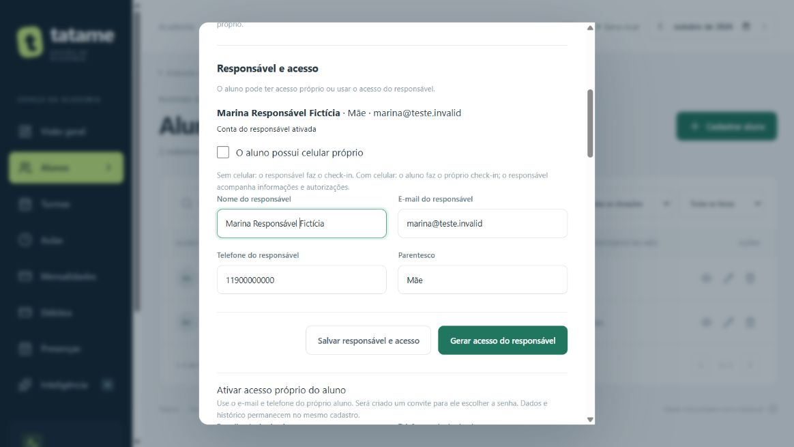
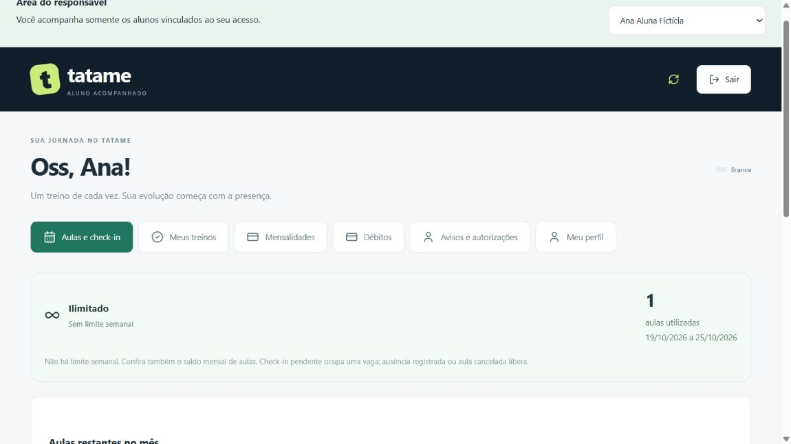

# Responsáveis, menores e transferência de acesso

Entrega de 25/10/2026, implementada e testada localmente e no Supabase de homologação. **Aguardando validação do usuário; sem commit/push desta entrega e sem publicação no Render.**

## Para entender do zero

O cadastro do aluno é a ficha da pessoa na academia. A conta de acesso é a chave que permite consultar essa ficha. Dar uma chave ao responsável não cria outro aluno: a mesma ficha continua guardando treinos, mensalidades e débitos.

O responsável tem uma chave própria que abre somente as fichas dos menores vinculados a ele. Quando o aluno passa a ter celular, ganha sua própria chave. Aos 18 anos, o responsável deixa de ter acesso administrativo à ficha; seu telefone pode continuar guardado como contato.

## O que foi implementado

| Situação | Acesso do aluno | Acesso do responsável | Quem faz check-in |
| --- | --- | --- | --- |
| Menor sem celular | Principal com responsável | Consulta dados, histórico, mensalidades, débitos e comunicados; responde autorizações; pode confirmar aula adicional com débito | Responsável |
| Menor com celular | Conta própria | Continua acompanhando dados, finanças e autorizações destinadas a ele | Aluno |
| Passou a ter celular | Administrador prepara convite de acesso próprio | Continua vinculado até a maioridade | Aluno após ativar a conta |
| Completou 18 anos | Administrador finaliza transferência ao aluno | Acesso aos dados é encerrado; vínculo pode ficar como contato ou ser arquivado | Aluno |

O responsável pode acompanhar vários menores com uma única conta. Nesta primeira implementação, cada aluno tem um responsável operacional ativo. Vínculos substituídos ficam arquivados para preservar o histórico; não são apagados.

Um e-mail pertence a um único perfil de acesso. Se ele já for usado por aluno ou administrador, o cadastro de responsável solicita outro e-mail. Contas com múltiplos perfis simultâneos ficam para evolução futura. Ao reutilizar um e-mail já cadastrado como responsável, o sistema conserva sua identidade e senha, e acrescenta o novo dependente. O nome informado no cadastro do novo filho não altera silenciosamente essa conta existente.

## Como conferir nas telas

1. Entre como administrador e abra **Alunos → Cadastrar aluno**.
2. Informe o nascimento. Sendo menor, aparece **Possui celular próprio**, inicialmente marcado.
3. Sem celular, desmarque e preencha nome, e-mail, telefone e parentesco do responsável. E-mail e telefone próprios do aluno tornam-se opcionais. O cadastro e o vínculo são salvos juntos.
4. Com celular, mantenha marcado. A opção **Vincular responsável também** permite cadastrá-lo no mesmo formulário. Em cadastros existentes, faça a vinculação pela ficha.
5. Abra **Alunos → Ver ficha → Responsável e acesso**. Salve o vínculo e use **Gerar acesso do responsável**.
6. Entregue o convite privado somente à pessoa indicada. Ela abre o link, escolhe a própria frase de senha e entra normalmente pelo e-mail. O perfil direciona automaticamente à área do responsável.
7. Na área do responsável, escolha o aluno no seletor superior. Consulte **Aulas e check-in**, **Meus treinos**, **Mensalidades**, **Débitos**, **Avisos e autorizações** e **Meu perfil**.
8. Para preparar o acesso do menor que passou a ter celular, na ficha informe o e-mail e telefone próprios e use **Ativar acesso próprio**. Entregue o convite ao aluno. O responsável continua vinculado, mas não faz mais check-in por ele.
9. Aos 18, use **Transferir responsabilidade ao aluno**. Escolha se deseja manter o responsável anterior como contato. A transferência encerra o acesso anterior do aluno e gera um novo convite; o mesmo `Aluno.id` permanece.

O administrador também pode voltar um menor ao acesso pelo responsável: desmarcar celular próprio e salvar o vínculo. Isso invalida sessões, senha e convite antigos do aluno. Uma nova ativação própria exigirá outro convite.

Se o aluno ficar inativo, seus acessos são recusados. A maioridade é calculada pela data de nascimento e pelo dia em São Paulo em cada requisição; não depende de alguém abrir a ficha. Ao completar 18, o responsável perde acesso àquele aluno imediatamente, mesmo que a transferência administrativa ainda esteja pendente. Se houver outros menores vinculados, continua acessando os demais. Não há criação automática de senha nem envio automático ao completar aniversário.

## Check-in, saldo e finanças

O usuário confirmou: **o responsável pode fazer check-in pelo menor sem celular**. Essa permissão é verificada no servidor e novamente dentro da transação de gravação. Esconder um botão, sozinho, não oferece essa proteção.

As mesmas regras do aluno continuam valendo: aula publicada para hoje, cadastro ativo, limites semanal/mensal, mensalidade e débito adicional vencidos. Repetir o check-in não desconta outra aula. O professor confirma presença posteriormente. Uma aula adicional continua exigindo aceite explícito do preço/prazo, gera débito no cadastro do aluno e não antecipa a presença. O responsável pode assumir essa confirmação financeira, mas não mudar preço, prazo, limite ou registrar pagamento. A baixa permanece administrativa.

Mesmo com bloqueio financeiro, o login permite consultar os débitos e comunicados. As pendências de mensalidade continuam apresentadas pelo bloqueio financeiro já existente.

## Avisos e autorizações

Na ficha, o administrador cria um **Aviso** ou **Pedido de autorização**, para o **Acesso principal do aluno** ou para o **Responsável vinculado**. O destinatário é identificado no momento do envio. Se ainda não houver conta preparada, a operação pede sua criação primeiro.

O destinatário recebe a mensagem dentro do Tatame. Aviso permite **Estou ciente**; autorização permite **Autorizar** ou **Não autorizar**. A primeira resposta fica registrada com data e conta destinatária. Repetir a mesma resposta conserva o registro; tentar substituí-la é recusado. A gravação revalida vínculo/idade em uma transação para não aceitar uma autorização depois da perda de acesso.

A conta do aluno não herda mensagens privadas destinadas ao responsável. Esses registros continuam na ficha administrativa e no histórico armazenado. Mensalidades, débitos e treinos continuam ligados ao aluno e ficam disponíveis em seu novo acesso.

Este recurso envia mensagens **dentro da plataforma**. Não envia e-mail, WhatsApp, SMS ou push; essas integrações continuam futuras. O convite precisa ser entregue manualmente. Um link `127.0.0.1` funciona somente no computador onde o servidor está rodando; acesso externo depende da publicação com HTTPS.

## Arquitetura e decisões

| Arquivo ou componente | Responsabilidade e motivo |
| --- | --- |
| `packages/shared/src/index.ts` | Contratos de aluno, responsável, vínculo, comunicado e auditoria compartilhados pelo frontend/backend. |
| `apps/api/src/modules/auth/familia.ts` | Regras de menoridade, permissões e plano de alterações. A mesma regra gera as operações dos dois bancos. |
| `apps/api/src/repository.ts` | Transações de cadastro/vínculo/transferência e respostas. SQLite usa `BEGIN IMMEDIATE`; PostgreSQL trava o aluno e serializa operações familiares para evitar contas duplicadas de responsáveis de irmãos. |
| `apps/api/src/modules/auth/familia-routes.ts` | Rotas administrativas de vínculo/convites/transferência/comunicados e listagem de dependentes. |
| `apps/api/src/modules/auth/routes.ts` | Login, identificação e ativação aceitam o novo perfil; verificam se ainda há dependente autorizado. |
| `apps/api/src/modules/auth/portal.ts` | Reutiliza as regras do portal, com aluno escolhido somente após validar o vínculo. Endereços diferentes não dão acesso a outros alunos. |
| `apps/web/src/pages/StudentsPage.tsx` | Cadastro com opção de celular e dados do responsável; ficha contém controles de transferência. |
| `apps/web/src/components/ControleParental.tsx` | Formulários administrativos, convite e histórico das trocas de acesso. |
| `apps/web/src/pages/ResponsavelPortal.tsx` | Seletor de dependente e montagem do portal. Trocar de filho recria a tela para não exibir respostas antigas do filho anterior. |
| `apps/web/src/pages/StudentPortal.tsx` | Portal compartilhado com endereço de API delimitado por aluno. A permissão do check-in aparece na tela e também é imposta no backend. |
| `apps/web/src/components/Comunicados.tsx` | Criação administrativa, caixa de entrada e confirmação de leitura/autorização. |
| `apps/api/src/familia.test.ts` e `familia-migration.test.ts` | Regras, autenticação, isolamento, transações, migração e preservação. |

### Dados e migração 9

- `Aluno`: `possuiCelular`, `acessoPrincipal` e `responsabilidadeTransferidaEm`. Cadastros existentes começam com acesso próprio, preservando o comportamento anterior.
- `Usuario`: novo perfil `responsavel`, sem `alunoId` direto. Um usuário pode estar ligado a vários alunos por `ResponsavelAluno`.
- `ResponsavelAluno`: aluno, usuário responsável, telefone, parentesco, tipo de vínculo e datas. Restrição garante um vínculo operacional ativo por aluno. `contato` guarda referência e não concede acesso; `arquivado` guarda o vínculo anterior.
- `EventoAcessoAluno`: aluno, conta que fez a mudança, tipo, detalhes e data. Vínculo e transferência são administrativos; a edição dos próprios dados básicos registra o aluno como autor. Não contém senha nem token de convite.
- `ComunicadoAluno`: aluno, destinatário, autor, tipo, título/mensagem, resposta e datas.

Sem e-mail próprio, o aluno recebe internamente um identificador único no domínio reservado `cadastro.invalid`, exibido como **Sem e-mail próprio**. Isso permite manter o contrato existente de e-mail único sem fingir que o e-mail do responsável é o do filho. Não há envio de e-mail para esse identificador. A ativação própria exige endereço real informado pelo administrador.

SQLite: `009_responsaveis.sql` reconstrói somente a tabela `Usuario` para ampliar a restrição de perfil, copia todas as colunas existentes e mantém seus vínculos. O executor desativa a aplicação das FKs somente durante essa reconstrução transacional, verifica integridade antes do commit e restaura a proteção no sucesso ou falha. O banco local recebeu backup consistente antes da migração. PostgreSQL: `202610250003_responsaveis/migration.sql` altera as restrições sem reconstruir os usuários. Nenhum arquivo de migração antiga foi reescrito.

### Contratos HTTP principais

| Método e rota | Perfil | Função |
| --- | --- | --- |
| `POST /api/alunos` | Admin | Cadastro; aceita `possuiCelular` e `responsavel` opcional, obrigatório quando menor sem celular. |
| `GET /api/alunos/:id/familia` | Admin | Situação, responsáveis e eventos de acesso. |
| `PUT /api/alunos/:id/familia` | Admin | Define responsável e modo de acesso com `{possuiCelular,responsavel:{nome,email,telefone,parentesco}}`. |
| `POST /api/alunos/:id/familia/convidar` | Admin | Convite único de 24 horas para responsável. |
| `POST /api/alunos/:id/familia/transferir` | Admin | `{email,telefone,maioridade,manterContato}`; prepara acesso próprio e, na maioridade, encerra o vínculo operacional. |
| `GET/POST /api/alunos/:id/comunicados` | Admin | Consulta e criação de comunicados. |
| `GET /api/responsavel/dependentes` | Responsável | Somente seus menores ativos autorizados. |
| `GET /api/responsavel/:alunoId/portal` | Responsável vinculado | Dados do aluno escolhido. |
| `GET .../portal/debitos` | Responsável vinculado | Débitos do dependente. |
| `PUT .../portal/aulas/:id/checkin` | Responsável principal | Check-in do menor sem celular. |
| `POST .../portal/aulas/:id/adicional` | Responsável vinculado | Mesmas condições/aceite do aluno para aula adicional. |
| `GET .../portal/comunicados` | Destinatário autorizado | Apenas mensagens destinadas à própria conta naquele aluno. |
| `PUT .../portal/comunicados/:id/resposta` | Destinatário autorizado | Resposta compatível, única e auditada. |

O portal do aluno usa os mesmos sufixos em `/api/portal`. O responsável não usa as rotas administrativas. Um aluno não pode selecionar outro aluno pelo endereço; o responsável só pode selecionar seus vínculos válidos.

## Validação executada nesta entrega

- **183 testes TypeScript aprovados**: 17 novos nesta entrega, incluindo preservação das 17 tabelas anteriores, migração com falha/reversão, check-in idempotente, isolamento entre famílias, acesso próprio, convites de uso único, bloqueios, maioridade, troca de responsável, revogação, avisos e respostas atômicas.
- **13 testes Python e 3 testes da configuração de homologação aprovados**, build/typecheck aprovados, Prisma Client gerado e schema validado.
- **SQLite local**: migração 9 com backup, hashes das 17 tabelas anteriores preservados, FKs ativas e verificação de integridade vazia.
- **Supabase de homologação**: TLS com certificado verificado; migração 9, dados anteriores preservados; teste sintético real de irmãos concorrentes compartilhando conta, convite único, sessão/isolamento, check-in concorrente sem duplicação, saldo, resposta e transferências. Limpeza conferida por hashes das 20 tabelas. Não é uma implantação pública.
- **Navegador em memória**: criação de menor sem contato próprio, vínculo com responsável existente, seleção de filhos, check-in/desconto, adicional com débito imediato, resposta à autorização e transferência para acesso próprio. Tela de aluno com celular bloqueou o botão de check-in do responsável. Capturas abaixo usam apenas dados fictícios.

Não houve teste físico em celular nem envio externo de notificações. A validação humana do conjunto ainda está pendente.

## Para sua defesa oral

**Por que separar conta de acesso e aluno?** Porque o aluno é a pessoa que treina; o usuário é quem entra. Um responsável pode entrar para acompanhar vários filhos sem duplicar fichas ou mensalidades.

**Por que não basta esconder o botão de check-in?** Porque alguém poderia chamar a API diretamente. O servidor confere perfil, vínculo, idade e modo de acesso antes de gravar.

**Por que usar uma transação na transferência?** Para evitar ficar com metade da mudança feita: acesso antigo desativado, mas vínculo ou convite não atualizado. Ou tudo é salvo, ou tudo volta ao estado anterior.

**Por que guardar o vínculo antigo?** Para explicar quem era responsável em cada momento e preservar a origem dos registros. Contato ou vínculo arquivado não concede permissão.

**Como saber que a IA não apagou o histórico?** Foram feitos testes automáticos de migração e reversão, backup local e comparação por hash de todas as tabelas anteriores nos bancos reais de desenvolvimento/homologação. Os testes não substituem sua revisão e validação das telas.
