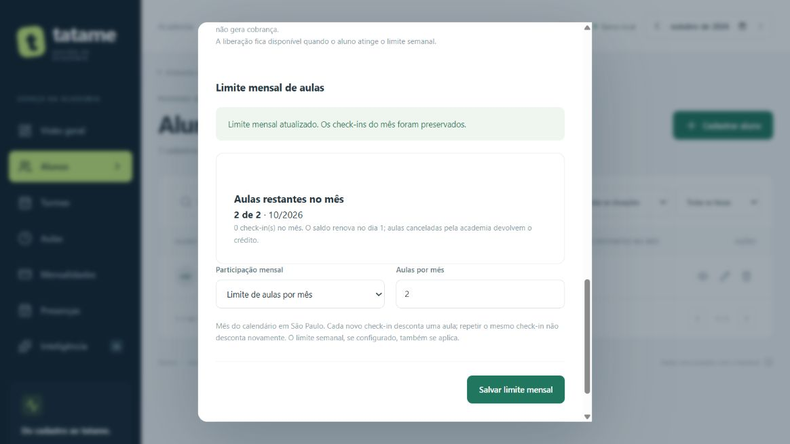
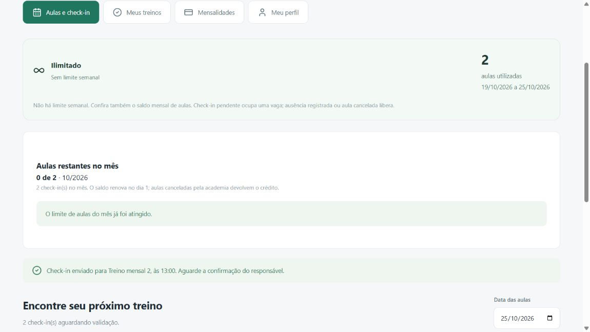

# Saldo mensal de aulas

## Ampliação para aulas adicionais — 25/10/2026

Após o pedido seguinte, existe [compra de aula adicional e menu Débitos](DEBITOS.md). A compra confirmada autoriza exclusivamente a aula escolhida e gera débito, sem aumentar o saldo do plano. Check-ins de adicionais ativos aparecem como adicionaisUtilizadas e não consomem de novo a cota regular. O limite semanal manual continua sem ignorar o mensal; a nova reserva paga é uma autorização distinta. Débito vencido bloqueia novos check-ins/reservas, mas a lista de débitos próprios permanece acessível. A renovação do saldo incluído no dia 1 continua igual. Migração atual passa a 8; as verificações de versão 7 abaixo são o registro da entrega anterior.

## Decisão e escopo — 25/10/2026

O usuário pediu saldo mensal no cadastro do aluno, desconto por check-in e aviso ao atingir o limite. Confirmou renovação no dia 1, sem desconto duplicado e devolução quando a academia cancela a aula. A opção é individual para atender academias com planos limitados e ilimitados.

O mês é o calendário em America/Sao_Paulo, independente do vencimento da mensalidade. O limite mensal e a cota semanal existente são regras distintas: ambas precisam permitir o check-in. Uma liberação extra semanal não ultrapassa o limite mensal. A cobrança e o bloqueio financeiro continuam separados.

## Uso

Em Alunos, abra a ficha pelo botão de visualizar e localize Limite mensal de aulas. Escolha Sem limite mensal ou Limite de aulas por mês (1 a 1000), informe o total contratado e salve. O saldo é calculado pelo servidor: não é um campo livre que o aluno possa aumentar. A listagem de alunos mostra Aulas restantes no mês; o próprio aluno vê o resumo no portal. Saldo esgotado mostra “O limite de aulas do mês já foi atingido.” e bloqueia novos check-ins na API, inclusive quando a tela está desatualizada.

Quem já está cadastrado continua sem limite mensal até configuração pela administração. Alterar dados cadastrais comuns não apaga o limite/saldo. Alterar o limite mensal desconta os check-ins válidos que já existem no mês, sem reiniciar ou apagar o consumo. Aumentar o limite libera a diferença; reduzir abaixo do já utilizado mantém saldo zero, nunca negativo. Desativar o limite preserva o histórico.

## Modelo e consistência

Aluno recebe três colunas opcionais: limiteAulasMensal (total contratado), aulasRestantesMes (saldo armazenado) e mesSaldoAulas (AAAA-MM do saldo). Null no limite significa ilimitado. São migrações novas e aditivas: SQLite 7 e equivalente PostgreSQL/Prisma. Migrações anteriores não foram reescritas. SQLite gera backup antes de atualizar banco existente.

CheckinAula é o registro de consumo. Um check-in único por aula/aluno desconta uma unidade; repetir retorna o mesmo aviso. Confirmar presença não desconta outra unidade. Marcar ausência após o check-in não devolve crédito mensal automaticamente: o consumo solicitado ocorre no check-in, enquanto a cota semanal continua com sua regra anterior de ausência. Aulas canceladas deixam de consumir saldo, e o cancelamento sincroniza o contador sem apagar o aviso histórico. Presença manual sem check-in e registros antigos por modalidade não consomem esse saldo mensal.

A cada operação relevante, o consumo é conferido pelo histórico do mês, em vez de confiar cegamente em um contador informado pelo cliente. Novo check-in, ajuste de limite e cancelamento persistem o saldo na mesma transação. Na virada do mês, consultas calculam o novo saldo lógico imediatamente; o contador e sua referência são persistidos na primeira operação relevante do novo mês. Não há agendador noturno obrigatório nem atualização destrutiva de históricos.

SQLite usa BEGIN IMMEDIATE. PostgreSQL bloqueia a linha do aluno com FOR UPDATE dentro da transação, serializando check-ins em aulas diferentes que disputam a última vaga. A criação do aviso e a atualização do saldo ou são concluídas juntas, ou são revertidas. Cancelamento e edição do limite usam bloqueios compatíveis. As colunas de saldo não são aceitas no cadastro comum ou no payload do aluno.

GET e PUT /api/alunos/:id/saldo-mensal são administrativos. PUT aceita apenas limiteMensal (inteiro positivo ou null); a resposta inclui competência, utilizadas, restantes e limiteAtingido. O portal retorna somente o saldo do usuário autenticado. Não há nova permissão de aluno para editar contrato ou saldo.

## Validação da entrega — 25/10/2026

Nova suíte TypeScript: 152 aprovados, incluindo 11 casos de saldo/migração. Verificados saldo persistido, repetição, concorrência SQLite, rollback por falha de gravação, cancelamento idempotente, confirmação/ausência, mudança de limite, autorização, payload forjado, limite semanal/financeiro, troca de mês/ano, atualização da competência e migração com backup/reabertura. Os 13 testes Python passaram. Prisma Client gerado, schema validado e build/typecheck final aprovados.

SQLite local real atualizado para a versão 7 pelo migrador, com backup anterior em data/backups. Comparação de hashes das colunas anteriores nas 15 tabelas confirmou preservação de todos os registros, nenhuma FK inválida e todos os alunos anteriores inicialmente sem limite mensal. Nenhum aluno real foi limitado para testar.

Supabase de homologação: TLS validado, migração aditiva 7 aplicada com saída 0. Teste com aluno/aulas inteiramente fictícios verificou dois check-ins simultâneos na última vaga (um aceito e outro recusado), repetição idempotente, cancelamento com devolução, novo desconto, alteração do limite preservando consumo e desativação do limite. Registros sintéticos foram removidos ao final. As 15 tabelas tiveram seus dados anteriores conferidos por hashes, preservados; sete migrações concluídas. Isso valida este caminho de saldo no PostgreSQL; não equivale a validar todas as funcionalidades ou a publicar a plataforma.

Navegador com SQLite em memória: configuração de duas aulas pela ficha; aluno visualizou 2 de 2, depois 1 de 2 e 0 de 2 após dois cliques de check-in; terceira aula ficou bloqueada com aviso mensal. Volta à gestão confirmou coluna com zero. Os testes visuais usaram identidade fictícia, sem senha pessoal e sem gravar nos bancos reais. Capturas abaixo. Um seletor de participação mensal foi ajustado após ler a árvore de acessibilidade; configuração e gravação foram efetivamente conferidas. Tela estreita/aparelho físico não foram testados neste incremento.

A API local está atualizada. Ainda sem aprovação de commit/push para este conjunto; alterações anteriores pendentes preservadas.

## Para a defesa oral

- Por que guardar o mês junto com o saldo? Para distinguir saldo antigo de saldo do mês atual e renovar sem misturar os períodos.
- Por que validar no servidor? A tela pode estar desatualizada ou ser manipulada; é o servidor que decide se ainda existe vaga.
- Por que usar transação e bloquear a linha do aluno? Duas aulas podem receber check-in ao mesmo tempo; o último crédito só pode ser utilizado uma vez.
- Por que manter o histórico além do contador? Ele permite conferir o desconto, recalcular após alteração/cancelamento e explicar de onde veio o saldo.
