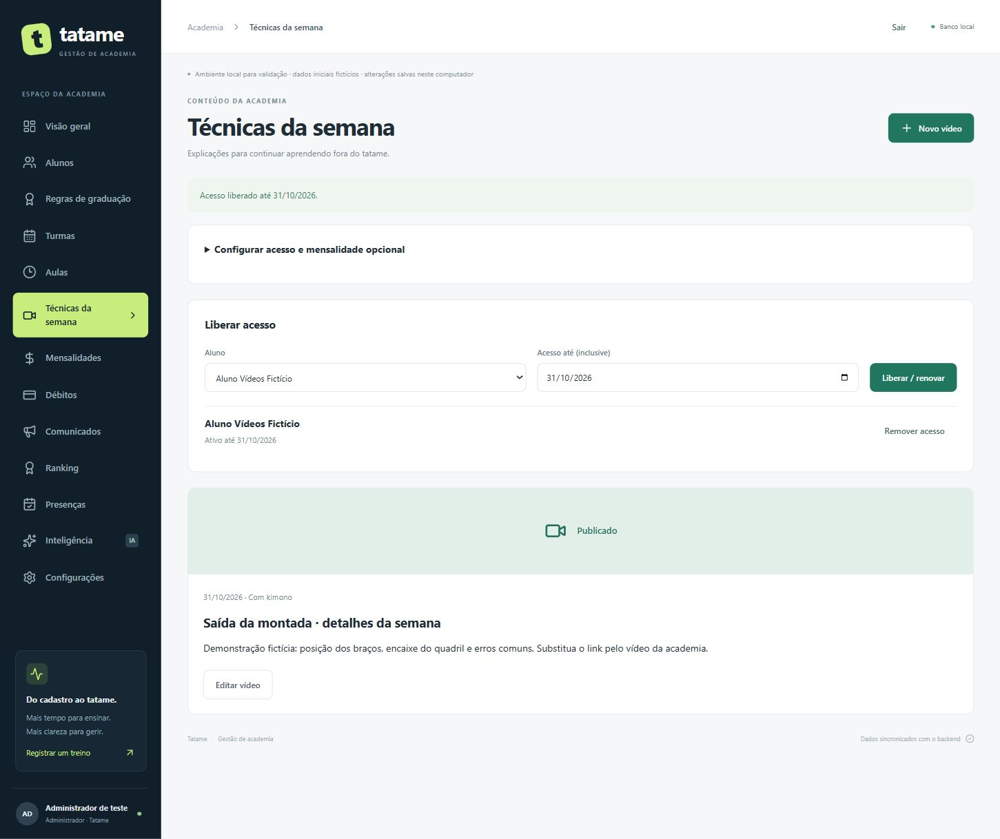
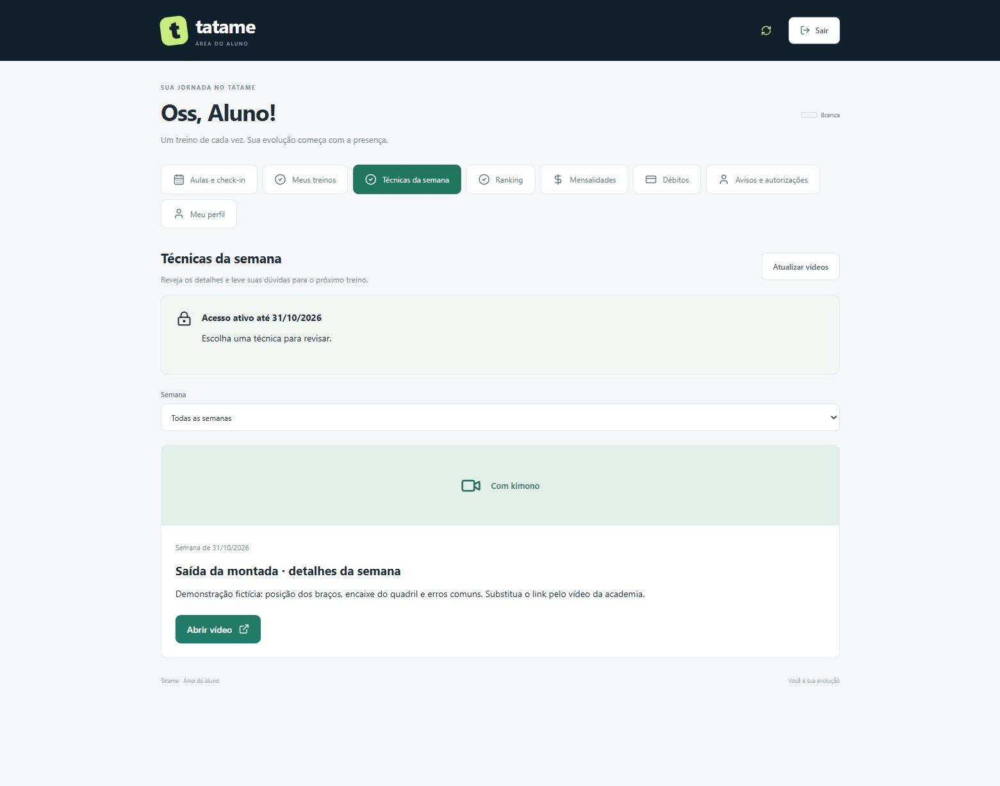

# Técnicas da semana

## Próxima etapa adiada — comunicado de vídeo novo e Pix (22/11/2026)

O usuário pediu **para depois**: quando houver um vídeo novo publicado, o aluno recebe um comunicado no Tatame. Abaixo do nome da técnica, aparece a contratação por Pix, e o acesso é liberado automaticamente após confirmação real do pagamento pelo provedor no servidor. Reutilizar o contador e a confirmação **Estou ciente** dos comunicados. Integração de pagamentos, modelo de cobrança, preço/validade e vínculo da liberação serão definidos na retomada. A mensalidade demonstrativa da captura não aprova cobrança avulsa nem recorrência. **Planejado, não implementado.** [Requisitos futuros](PLANO_FUNCIONAL.md#vídeo-novo-com-comunicado-e-pix--planejado-para-depois-22112026).

## Player do Tatame com Google Drive privado

1. Na conta Google exclusiva do Tatame, crie uma pasta para os vídeos. Mantenha **Acesso geral → Restrito** na pasta e em cada arquivo. Compartilhe a pasta apenas com quem administra o conteúdo e com a conta de serviço do Tatame como **Leitor**. [Permissões no Google Drive](https://support.google.com/drive/answer/7166529?hl=pt-BR).
2. No Google Cloud, habilite a Drive API e crie uma conta de serviço para a leitura. Configure `GOOGLE_DRIVE_FOLDER_ID` e `GOOGLE_DRIVE_SERVICE_ACCOUNT_JSON` somente na API, em variáveis privadas. A conta de serviço usa OAuth de leitura. [Conta de serviço](https://docs.cloud.google.com/iam/docs/service-accounts-create) · [Chave JSON](https://docs.cloud.google.com/iam/docs/keys-create-delete).
3. Coloque um MP4 diretamente na pasta e, em **Técnicas da semana → Novo vídeo**, cole o link desse arquivo e publique na data desejada. Libere o acesso ao aluno após confirmar o pagamento. A liberação continua sendo registrada pela gestão.
4. Na área do aluno, **Assistir técnica** abre o player na própria página. Cada pedido de vídeo verifica a sessão e a validade da liberação. O endereço do Drive e a credencial ficam no servidor. O endereço do player copiado sozinho exige uma sessão com acesso válido. Gravação de tela e cópia por quem consegue assistir continuam tecnicamente possíveis.

A implementação local foi testada com respostas simuladas do Drive. A reprodução real aguarda a configuração da pasta e da conta de serviço. O vídeo permanece no Drive. A API envia trechos autenticados de até 4 MiB para requisições por intervalo. [Download parcial no Drive](https://developers.google.com/workspace/drive/api/guides/manage-downloads) · [Limites de resposta na Vercel](https://vercel.com/docs/functions/limitations).

## Direção proposta — envio ao YouTube pelo Tatame (01/11/2026)

Usuário prefere manter vídeos no YouTube e quer evitar o trabalho de abrir o YouTube Studio, enviar e copiar links manualmente. Consulta confirmou viabilidade com **YouTube Data API v3**, `videos.insert`, OAuth2 e biblioteca oficial Google para Node.js (`googleapis`). **Estado: proposta documentada; integração, conexão de canal e envio real não implementados.** A opção de link já existente continua funcionando. O upload privado em Supabase permanece adiado; não remover o código preparado nem ativá-lo por este planejamento.

Fluxo proposto: professor conecta o canal com autorização Google; seleciona arquivo e título/descrição no Tatame; confirma o envio e visibilidade; acompanha Enviando/Processando/Disponível. O aplicativo registra o ID/link após confirmação da API e só disponibiliza ao aluno quando o vídeo estiver pronto. O arquivo fica no YouTube; o banco do Tatame guarda referência e metadados. Envio não faz automaticamente cortes, tratamento de áudio ou edição pedagógica; esses recursos seriam outra etapa.

Antes de implementar: configurar projeto no Google Cloud e OAuth com escopo mínimo de upload, consentimento e retorno HTTPS estável; proteger tokens no servidor e oferecer desconexão; respeitar cotas e visibilidade escolhida; confirmar o canal destinatário antes de qualquer envio. Usar upload retomável e arquitetura que evite passar arquivos grandes pelo corpo da função da Vercel. Conferir o canal/projeto de teste antes de prometer funcionamento de não listado, notificações ou publicação final. Nenhuma senha Google será solicitada ou armazenada pelo Tatame.

**Ponto pendente para a monetização:** as políticas da API, seção III.F.3, proíbem cobrar para assistir conteúdo em player YouTube incorporado. Também há restrições comerciais em III.G. Não apresentar esse desenho como biblioteca paga aprovada, nem usar uma abertura externa como suposto contorno. Vídeo não listado pode ser compartilhado por qualquer pessoa com o link. A estratégia de cobrança/hospedagem precisa ser revista antes de vender acesso aos vídeos. Não há escolha comercial final nem implementação de pagamento autorizada por esta consulta.

Fontes oficiais consultadas em01/11/2026:

- [Envio de vídeo e autorização](https://developers.google.com/youtube/data/reference/rest/v3/videos/insert?hl=en).
- [OAuth no servidor e bibliotecas oficiais](https://developers.google.com/youtube/data/guides/auth/server-side-web-apps).
- [Cliente oficial Node.js](https://github.com/googleapis/google-api-nodejs-client).
- [Políticas da API](https://developers.google.com/youtube/terms/developer-policies).
- [Privacidade de vídeos não listados](https://support.google.com/youtube/answer/157177?hl=pt-BR).

**Decisão mais recente —31/10/2026:** upload privado de vídeos adiado pelo usuário para definir tamanho, qualidade e duração posteriormente, sem bloquear a atualização atual. Código local preservado; buckets e chaves não ativados. Links externos da versão publicada continuam disponíveis. [Ponto de retomada](ARMAZENAMENTO.md).

## Envio privado adicionado localmente —31/10/2026

Editor agora permite link externo ou arquivo MP4 de até50 MiB, com upload direto e URLs temporárias após autorização. Código e testes locais aprovados; envio real no Supabase ainda não ativado. A descrição anterior de “somente links” registra a primeira implementação e é superada por esta extensão local. Modelo/preço continuam adiados, sem novas cobranças. [Configuração e limitações](ARMAZENAMENTO.md).

**Atualização externa — 31/10/2026:** migração18 aplicada no Supabase junto com11–17, com autorização, exportação lógica privada e preservação verificadas. Onze modelos novos lidos pelo Prisma; biblioteca externa continua sem conteúdo ou acessos liberados. [Relatório](MIGRACOES_11_18.md). Modelo/preço seguem adiados. Registros de QA e estados anteriores abaixo são históricos; não houve publicação da aplicação.

## Objetivo e proposta inicial

O usuário pediu uma área com explicações em vídeo das técnicas da semana. A participação é opcional: inicialmente a receita ajudará a custear o aplicativo da academia; posteriormente, a intenção é monetizar o conteúdo e a plataforma em outras filiais/equipes.

O usuário decidiu em 31/10/2026 **deixar o modelo de cobrança para depois**. Mensalidade da biblioteca, vídeo avulso e pacote semanal continuam sem escolha aprovada; não solicitar novamente essa decisão até retomar o assunto. A prévia já construída demonstra mensalidade opcional, valor editável e liberação manual por validade, apenas como proposta. R$ 10,00 é um exemplo, não um preço aprovado. Não há cobrança, repasse ou destinação automática de receita. Validar a área de vídeos independentemente da definição comercial.

## Como conferir

No painel administrativo, entre em **Técnicas da semana**:

1. Em **Configurar acesso e mensalidade opcional**, habilite a biblioteca, defina o valor mensal e escreva como o aluno pode contratar.
2. Em **Novo vídeo**, informe título, data da semana, Com kimono/Sem kimono, link e explicação. Salve como rascunho ou publique. Uma data futura adia a exibição ao aluno até essa data.
3. Após conferir o pagamento fora da plataforma, selecione o aluno e informe **Acesso até (inclusive)**. Liberar novamente atualiza a validade, sem duplicar o registro.
4. **Remover acesso** encerra a autorização dentro do Tatame. Desativar a biblioteca oculta o catálogo e bloqueia a entrega de links, preservando os cadastros e as validades.

Aluno e responsável vinculado encontram a aba na área do aluno. Podem consultar as técnicas publicadas, filtrar pela data de referência e ver as condições de contratação. **Assistir técnica** consulta o servidor; com acesso vigente, aparece **Abrir vídeo**, que leva ao provedor em outra aba. O responsável usa a autorização específica do dependente; pagar/liberar para um aluno não libera outros.

O bloqueio financeiro de check-in não concede nem revoga esta contratação separada. Não são criados débitos de aula adicional, mensalidades de treino ou limites de presença pela biblioteca.

## Limitação importante dos vídeos por link

Esta primeira versão cadastra links HTTPS de vídeos YouTube e Vimeo; não faz upload, streaming próprio ou consulta desses provedores. A lista entregue ao aluno nunca inclui URLs; a rota de assistir só entrega o link após verificar sessão, vínculo, biblioteca habilitada, validade, publicação e data. Rascunhos e semanas futuras não entram no catálogo do aluno.

Esse controle protege a entrega pelo Tatame, **não impede repassar um link já recebido**. O próprio [YouTube explica que vídeos não listados podem ser vistos e compartilhados por quem tem o link](https://support.google.com/youtube/answer/157177). Não chamar essa solução de hospedagem privada ou proteção contra cópia. Para comercialização com controle no próprio provedor, integrar hospedagem com autorização/URLs temporárias antes do lançamento pago. Conteúdo, privacidade e reprodução dependem das configurações do provedor; o teste usou um link fictício e não comprovou reprodução de um vídeo real.

## Arquivos e responsabilidades

| Parte | Responsabilidade |
| --- | --- |
| `apps/web/src/pages/TecnicasPage.tsx` | Gestão administrativa, editor de vídeo e biblioteca do aluno |
| `apps/api/src/modules/tecnicas/routes.ts` | Validação e regras de publicação, autorização e entrega do link |
| `packages/shared/src/tecnicas.ts` | Contratos usados por tela e API |
| `repository.ts` | Persistência SQLite/Prisma; upsert de configuração e liberação |
| Migração SQLite 18 / Prisma `202610310001_tecnicas` | Três tabelas novas, sem modificar os registros anteriores |

`ConfiguracaoTecnicas` guarda ativação/preço/instruções desta instalação. `VideoTecnica` guarda os conteúdos. `AcessoTecnicas` usa o ID do aluno como chave, validade e autor da última liberação. FKs impedem perda silenciosa de vínculos; índices cobrem semana e autor. Migração PostgreSQL preparada com RLS nas três tabelas, sem políticas públicas; o backend continua usando sua conexão privada. **Não executada no Supabase.**

Upsert significa “crie se ainda não existe; atualize se já existe”. Evita autorizações duplicadas quando o professor renova o mesmo aluno. Não é comprovante financeiro e não mantém histórico completo das renovações ou pagamentos; isso pertence à futura integração financeira.

O modelo atual configura uma academia por instalação/banco. **Isolamento de várias academias no mesmo banco, vendas entre filiais, comissões e repasses não estão implementados.** Antes dessa expansão, definir titularidade dos conteúdos e separar academia/contratante/direitos de acesso na arquitetura.

## Verificações de 31/10/2026

276 testes TypeScript aprovados; build/typecheck, geração e validação Prisma aprovados. Casos novos cobrem link inválido/host disfarçado, acesso sem autorização, validade inclusive/vencida, rascunho/futuro, desativação, aluno inativo, renovação única, responsável correto, isolamento entre alunos e migração aditiva preservadora.

Após os índices/RLS finais, os sete testes específicos de biblioteca/migrações e a validação Prisma foram executados novamente e passaram. Após acrescentar atualização por botão/foco e a cada 30 segundos, novo build/typecheck passou; navegador confirmou **Atualizar vídeos → Assistir técnica → Abrir vídeo**. Essa atualização permite ao aluno conferir uma liberação recente sem sair da aba.

Navegador com banco fictício em memória: configuração salva, vídeo cadastrado/publicado, aluno sem acesso recebeu botão bloqueado, professor liberou a validade e aluno recebeu o link após **Assistir técnica**. O primeiro salvamento da QA falhou por origem não permitida na porta de teste; corrigido somente o `APP_ORIGIN` do script de QA, sem enfraquecer a proteção da aplicação.

Prévia administrativa `http://127.0.0.1:3352/`, aluno `http://127.0.0.1:3353/`. Dados dessa prévia são fictícios e somem quando o processo é encerrado. Banco principal permanece v17 nesta entrega; migração18 testada somente em bases de teste. Reiniciar o servidor habitual com o código novo aplicará a migração SQLite pelo mecanismo existente, com backup. Supabase permanece com dez migrações concluídas; 11–18 pendentes. Sem commit/push/deploy nesta entrega.

## Para a defesa oral

- **Por que bloquear no servidor?** Esconder um botão não impede alguém de chamar a API diretamente. O servidor é quem decide se entrega o link.
- **Por que não reconhecer pagamento automaticamente agora?** Precisamos de um provedor e de confirmação verificável do pagamento; clicar em “paguei” não comprova recebimento. Por enquanto a academia confere e libera a validade.
- **O que precisará mudar para vender a várias academias?** Definir e aplicar o isolamento de cada academia e os direitos de conteúdo em todas as consultas; o preço editável sozinho não resolve isso.
