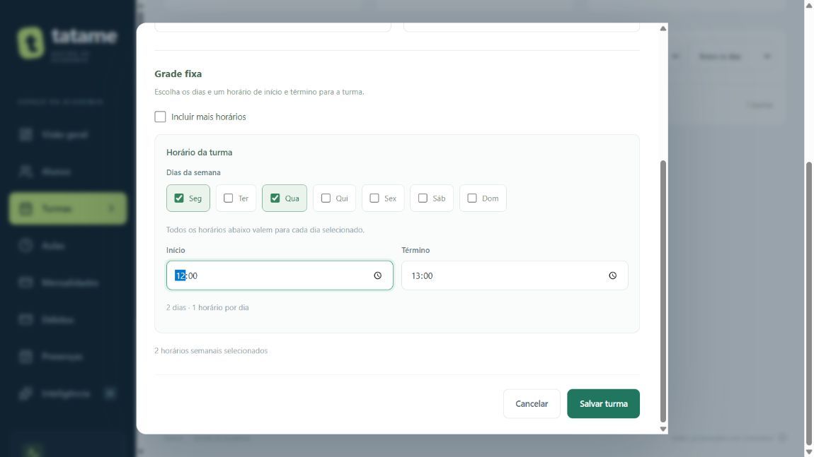
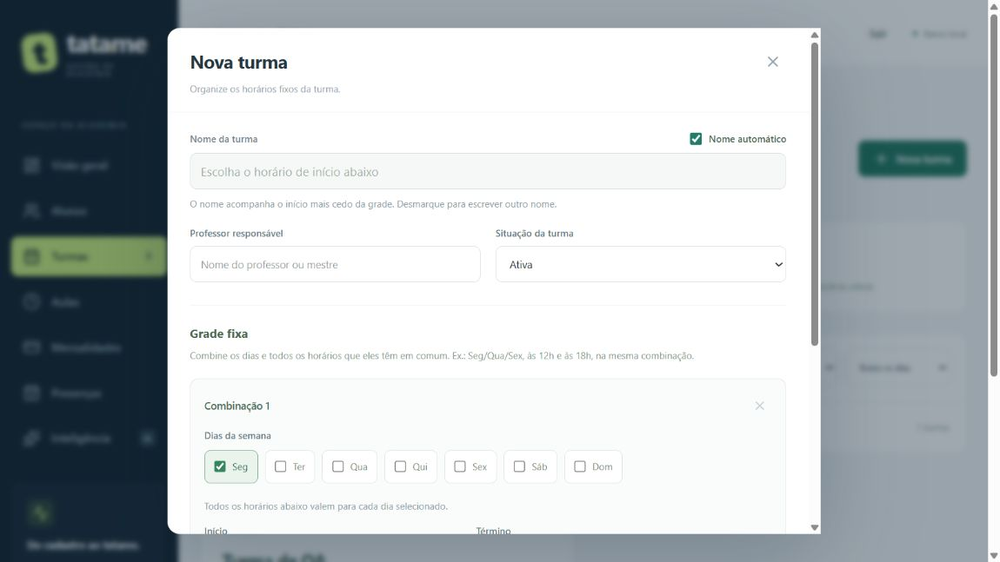
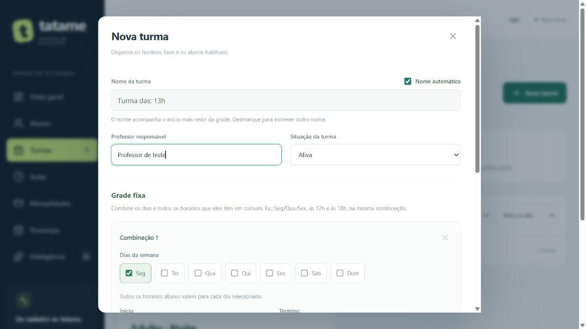
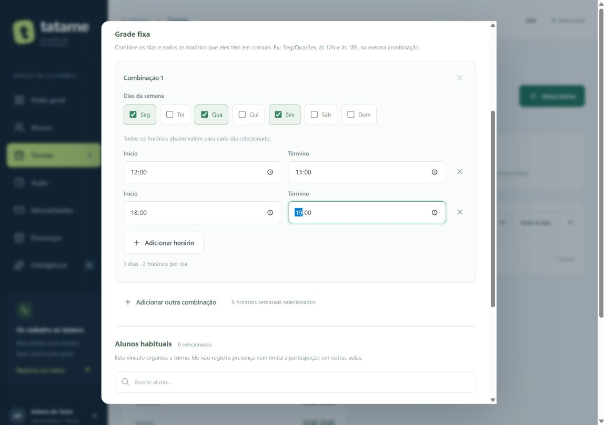
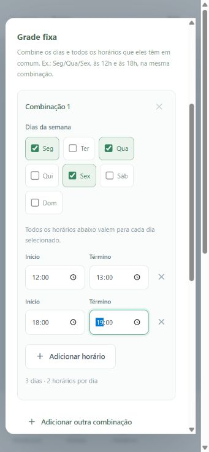
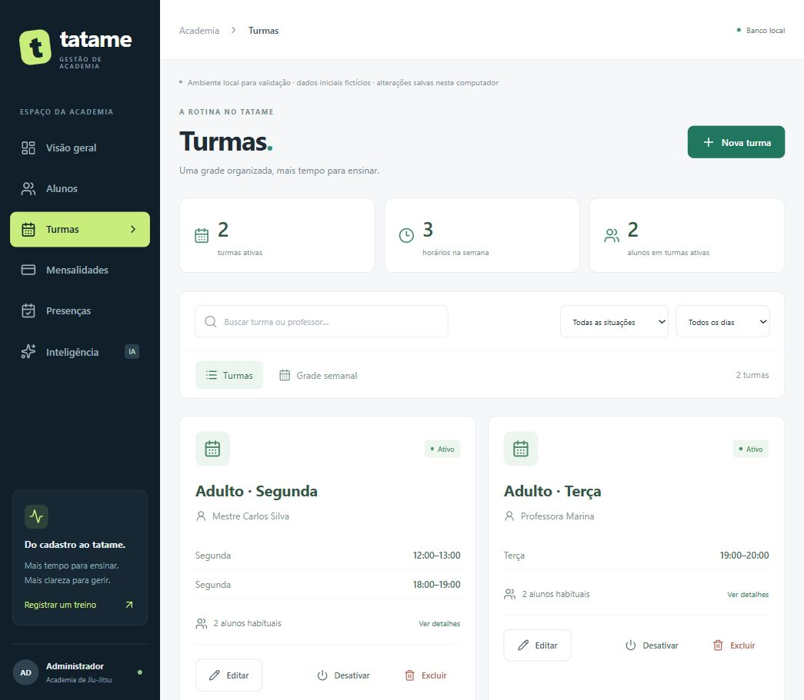
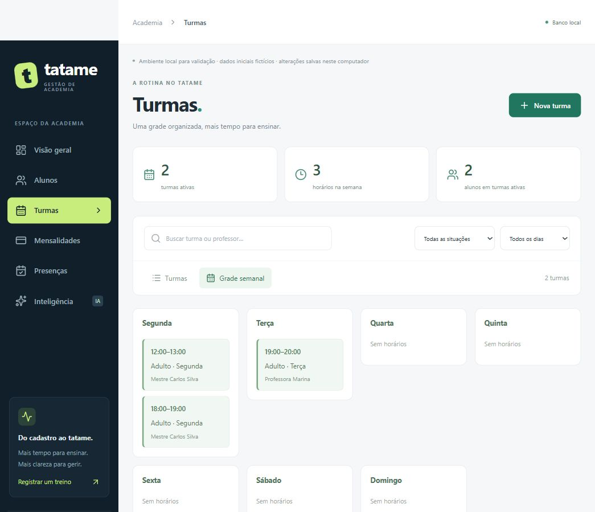
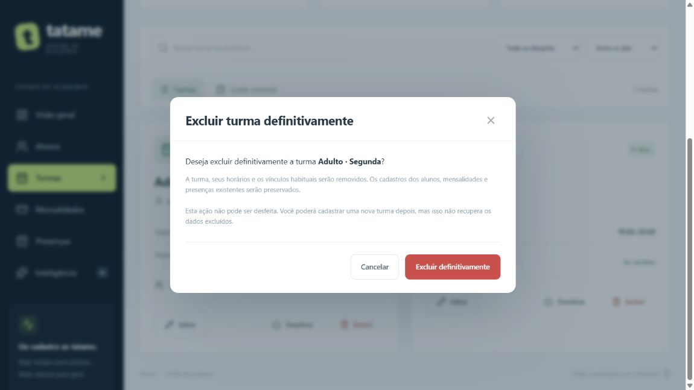

# Turmas e grade fixa — entrega 1A

## Horários adicionais opcionais — 26/10/2026

Em **Turmas → Nova turma → Grade fixa**, o checkbox **Incluir mais horários** começa desmarcado. O formulário mostra um intervalo de início/término, que pode valer para vários dias selecionados. Os botões **Adicionar horário** e **Adicionar outra combinação**, assim como os controles de remoção dos extras, ficam ocultos. Ao marcar, os controles e os horários adicionais ficam disponíveis.

Ao desmarcar, somente o primeiro intervalo da primeira combinação participa da tela, da contagem, do nome automático e do salvamento. Ele continua valendo para todos os dias selecionados nessa combinação. O rascunho dos extras fica guardado enquanto o formulário estiver aberto: marcar novamente restaura os campos. Se houver extras ocultos, uma orientação informa que eles não serão incluídos ao salvar. Fechar/cancelar descarta o rascunho sem modificar o cadastro salvo.

Na edição, turmas que já possuem mais de uma combinação ou mais de um intervalo começam com a opção marcada, preservando a grade. Um único intervalo repetido em vários dias continua sendo modo simples. A preferência é de interface; o banco recebe a grade efetivamente selecionada pelo contrato já existente, sem coluna ou migração nova. Nome manual e vínculos anteriores continuam preservados.

Verificação desta mudança: build/typecheck e os oito testes existentes de combinação de horários aprovados. Navegador com SQLite em memória confirmou opção inicialmente desmarcada, ausência dos botões, exibição ao marcar, inclusão/ocultação/restauração de um segundo intervalo e edição de grade múltipla inicialmente marcada. Salvar sem mudanças preservou os cinco horários, seus IDs, nome e vínculo. Após incluir um intervalo vazio e desmarcar, salvar considerou somente 12h–13h de Seg/Qua; o campo vazio oculto não bloqueou o formulário nem foi enviado, e os IDs mantidos/vínculo foram preservados. Reabrir essa turma mostrou a opção desmarcada. Dados somente fictícios, sem alteração de turmas reais. Suíte completa, Python e Supabase não foram reexecutados neste incremento de interface. Aguardando validação antes de commit/envio.

## Remoção da seleção de alunos no formulário — 25/10/2026

A pedido do usuário, Nova turma e Editar turma não exibem mais Alunos habituais, sua busca ou os checkboxes de alunos. O formulário contém nome, responsável, situação e grade fixa. Novas turmas enviam alunoIds vazio; na edição, o formulário reenvia os vínculos já existentes para não removê-los por estarem ocultos. A API, tabela de vínculos, cartões, detalhes e previsão de alunos em aulas continuam com seu comportamento existente; não foi solicitada exclusão de dados ou remoção completa desse modelo.

Verificação nova: build/typecheck aprovados; navegador com identidade fictícia e SQLite em memória confirmou ausência da seção em criação/edição. Salvar professor alterado em turma com um aluno vinculado preservou exatamente seu alunoIds, conferido por consulta posterior. Nenhum dado real foi alterado. Não se repetiu a suíte completa nesta mudança de apresentação. Incremento aguardando validação para commit/envio; descrições históricas abaixo que orientam selecionar alunos no formulário foram superadas por esta seção.

## Nome automático — 25/10/2026

Ao abrir **Nova turma**, **Nome automático** aparece marcado ao lado do rótulo Nome da turma. Escolha o início na grade para preencher o nome: 13:00 gera **Turma das: 13h**, 13:30 gera **Turma das: 13h30** e 09:00 gera **Turma das: 9h**. Antes de escolher um início, o campo fica vazio com orientação. No modo automático, ele é somente leitura e acompanha alterações de horário. Com múltiplos intervalos/combinações, o início mais cedo é a referência; adicionar ou remover o início mais cedo também atualiza o nome.

Desmarque a opção para digitar outro nome. Dentro da mesma edição, alternar novamente entre os modos preserva o texto manual. Ao reabrir uma turma, a opção fica marcada se o nome salvo corresponde ao nome calculado pela grade; nomes personalizados são preservados em modo manual. A preferência não é uma nova coluna no banco: somente o nome final é salvo pelo contrato existente. Por isso, um nome manual idêntico ao sugerido será reconhecido como automático ao reabrir. Não há renomeação em lote das turmas existentes.

Validação desta alteração: build/typecheck aprovados, oito testes existentes de horários aprovados; navegador com identidade fictícia e SQLite em memória conferiu marcação inicial, campo somente leitura, horas/minutos, nome manual independente da grade, retorno ao automático, horário mais cedo entre vários intervalos, remoção do intervalo, gravação e reabertura de nomes automáticos e personalizados. Uma entrada de hora pela automação não preencheu o controle nativo; a conferência foi concluída com entrada pelo teclado. Dados reais e Supabase não foram alterados nesse teste. Pendência: validação visual pelo usuário e aprovação para commit/envio.

**Estado em 22/10/2026:** as melhorias posteriores de horários combinados foram aprovadas para commit/envio, junto da chamada e portal. Nova validação passou com 121 testes TypeScript, 13 Python, build/typecheck e Prisma. As pendências de aprovação nos registros anteriores são históricas; autorização em [PROCESSO.md](PROCESSO.md).

Implementação em 19/10/2026, aprovada pelo usuário para commit e envio na branch `codex/reestruturacao` após a apresentação das telas e verificações. A tag v1.0.0 está preservada. Esta entrega não cria uma nova tag ou número de versão do produto; a versão 2 é somente a versão da estrutura SQLite.

**Evolução posterior:** 1A enviada no commit `507d260`. A entrega 1B acrescentou [Aulas](AULAS.md) e a migração SQLite 3. Excluir uma turma também preserva suas aulas datadas e nomes históricos, removendo somente a referência à turma; a confirmação passou a explicar isso. As descrições de aulas “futuras” e os testes abaixo registram a apresentação original da entrega 1A; a chamada por aula continua para 1C.

**Atualização de 21/10/2026:** [Chamada por aula](CHAMADA.md) implementada e testada localmente em 1C, aguardando validação antes de commit/push. Excluir turma também preserva essas marcações. Aluno com chamada por aula deve ser inativado em vez de excluído. Referências abaixo a chamada futura são históricas; a situação posterior de login e área do aluno está descrita em [ACESSO_ALUNO.md](ACESSO_ALUNO.md). Reservas futuras e planos continuam pendentes.

**Melhoria do formulário — 21–22/10/2026:** uma combinação reúne vários dias e vários intervalos. Todos os intervalos valem para todos os dias selecionados. Exemplo: Seg/Qua/Sex às 12h–13h e 18h–19h, seis horários semanais salvos juntos. Não exige migração ou mudança no contrato da API de turmas. Incremento local aguardando validação antes de commit/push. O login, implementado em seguida, passou a proteger a API administrativa.

Primeira verificação, anterior à ampliação para múltiplos intervalos por combinação: **87 testes TypeScript e build/typecheck aprovados**; seis casos novos do helper de horários. Em navegador com banco fictício em memória, criação Seg/Qua/Sex 12h–13h e segundo intervalo na segunda, edição de dias, preservação de IDs/vínculos, erro sem dia e bloqueio de sobreposição foram conferidos. Medição de tela estreita: documento 341/341, modal 309/309 e dias 242/242 px (client/scroll), com sete opções e sem transbordamento. Viewport restaurado; não é teste em aparelho físico. Python e Prisma não foram reexecutados neste incremento. As execuções de 44/12 testes abaixo pertencem à entrega 1A original.

**Validação posterior — 22/10/2026:** 112 testes TypeScript e build/typecheck aprovados no conjunto atual; oito testes do helper cobrem o produto dias × intervalos, agrupamento sem inventar aulas, preservação, validações e limite de 100. Os 13 testes Python também foram reexecutados e passaram. Confira o registro atual em [REVISAO_IA.md](REVISAO_IA.md).

## O que você pode fazer

No menu **Turmas**, clique em **Nova turma**. Informe nome, professor responsável e situação. Em **Grade fixa**, marque os dias e preencha início e término. Para adicionar outros intervalos, marque **Incluir mais horários** e use **Adicionar horário** dentro da combinação. Exemplo: **Seg, Qua e Sex**, das **12:00 às 13:00** e das **18:00 às 19:00**. Ao salvar com a opção marcada, os seis horários entram juntos na grade.

Com **Incluir mais horários** marcado, use **Adicionar outra combinação** quando outros dias tiverem uma programação diferente. Uma segunda-feira pode ter vários intervalos na mesma combinação, e terça/quinta podem ter outro conjunto. Cada combinação precisa de pelo menos um dia e um intervalo. O limite de 100 considera dias × intervalos, somados entre as combinações.

Ao **Editar**, só são agrupados dias que possuem o mesmo conjunto completo de intervalos. Assim, se segunda tem 12h e 18h, mas quarta apenas 12h, o formulário não inventa quarta às 18h. Mudar um intervalo aplica a mudança aos dias da combinação. Para mudar somente um dia, retire-o da combinação original e crie outra para ele. Salvar sem alterações preserva os identificadores dos horários existentes; remover/adicionar dias conserva os identificadores dos demais intervalos.

Escolha os alunos habituais e salve. É permitido salvar sem alunos e vincular depois. Um aluno pode estar em mais de uma turma. Apenas alunos ativos podem receber um vínculo novo. Se um aluno for inativado posteriormente, seu vínculo permanece até a remoção explícita.

A busca encontra nome da turma ou professor, inclusive sem digitar os acentos. Há filtros por situação e dia. **Grade semanal** organiza os intervalos por dia; ao selecionar um deles, os detalhes da turma são abertos. Os filtros também se aplicam à grade. Os contadores do topo resumem todas as turmas ativas e contam cada aluno vinculado uma única vez, mesmo que esteja em várias delas.

**Editar** permite mudar informações, horários e vínculos. Horários adjacentes, como 12h–13h e 13h–14h, são permitidos. Sobreposição ou repetição dentro da mesma turma é rejeitada; turmas distintas podem ter horários iguais. O intervalo deve terminar no mesmo dia, após o início. **Desativar** e **Reativar** preservam grade e vínculos.

Após o usuário conferir a primeira tela, pediu também **Excluir definitivamente**. O botão está nos cartões e nos detalhes, para turmas ativas ou inativas. A confirmação explica que removerá a turma, seus horários e vínculos habituais; os cadastros dos alunos, mensalidades e presenças existentes continuam no banco. Cancelar não altera nada. Confirmar é definitivo; cadastrar novamente gera outro identificador, sem restaurar os dados anteriores. A exclusão inteira é transacional, como a gravação.

## O que cada registro significa

Imagine uma agenda com uma lista de pessoas:

- **Turma** é o grupo identificado pelo nome e pelo responsável.
- **HorarioTurma** é uma linha da programação semanal, com dia, início e término.
- **AlunoTurma** é a ligação entre uma pessoa e um grupo habitual. Como o aluno pode estar em vários grupos e cada grupo tem várias pessoas, precisamos dessa tabela de ligação.

Uma turma pode ter vários horários na segunda-feira. Esses horários ainda não são aulas realizadas em uma data específica, e vincular um aluno não registra presença.

O responsável é um nome cadastral. Não há login ou acesso exclusivo do professor nesta entrega. Aulas fixas datadas, aulas extras, nova chamada, inscrições dos alunos e limites dos planos permanecem nas etapas seguintes. A presença anterior continua por data e tipo de treino; a mudança para várias presenças da mesma modalidade no dia depende da chamada por aula, ainda não implementada.

## Como os arquivos se dividem

| Arquivos | Responsabilidade |
| --- | --- |
| `packages/shared/src/index.ts` | Define os dados que API e interface trocam: Turma, HorarioTurma, AlunoTurma, TurmaInput e TurmaView |
| `apps/api/src/modules/turmas/schema.ts` | Confere campos, horários, sobreposição e alunos repetidos |
| `apps/api/src/modules/turmas/service.ts` | Confere alunos existentes/ativos e monta o conjunto que será salvo |
| `apps/api/src/modules/turmas/routes.ts` | Recebe as requisições HTTP e chama o serviço |
| `apps/api/src/repository.ts` | Grava turma, grade e vínculos em uma transação; se uma parte falhar, desfaz o conjunto |
| `apps/api/src/database/sqlite/migrations/002_turmas.sql` | Acrescenta as três tabelas locais sem mudar as quatro anteriores |
| `prisma/schema.prisma` e `prisma/migrations/202610190001_turmas/` | Mantêm o caminho equivalente para PostgreSQL, ainda sem execução externa comprovada |
| `apps/web/src/pages/TurmasPage.tsx` | Exibe lista, formulário, detalhes, filtros, confirmação de situação e grade semanal |
| `apps/web/src/turma-horarios.ts` e `turma-horarios.test.ts` | Agrupa dias pelo conjunto completo de intervalos ao editar, expande a seleção para o contrato da API e verifica preservação/limites |
| `apps/web/src/data.ts`, `load-data.ts` e `App.tsx` | Acrescentam o recurso e a navegação; falha em turmas não derruba as outras áreas |

A transação é como salvar a ficha inteira em um envelope: ou todas as partes são guardadas, ou o sistema mantém o conjunto anterior. Isso evita cadastrar a turma e perder metade dos horários se um aluno selecionado tiver um vínculo inválido.

O agrupamento novo é apenas uma forma mais rápida de preencher o envelope: o formulário mostra Seg/Qua/Sex juntos, mas envia três itens de horário. O banco continua guardando uma linha por dia e intervalo. As regras existentes de sobreposição e preservação de IDs continuam na API.

## Rotas da API

| Método e rota | Operação |
| --- | --- |
| GET `/api/turmas` | Lista turmas com horários e IDs dos alunos |
| GET `/api/turmas/:id` | Consulta uma turma |
| POST `/api/turmas` | Cria a turma, grade e vínculos; retorna 201 |
| PUT `/api/turmas/:id` | Substitui as informações editáveis, a grade e os vínculos; retorna 200 |
| PATCH `/api/turmas/:id/situacao` | Altera somente a situação; retorna 200 |
| DELETE `/api/turmas/:id` | Exclui turma, horários e vínculos atomicamente; preserva os cadastros dos alunos e retorna 204 |

O corpo de criação/edição contém `nome`, `professor`, `situacao`, `horarios` e `alunoIds`. Cada horário contém `diaSemana` (0 a 6), `horaInicio` e `horaFim` (HH:mm). O PATCH recebe apenas `situacao`. Campos não previstos são rejeitados. O payload aceita até 100 intervalos e 500 vínculos por turma, dentro do limite geral de tamanho da API.

Regras inválidas retornam 400; turma inexistente ou identificador inválido retorna 404. Excluir um aluno ainda vinculado retorna 409, orientando a retirar o vínculo ou inativar. A checagem anterior de cobranças continua protegendo o histórico financeiro.

## Verificações desta execução

- **44 testes TypeScript aprovados:** 30 anteriores, doze novos de turmas, um de atualização real de estrutura/persistência e um de isolamento de falha no carregamento de turmas. Inclui exclusão de ativas/inativas sem apagar alunos, cobranças e presenças, recriação com novo ID e rollback se a exclusão da turma falhar. As expectativas das versões e recursos anteriores foram atualizadas para a nova estrutura.
- **12 testes Python aprovados**, sem alteração das fórmulas.
- **Build e typecheck aprovados; Prisma validate aprovado.** Gerado o cliente Prisma para os novos modelos. Isso não comprova execução no PostgreSQL.
- **Navegador em base fictícia em memória:** duas turmas; dois horários na segunda; aluno em duas turmas; edição e troca de vínculos; erro de sobreposição; correção e salvamento; filtro mantido; desativação/reativação com detalhes preservados; grade semanal.
- **Tela estreita:** override solicitado de 390 × 844, largura CSS observada de 355 px no navegador. Grade e formulário conferidos visualmente, sem transbordamento horizontal; formulário com largura interna e conteúdo de 309 px. O override foi removido depois. Não é teste em um celular físico.
- **Base local existente:** backup antes da versão 2; mesmas linhas por contagem e SHA-256 nas quatro tabelas anteriores: 20 alunos, 110 mensalidades, 432 presenças e zero análises. Nenhuma inconsistência em chaves estrangeiras; tabelas novas vazias.
- **Serviços locais:** health, alunos, mensalidades, presenças, dashboard, analytics, análises e turmas responderam 200. Python disponível; IA externa sem chave e sem chamada nesta entrega.

O navegador de teste usou um processo separado, sem inserir turmas fictícias no banco do usuário. Os arquivos temporários de conferência ficam em `data/`, ignorado pelo Git. Capturas abaixo são desse ambiente fictício; não são turmas predefinidas que surgirão ao abrir o banco local.

Após o pedido de exclusão, a suíte TypeScript e o build foram reexecutados com sucesso. No navegador isolado foram conferidos o botão nos cartões, o texto da confirmação e seu cancelamento, mantendo as duas turmas; a remoção efetiva e o rollback foram exercitados pelos testes HTTP/SQL. A lista com os três botões também foi conferida em tela estreita, sem transbordamento horizontal. Nenhuma exclusão foi feita nas turmas do usuário durante a validação.

Ao atualizar o servidor para esse incremento, a base local já continha uma turma, três horários e três vínculos. A comparação antes/depois das sete tabelas manteve contagens e hashes iguais, incluindo essa turma. Isso é um estado observado posterior à migração inicial, não uma turma inserida pelo ambiente de testes.

## Limites e defesa oral

Não foi validada a execução PostgreSQL/Supabase ou uma chamada de IA externa. A aplicação permanece local, sem autenticação. A edição completa não possui controle de versão para conflitos entre duas pessoas editando a mesma turma: prevalece a última gravação. A futura chamada guardará os dados da aula e os participantes esperados, pois a grade e os vínculos habituais podem mudar.

Explicação curta: “Separei o grupo, seus horários e os alunos vinculados. Assim um grupo tem vários horários e um aluno participa de vários grupos. O backend valida as regras e salva o conjunto em uma transação. Acrescentei uma migração para manter os registros que já existiam. Cadastro de turma ainda não é presença: isso depende de uma aula específica, que será a próxima entrega.”

Perguntas de fixação:

1. Por que usamos uma tabela de ligação AlunoTurma em vez de guardar uma única turma no cadastro do aluno?
2. Se a gravação de um vínculo falhar, por que devemos desfazer também a edição da grade?
